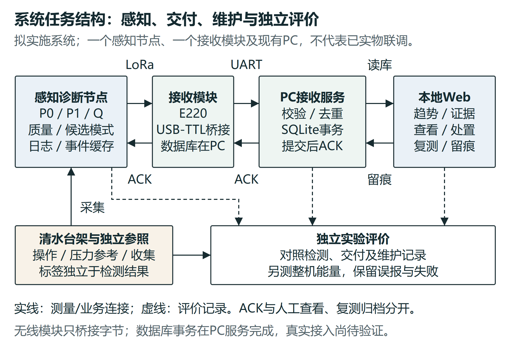
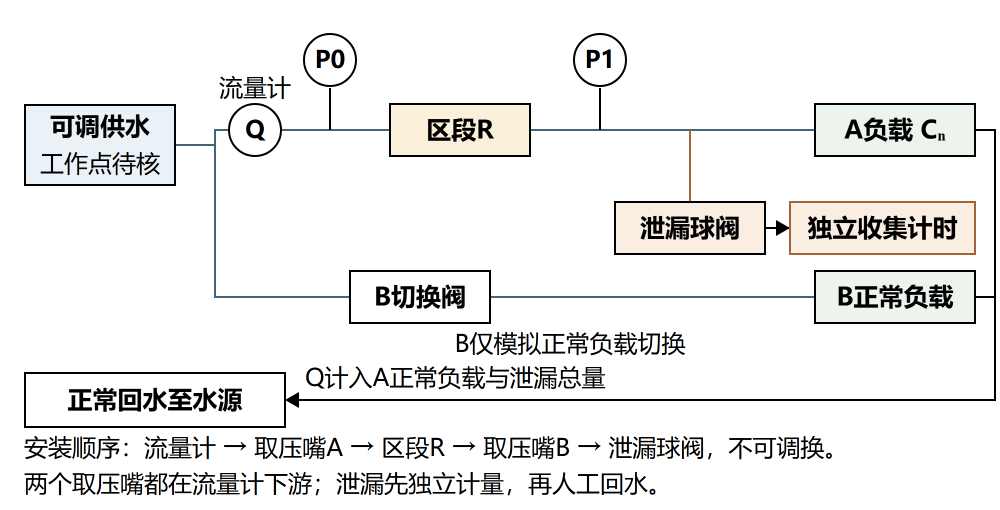
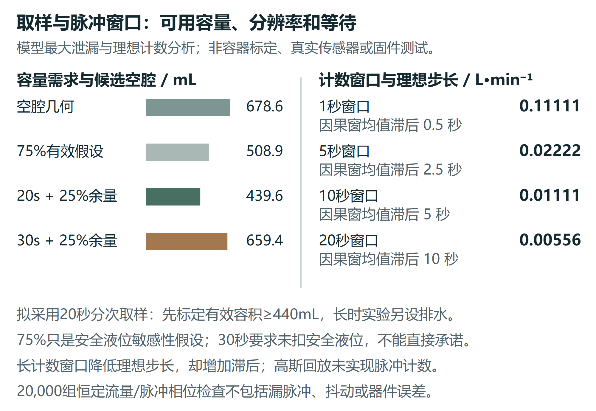
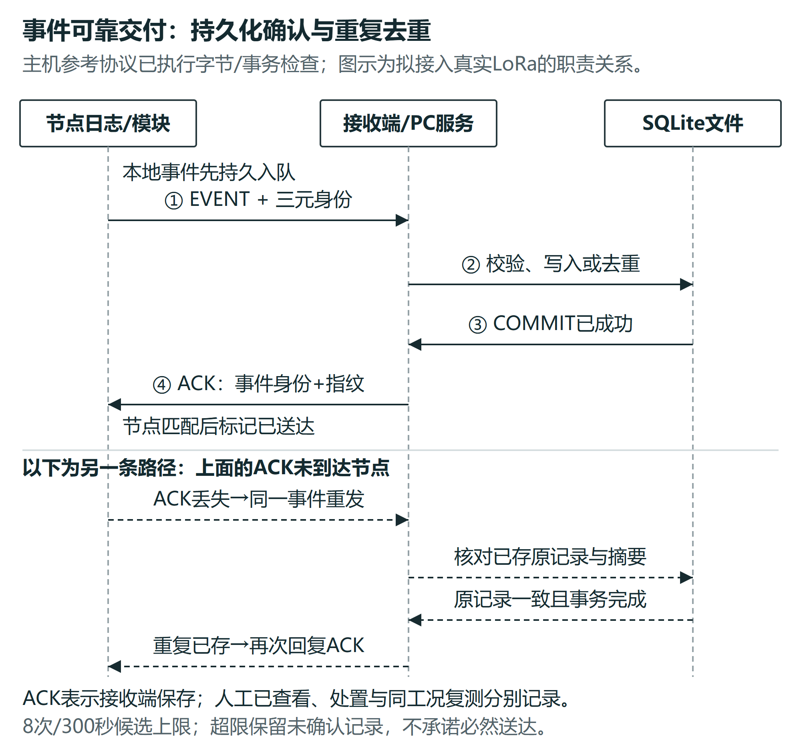
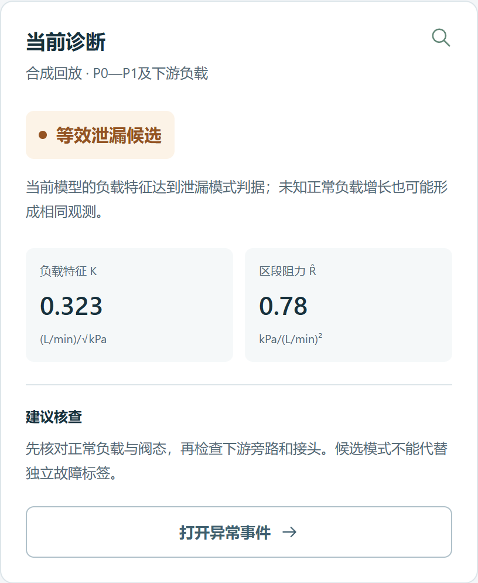

# 南疆滴灌支管道故障诊断系统实施项目书

项目名称：基于 LoRa 的南疆滴灌支管道早期故障诊断物联网原型系统

项目类别：大学生创新训练项目；拟实施期：2027年3月至2028年2月。

编制日期：2026年10月5日；版本：实施规划第一版。

负责人、指导教师、团队成员、正式编号及获批级别：待真实立项资料确认。

本书供负责人、导师及团队安排工作、检查阶段产物和控制变更。目标是完成一个可重复验证的物联网原型及一篇有真实数据支撑的论文稿。当前主要成果为模型、几何设计、接口论证、主机协议检查和合成数据网站；采购、标定、实物与田间验证尚未开展。

本书为自主编制的实施执行稿。学校正式任务书在立项后按当批模板填写，名称、编号、人员、经费及目标须与批准材料对应；本书不替代学校审批表。

## 一 项目目标与交付边界

### 1 研究问题和系统任务

围绕低成本双压力流量测量，在供压及轮灌负载改变时，研究等效泄漏与等效受限何时可辨、何时必须暂缓归因。围绕同一检测规则，研究周期与事件上报在有限无线链路下的远端及时性、未送达及通信开销。系统训练覆盖测量、嵌入式日志、LoRa、接收存储、Web和独立实验，研究贡献取决于对照和实测结论。

基础交付限定为一个P0/P1/Q感知诊断节点、一个E220接收桥、现有PC上的接收服务及SQLite、本地六模块Web和双支路清水台架。A为监测支路，B仅作正常负载切换。监测位置是两压力点包围区段及其下游等效负载，不能精确定位每个滴头。自动阀控、云端、太阳能和多节点另有资源与验证要求。

### 2 三阶段目标及证据

| 阶段 | 应完成的内容 | 验收所需证据 |
| --- | --- | --- |
| 立项准备 | 九节申报书、支撑模型与图、资源计划；稳定后同步PPT | 原模板、可复算数据、图片来源与适用边界；已做与拟做分开 |
| 大创实施和结项 | 真实台架和节点、参考标定、诊断对照、无线接入、维护复测及归档 | 原型、硬件连接、原始日志、独立标签、失败清单、研究报告及获批任务对照 |
| 论文深化 | 从测量辨识或可靠告警中提炼一个主要问题，完成对照与独立留出验证 | 冻结方法、批次数据、可复算统计、消融及局限；导师审核后投稿 |

在可测且工况可比的范围内，提出10%及15%故障组首次持续候选正确比例达到90%、正常确认误报不高于1次/小时的挑战目标；评价到达15%独立参照前的有效早期比例，5%组研究可检边界。这些是拟研究目标。预实验完成后由导师审核并按正式任务书冻结，正式验证不能为达到指标回调阈值。未达标须保留结果并履行变更程序。

### 3 现有证据能支持到哪里

当前480个合成试次、960条配对方法结果和288个静态有界误差组合用于查找条件与反例；20个基础随机序列跨场景和噪声档复用，不能当成480次独立实物试验。低压力噪声下两条规则均可早期提示；σ=10kPa时K/R泄漏仅1/20、受限2/20，固定Q两类仍为20/20。未知正常负载可与泄漏产生相同观测，压力漂移也可产生受限候选。

199个有效实体、96个稀疏流道中心探针、局部交集和20个离散取出姿态支持概念布局，不证明制造尺寸、密封、全装配无干涉或连续取出路径。12项主机编码与SQLite事务检查支持协议逻辑，不证明节点缓存恢复或真实射频。Web支持合成回放和人工记录，尚未与主机数据库贯通。

## 二 系统结构与工程设计

### 1 数据与维护职责

节点保存原始采样、质量和工况信息，计算有条件的候选模式，把事件持久化入队后发送。接收模块仅桥接无线字节，PC校验与去重，SQLite提交成功后回ACK。Web读库显示测量、事件与来源，人工已查看、处置和同工况复测分别记录。无线ACK不是人工确认，也不能证明故障已经消失。

拟统一事件身份为device、boot/session与seq，配置版本、健康参照和试次ID随记录保存。原始测量、本地判定、发送、接收提交和显示时间分别记录；跨设备时间须注明同步方法及偏差，未完成同步时不能直接相减声称精确延迟。

### 2 水路和装配冻结

A依次设置P0侧向取压、受限元件R、P1侧向取压、Q，之后分为正常负载与泄漏旁路。Q计入正常与泄漏总量。泄漏必须独立收集计时，之后人工回水；B为同源正常切换支路。集中参数平方律先用于设计，实际健康关系须用参考数据检验。

900×520mm底板与140mm管中心高度暂用于布局。采购前核对实际接头、活接、流量计直管段、支架和维护空间，形成版本化装配清单。先检查固定、排气、清水漏水与安全电源布置，再进行稳定性测试。需要压力回路、电子盒及水路隔开布置，先按实际器件说明确认允许压力，不以模型压力代替耐压规格。

候选空腔几何容量678.6mL；模型最大泄漏1.055L/min时，20秒取样乘1.25余量需439.6mL。先标定容器安全液位下的有效容量达到440mL，再采用20秒分次取样。泄漏出口与杯口保持20mm自由出流设计间隙，装配后核对飞溅、出口浸没及背压。若实测上界变大，按V≥1.25×q最大×t/60重算容量。8小时记录另设排水，不能由小杯连续承接。

### 3 采集接口与计数窗口

主控采用GD32F103CBT6（128KB Flash）、单只差压变送器（0—40kPa档、±0.5%FS）+一只0—200kPa干管参照表压（两线制4—20mA）、SGM58031、SEN0549、microSD及E220-400T22D。差压精度按厂家书面确认的±0.5%FS写实，±0.25%FS/±0.1%FS档厂家不存在；MPM489系列名不能替代订货规格。按128KB Flash与20KB SRAM规划，以实际编译、堆栈和日志压力检查为准。

压力回路24V经150Ω得到0.6—3.0V，SGM58031为3.3V供电；22mA已达到3.3V，保护必须覆盖过流及ADC断电时的注入。正常耗散0.06W不等于故障耗散上限。SEN0549的5V脉冲经3.3V供电SN74LVC1G17转换，E220拟5V供电而UART为3.3V。保护定值、去耦、接地和接线经导师或具备能力的成员复核后才上电。

拟每1秒记录压力读数与原始脉冲数，流量采用10秒因果滚动窗。540脉冲/L条件下单脉冲步长为0.01111L/min，均值窗对应约5秒滞后；两压力128SPS名义转换共15.625ms，错位约7.813ms。记录转换时间、计数窗口、缺测与时钟偏差，在突变试验中检验这些错位对特征的影响。

本图中的75%有效容量仅为敏感性假设。20,000组理想恒定流量与脉冲相位枚举验证量化步长，不含抖动、漏脉冲、实际流量计误差；高斯诊断回放尚未实现脉冲计数。实物计数需要独立生成已知频率或参考流量，对比输入、日志与计算结果。

## 三 四工作包及阶段退出条件

### WP1 测量建模和台架

输入为实际器件资料、借用仪器记录、连续水源工作点及候选几何。系统与实验岗位核对报价和安装，嵌入式岗位先实现有线采集及原始日志；故障规则暂不开启。完成稳定排气、共同压力、压力升降压和流量计量，再拟合健康关系与残差。

交付包括BOM与照片、连接表、器件资料、容器有效容量、至少5点标定及每点至少3次独立稳定读取、健康批次和误差预算。对参考仪器的精度、单位、校验信息和计时误差明确记录。退出条件为目标变化能够在不确定度下分离，暂以变化约为扩展不确定度两倍作保守审查线，具体口径由导师冻结。

不满足时调整量程、测点或可检程度，再标定。参考仪器未落实时不能进入正式辨识验证，不能以厂家标称或ADC分辨率补上参考测量。水源须在所需连续压力—流量工作点满足供水，模型总流量上界约7.95L/min，不能拼接商品最大流量与截止压力。

### WP2 诊断边界和独立对照

输入为通过WP1的适用范围、原始日志、独立参考、已知阀态和冻结健康参照。先复现固定Q及K/R基线，再实现缺测、工况可比与切换暂缓门控，记录暂缓期内的故障遗漏。特征K=Q/√P1，R̂=(P0−P1)/Q²；持续确认、阈值及参照更新策略在预实验集确定。

交付包括冻结协议、训练与留出批次清单、54次主要故障基础网格、18次正常干扰、12次切换期故障、逐试次输出及统计。比较固定Q、同信息多变量阈值和拟实施方法，并去掉P0或工况信息做消融。按整日、压力档或负载档留出，不随机拆相邻采样点。

退出条件是每次操作都有独立真值、所有方法面对相同验证集、首次持续模式与15%参照可复算，误报、漏检、先错后对、迟检和无输出均计入。性能未达目标时仍形成有边界的研究结论，并按正式目标办理调整；未知负载不能强制判成泄漏，漂移不能强制解释为水力受限。

### WP3 可靠告警和接收服务

输入为同一份冻结本地检测日志、事件身份、实际E220固件与配置。实现节点日志和掉电恢复，再有线验证帧、CRC、COBS及事务，最后接入真实无线。初版候选44B事件及24B ACK，8次/300秒为候选重试上限；配置改变时记录版本。

交付包括节点与服务代码、协议向量、正常/错帧/重复/身份冲突/丢ACK/重启记录、四策略真实链路对照和未送达清单。比较快周期、慢周期、原始事件、滤波限频事件，在相同载荷、检测器及确认规则下重放相同本地轨迹。链路覆盖稳定、遮挡衰减和受控阻断，记录距离、环境、参数及实际中断。

退出条件为重复记录不覆盖、提交失败不回成功ACK、恢复后事件身份不冲突，超期、拒绝入队和丢失显式可见。已有FIFO反例会使后续事件等待61秒，应研究队列调度而非承诺必然20秒送达。未取得整机电流仪器时只交付通信评价，帧数不换算节电或续航。

### WP4 软件集成和维护复测

输入为真实串口、SQLite记录与前三包通过项。把现有离线网站的总览、支管监测、异常事件、设备链路、历史记录及设置接入真实服务，保留合成回放入口和来源字段。断连或无效时显示无当前有效判断，旧值仅作历史，不显示为正常运行。

交付包括启动说明、数据库结构、接口映射、事件全过程日志、两类故障处置复测和一次误报核查。至少一次8小时台架记录、至少3次重启，检查缺失、缓存和恢复；这不是寿命或田间长期可靠性保证。375/768/1024/1440宽度及横屏均需可用，关键键盘路径、保存失败和导出数据接受独立检查。

退出条件为同一事件的测量、判定、发送、提交、显示和人工记录可以由日志重建。已查看不能当处置完成；数据无效、工况不可比或异常仍在时不能归档。界面截图只是功能说明，不能代替实测指标。最终与获批申报书和任务书逐项对应，缺项返工或按要求办理变更。

## 四 实验协议与数据管理

### 1 实验规模和独立重复

| 项目 | 拟定规模 | 必须记录及通过条件 |
| --- | --- | --- |
| 参考标定 | 压力和流量各至少5点，每点至少3次；共同压力检查 | 原始参考、升降方向、计时、温度、残差及批次 |
| 主要故障 | 2类型×3供压×3程度×3操作，共54次 | 80/120/160kPa和5/10/15%暂定，预实验后冻结可用范围 |
| 正常干扰 | 3供压×2个B状态×3操作，共18次，各至少20分钟 | 正常运行至少6小时基础时长，同时报时长与误报次数 |
| 切换期故障 | 2类型×3供压×2切换方向，共12次 | 切换、暂缓、故障发生及恢复判断时刻，不删除等待段 |
| 无线对照 | 4策略×3链路×3批次，共36次重放 | 同轨迹与规则，随机顺序或分块，保留超期和未送达 |
| 连续与恢复 | 至少1次8小时、至少3次重启及维护配对 | 停机与缺测、恢复日志、配置、人工记录和同工况复测 |

以上是基础任务量，不自动满足论文样本量。关键测量边界、跨日泛化及置信区间精度不足时补充独立批次。验证集标签由操作记录和独立参考确定；操作者与分析人员能分开时采用盲化，无法分开时说明限制并先锁定试次顺序与分析程序。

### 2 单试次执行顺序

开始前核对日期、仪器、配置、阀态、供压、健康参照和容器有效容量，生成唯一试次ID。确认稳定健康段并保存原始数据；按预定顺序开展正常操作或逐步故障注入，独立记录开始时刻和程度。检测程序仅接收允许的信息，不能读取独立参照的到达时刻。结束后保留恢复及参考复测，记录缺失和异常，再做完整性检查。

预实验用于确定稳定时间、取样误差、阈值与门控等待，不进入最终验证统计。正式验证由另一批次执行，配置与方法冻结。失败试次若因仪器损坏等原因需要排除，按事先规则列明原因、数量与原始记录；不能因检测失败而排除。补做试次采用新ID，不能覆盖原记录。

### 3 指标的计算口径

故障程度用独立参考流量相对同供压、同B状态健康值的偏离定义，分别核对泄漏量和受限操作；15%为暂定演示参照，不等于农业失效、产量损失或泄漏占比。有效早期要求故障前无确认误报、故障后首次确认模式正确且早于参照。提前量为参照时刻减首次正确持续确认时刻，失败及未检出同时报分母。

本地检测延迟从独立操作开始算到本地确认；远端交付延迟按明确的事件起点算到数据库提交，传输延迟另用发送时刻计算。报告P50/P95、期限内送达、重试、重复、未送达及恢复缺口，时间不同步时报告区间或同设备时间。整机能量用实测电压电流积分并包含采集、日志、发收与空闲；无仪器则不报告该指标。

统计以独立操作和日期批次为单位。比例报告样本数及Wilson等适当区间；连续指标保留分布与失败截尾，配对比较使用同一试次。不能把每秒记录当独立样本扩大样本量。模型随机噪声区间与实物重复区间分开。

### 4 文件结构与复现

每批次保存原始只读数据、参考及操作记录、配置、派生结果、分析代码、软件与固件版本、图片、问题和复测。CSV至少包括trial_id、device、session、seq、采集及窗口时间、P0/P1/Q、原始ADC/脉冲数、阀态、质量、健康参照及配置版本；参考、事件、通信和维护分表关联。文件附单位、时区和缺失编码说明。

验证前保存试次清单、规则及脚本哈希；分析输出可以重建且不改原始值。备份至少两处，仓库提交代码和非敏感数据，身份、电话和场地授权按实际需要处理。结项数据包应能由另一成员从说明开始复算图表和主要结论。

## 五 资源预算和人员责任

### 1 条件预算

| 用途 | 预算帽 元 | 成交前核对 |
| --- | --- | --- |
| 主控无线日志调试 | 350 | 一个MCU、两只E220、天线、SD和USB-TTL |
| 两压力器件 | 680 | 指定量程、输出和精度；每只340仅为预算帽，未询价 |
| 流量和压力ADC | 200 | SEN0549、SGM58031规格与最新报价 |
| 调理电平与保护 | 80 | 实际定值、精度、容差和保护验证 |
| 水路独立收集 | 350 | 阀、接头、回水、容器和固定，按实际安装尺寸 |
| 供电安装防护 | 200 | 24V回路、降压、外壳及瞬态电流需求 |
| 记录耗材 | 60 | 按学校允许科目列支 |
| 返工预留 | 80 | 依真实询价和学校科目调剂 |
| 合计 | 2000 | 其他1320加双压力680，未发生采购 |

预算以已有电脑、借用连续可调水源、独立压力与流量参考及电流设备为前提，不含新增泵站、多节点、论文费及差旅。采购决策先看有效规格与参考测量能力，再看预算；不得为保持2000元选择无法证明测量目标的器件。供应商入口及产品图见国内硬件选型附件，现货和价格须询价。

正式任务书经费需按学校当批经济科目重新映射，不能直接将候选器件表当批准预算。启动额度、学校批准资助和实际支出分别记录。借用不落实或指定压力报价超帽时，由导师重新审核经费和任务，未批准不得悄悄删除核心实验。

### 2 岗位与复核

系统与实验岗位负责台架、参考、真值、采购核对和总体联调；嵌入式与无线岗位负责有线采集、计数、日志、协议和真实链路；数据与Web岗位负责接收存储、界面、统计及复现。拟含负责人不超过5人，实际名单与职责经成员确认后填入，不能虚构技能与导师支持。

负责人每两周核对任务与问题，导师在测量进入、方法冻结、正式验证及结项前审核。成员须能独立运行、解释和修改所负责核心程序，保留复现讲解记录。关键原理、配置及实验协议由另一成员或导师复核，避免同一作者自证通过。

## 六 里程碑与变更管理

### 1 按月安排

| 时段 | 应交付内容 | 进入下一阶段的条件 |
| --- | --- | --- |
| 申报前约一个月 | 高质量申报稿、来源图、资源落实清单、随后制作PPT | 教师核定目标、人员与现实资源；行政字段据实 |
| 2026年11月至2027年2月 | C语言和采集训练、复现、询价、借用与安装核对 | 成员能独立解释核心实现，水源与参考可取得 |
| 2027年3至4月 | 台架、节点、有线日志、标定与健康关系 | WP1通过，目标变化在误差下可测，实际BOM冻结 |
| 2027年5至6月 | 独立故障和正常对照、门控、基线与留出协议 | WP2数据链完整，方法冻结，不读取独立标签 |
| 2027年7至8月 | 真实LoRa、SQLite、Web及连续恢复和维护复测 | WP3和WP4全过程可追溯，缺口和失败可见 |
| 2027年9至10月 | 跨日或整档留出、消融、关键边界补试验、论文稿 | 独立数据足够支撑结论，导师审核贡献与统计 |
| 2027年11月至2028年2月 | 补验证、研究报告、结项材料、任务与经费对照 | 与批准任务对应，成果状态及未达项如实登记 |

时间是当前内部计划，正式执行期以2027批次通知和批准任务书为准。学校2026批次的执行时间与成果要求不直接推定为2027规则。论文审稿可能超过项目期，结项按真实完成的研究工作处理，发表与收录另留证明。

### 2 风险触发与处理

| 触发条件 | 处理动作 | 重新进入条件 |
| --- | --- | --- |
| 水源或独立参考不能取得 | 先借用或补经费，暂停正式性能验证 | 连续工作点、仪器和误差预算可确认 |
| 测量误差覆盖目标变化 | 调整量程布点或可检程度，重新标定 | 新范围与参照经导师冻结 |
| 未知负载和泄漏同形 | 保留异常待检查，增加明确的操作信息对照 | 不超出已有信息的归因边界 |
| 掉电恢复、队列或交付失败 | 保留原日志，复现反例，修复后重新检查 | 错帧重复身份、恢复与超期可追溯 |
| 报价超帽或成员无法承担任务 | 重编经费、职责和里程碑，办理必要变更 | 经导师及学校要求审核，批准文件可追溯 |
| 论文贡献或样本不足 | 补关键独立批次或收窄研究问题 | 保留原验证结果，新增实验另编号 |

凡影响正式研究内容、周期、成果形式、主要指标或经费的变更，保存原因、前后方案、资源影响、导师意见及学校所需审批。网页和材料不得在未经批准的情况下自动改写目标并声称完成。普通实现细节可以由团队决定，但配置与复验记录要完整。

## 七 结项验收和论文路线

### 1 结项材料的检查顺序

先核对批准文件、申报书及任务书，再查原型是否实现承诺功能、每项实验是否有独立证据、指标与成果状态是否一致。检查程序、原始数据、配置、连接和使用说明能否复现，最后核对预算、支出和必要审批。图片须出自同一版本，流程箭头正确，文字和图注清楚，不裁切、不拉伸、不用示意图冒充实物。

结项包至少包含真实原型及演示、硬件连接与标定、诊断和无线对照、连续恢复、维护前后记录、研究报告和结题所需表格。学校2026立项通知列有项目竞赛与国家级成果要求，可作为准备方向；2027的项目级别、竞赛及论文要求待当批正式通知确认，不在本书虚构已满足条件。

### 2 主论文与备选问题

主论文优先研究低成本双压力流量的跨工况辨识边界。最低内容为实际标定与误差、独立故障程度、正常干扰、同信息强基线、测点及门控消融、整日或整档留出和失败。仅展示网页、LoRa或若干成功曲线不足以支持创新贡献。先完成一套有说服力的数据，再选与贡献匹配的期刊。

若测量信息增量不足，备选统一检测器下的事件上报与队列调度。该方向需要真实发收及提交日志、相同轨迹与确认规则、遮挡阻断、丢ACK和拥塞反例；要写节能结论还需整机能量测量。两问题可分阶段深化，不为凑论文数量拆分同一薄弱结论。

后续首先扩展负载档与日期，比较冻结参照、少量健康重标定和经验模型；其次在新增节点、共同供压与同步日志落实后研究多支管扰动与事件竞争；长期维护方向需要真实处置复测配对及参照漂移记录。每条扩展都有数据进入条件，基础交付仍为单监测支路。

### 3 科研积分与成果状态

用户提供的当年推免参考表为科研类满分10分：第一完成人国家级、省级、校级大创合格结项分别为5、4、3分；指定SCI/EI等收录论文6分，指定北大核心/CSCD/CPCI-S等4分，论文要求独立或第一作者且与学业相关。该截图不代表未来政策，认定须向学院核对正式文件、截止日及发表收录证明。

按该参考口径，省级结项4分加认可6分论文才恰好10分；国家级结项5分加认可4分论文为9分，国家级加6分论文为11分但按10分封顶；校级加6分论文也仅9分。国家级和高等级论文均不能保证。当前务实路线是争取较高立项、以第一完成人完成真实系统，并持续积累足以投稿的独立数据；不把立项、论文稿或录用自动计分。

项目成果状态单独登记为计划、已实施、完成验证、结项验收，以及论文稿、投稿、录用、发表、收录。真实作者贡献与证明分别保存，必要时提前向学院核对未来认定口径；评分规则变化后重新计算，不为积分编造已有成果。

## 八 官方任务书映射和待定字段

| 正式材料要素 | 本书对应位置 | 提交时仍需核定 |
| --- | --- | --- |
| 项目身份 | 封面及第一章 | 项目名称、正式编号、级别、成员、导师与批准名单一致 |
| 内容与目标 | 第一至四章 | 获批任务、挑战指标、适用范围与实验规模 |
| 技术路线 | 第二至四章 | 实际BOM、软件协议、健康关系与冻结版本 |
| 进度及责任 | 第五至六章 | 成员、执行期、岗位及阶段检查安排 |
| 预期成果及验收 | 第七章 | 当批竞赛、论文或其他成果要求及验收方式 |
| 经费 | 第五章 | 学校经济科目、批准资助及真实采购支出 |
| 指导审批与签字 | 正式表格填写 | 实际意见和签名；本书未生成任何签字 |

已查到学校2026及2025立项通知的创新训练任务书附件入口，附件下载返回人工验证码页面，尚未取得实际表格。因此这里只作要素映射，字段名称与顺序均须以正式下载模板为准。申报阶段先提交学院要求的申报书，立项后将核定内容套入正式任务书，不能把本自主文件称为已填官方任务书。

## 九 依据与配套证据

学校2026立项通知说明立项后填写任务书，项目身份应与立项信息一致，并按要求编制经费；2026验收通知将研究内容、周期、成果形式、指标目标及经费与申报书、任务书对照。本执行稿采用这一任务对应原则，2027具体安排仍待通知。来源一为 https://jwc.taru.edu.cn/info/1052/4416.htm ，来源二为 https://jwc.taru.edu.cn/info/1052/4432.htm 。2025立项通知参考 https://jwc.taru.edu.cn/info/1052/3886.htm 。

中文11篇、英文6篇的17篇学术文献及正文支撑点保存在申报书研究现状和application/references.json；本书不改变其引文或将未阅读全文的内容写成已验证结论。对应文献核验、国内选型、几何、诊断、接口、网站和本轮复核记录一并归档。

模型版本为20261004-A06A07-v1；复现与验收索引见application/quality_release。历史证据保留，实物验证仍待开展。
