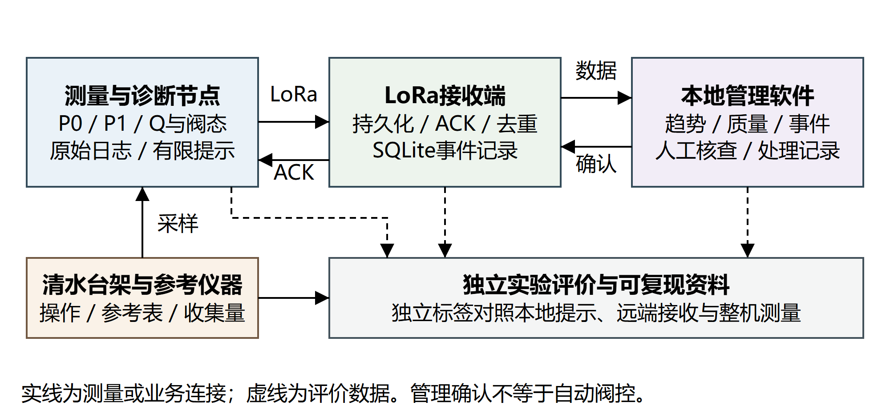
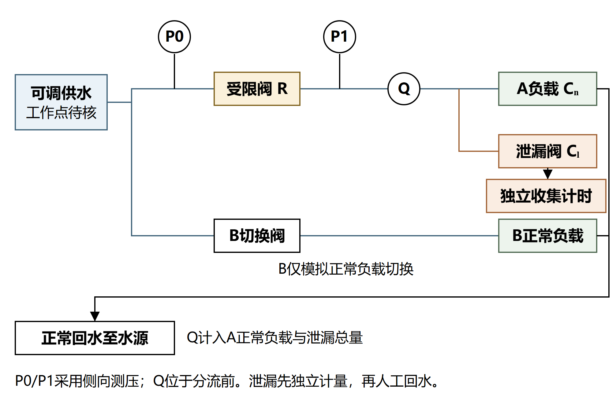
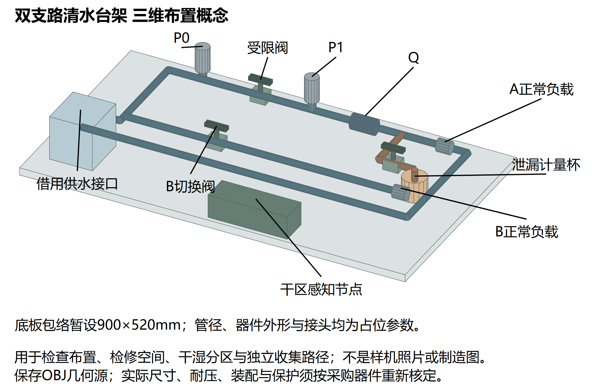
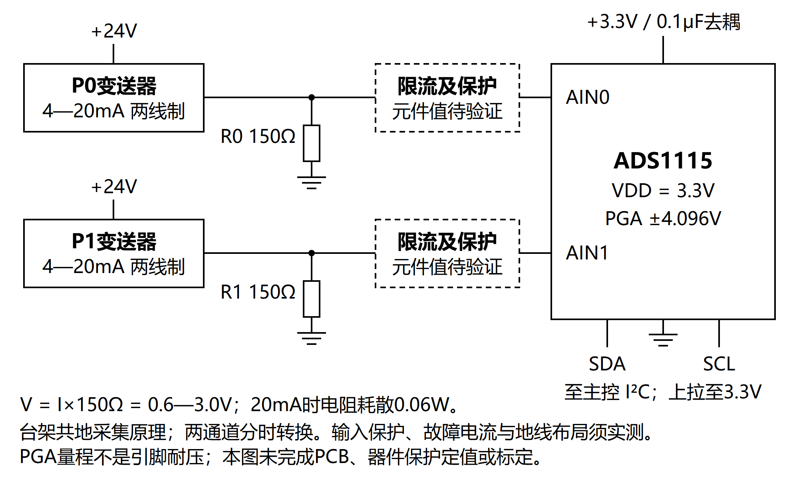
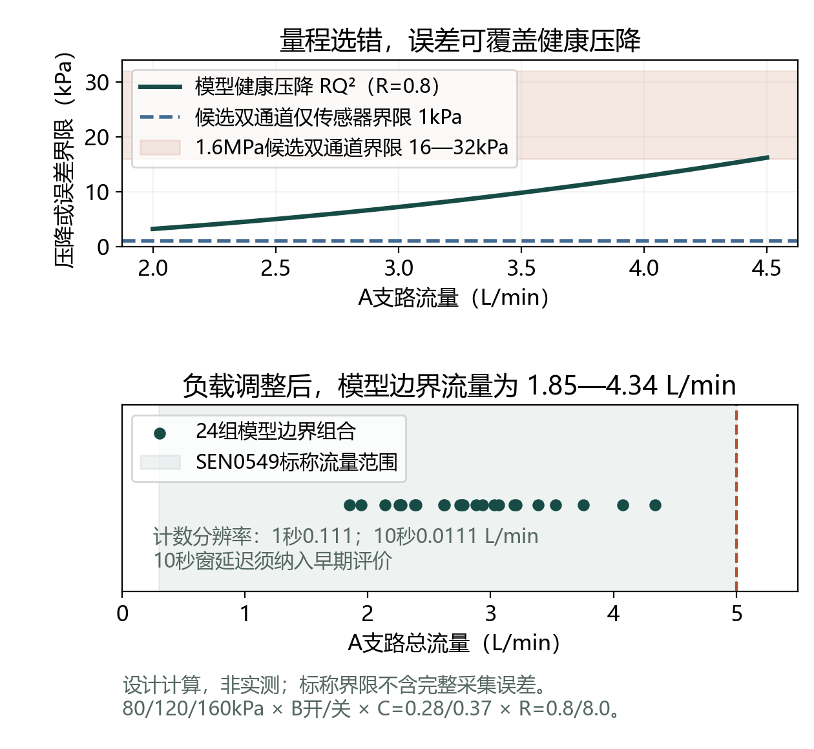
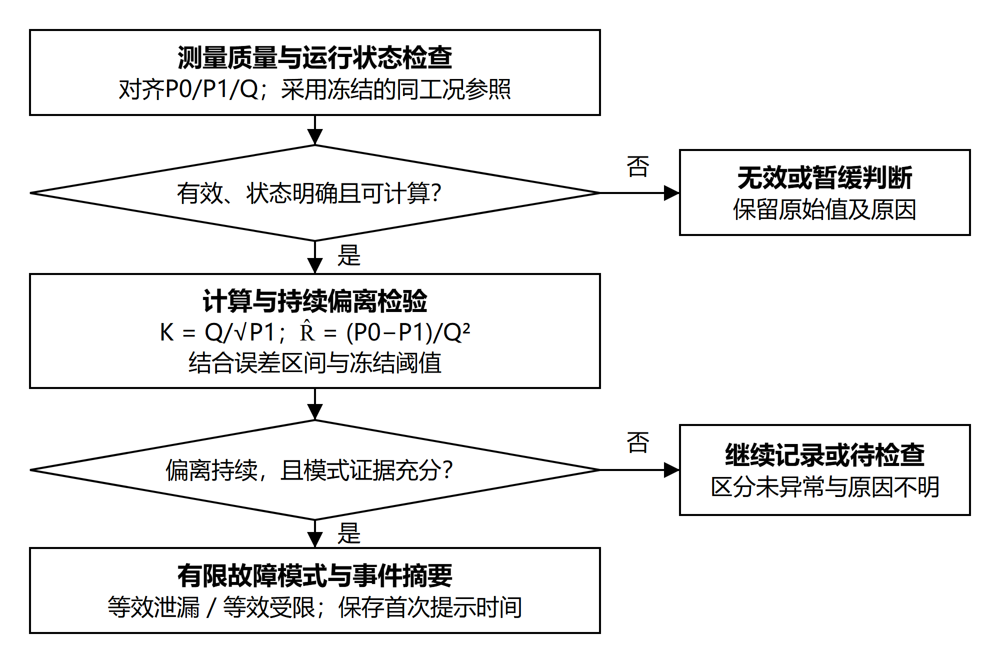
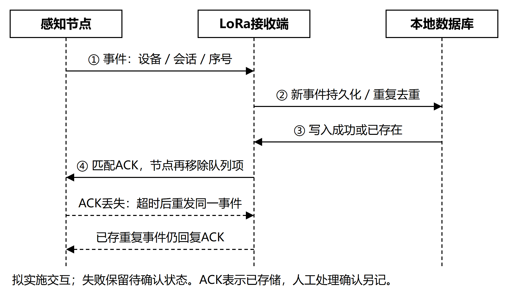
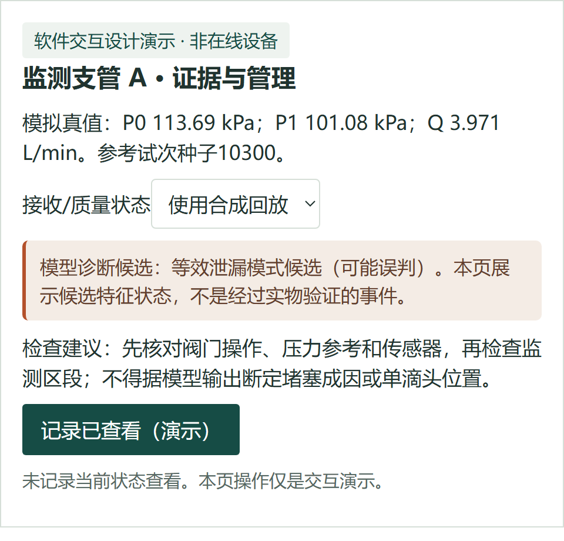
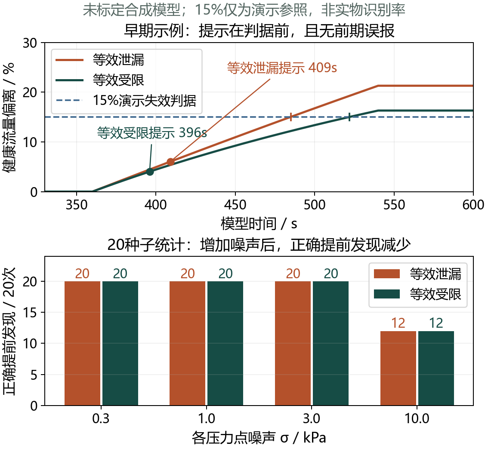

# 基于 LoRa 的南疆滴灌支管道早期故障诊断物联网原型系统

2026年10月4日研究正文修订稿。创新训练，实施期2027年3月至2028年2月。图文按系统、测量、诊断、通信和验证重新组织。原学校模板的九节顺序不变；行政资料及意见由本人和指导教师填写。

## 一、项目简介（300字左右）

本项目面向南疆滴灌支管运行巡检，拟研制由双压力流量感知节点、LoRa接收端和本地管理软件构成的早期故障诊断物联网原型系统。针对供压变化、轮灌切换与渐进故障容易混淆的问题，研究入口压力、下游压力及总流量联合观测下等效泄漏、等效受限的识别条件，建立包含故障程度、独立失效参照、误报和提前量的评价方法；结合事件缓存、确认与去重，研究有限通信量下告警及时送达的取舍。项目将建设双支路清水台架，开展标定、独立重复、跨批次对照和真实无线测试，形成可演示原型、可追溯数据及研究报告，为支管检查提供位置范围、变化证据和处理记录。当前已完成文献分析、未标定水力模型、合成试验与离线网页，实物及田间验证拟在实施期开展。

## 二、申请理由（包括自身/团队具备的知识条件、特长、兴趣等）

### 1 研究目的与应用场景

滴灌支管的渐进变化可能同时受到供压、运行负载、操作状态和故障影响。一个流量下降提示只能说明观测发生了变化，难以直接告诉管理者应检查供水、阀门还是管路。本项目把研究对象放在支管运行巡检：在可观测的变化出现后，及时提供有证据的检查线索，并保留处理前后的数据，支持管理者核查。

拟以支管及压力点包围区段作为位置范围，研究水力响应可观测的等效泄漏和等效受限。项目的农业意义在于辅助运行排查；节水、增产等效益还需要独立农学试验，不作为本期已证实结论。南疆场景的实际轮灌方式、供压范围、安装位置与通信条件，将通过后续联系和现场调查校核。

### 2 专业结合与人员安排

传感采集、嵌入式处理、无线协议和管理软件共同构成通信专业可参与的系统任务。负责人为塔里木大学信息工程学院通信专业大二学生，目前确认具备焊接能力。拟按系统与实验、嵌入式与通信、数据与管理软件配置三个岗位，在导师指导下完成原理学习、程序复现、分工开发和实验审查，团队总人数不超过模板规定的5人。

申报前需落实实际成员及开发能力，完成一次核心模型和网页流程的现场讲解与复现。成员经历、导师简介、实验室支持及仪器借用按实际情况填写。当前生成的程序与材料是前期方案基础，成员独立掌握和实施能力仍需训练与验证。

## 三、项目方案（项目内容、项目目标、技术路线、实验方案、要解决的主要问题）

### 1 系统组成与任务分工

本项目建设面向支管巡检的感知、诊断、无线告警与管理原型，基础配置为1个P0/P1/Q感知节点、1个LoRa接收端、1套双支路清水台架和1套本地Web管理软件。节点将有效测量与运行状态关联，给出有条件的故障模式或待检查提示；接收端保存事件证据，管理者据此核查并记录处理结果。独立参考测量和操作日志用于检验提示是否正确、是否提前以及何时送达，不能用检测器自己的输出替代实验标签。图1给出系统组成及评价数据的来源。

系统按感知测量、有限诊断、可靠告警和管理核查四项任务组织，表2分别规定其验证证据。系统闭环截至管理确认，自动阀控不列入本期基础任务。一个节点用于研究一个被监测区段，双支路用于制造共同供水与正常切换条件；它们并不代表已完成多节点田间部署。增加节点和现场适应性试验以资助、许可和测量质量为条件。

### 2 水力感知与台架设计

#### 2.1 布点与故障注入

P0位于监测区段入口，P1位于集中受限元件下游，Q位于泄漏旁路与A负载分流之前，记录两者的总流量；B支路连接同一供水源，用于模拟其他轮灌负载或正常切换。A支路逐步打开泄漏旁路模拟等效泄漏，逐步调节受限元件模拟局部阻力增加，分别记录操作、收集量和参考读数。图2用蓝色、绿色、橙色分别区分供水、正常负载与泄漏路径，限定观测区段与两种故障的注入位置。

台架拟采用可调供水、支管、调节阀、三通、回水及泄漏收集装置。装配时先校核螺纹、密封、排气和传感器安装位置，再检查稳定供水与回水条件，最后开展切换和故障操作。泄漏支路保留独立收集与计时，以校核故障程度；B支路只承担正常负载切换，不注入第二类故障。节流阀用于模拟水力受限，所得结论不延伸到滴头沉积、生物膜或真实堵塞材料的形成机理。

台架的物理布置与水力关系分别论证。图3按暂定900×520mm底板建立三维几何布局，将水路、侧向测压、独立计量杯和前侧干区节点分开，检查测点先后、操作可达性及回水路径。模型保留可复算几何源，管径、接头及器件包络目前是占位参数；采购后须校核装配尺寸、检修间距、固定与电气防护。这是已生成的设计模型，尚未制成台架。

#### 2.2 节点硬件与数据采集

节点主控拟采用STM32F103C8T6最小系统板，压力经电流采样电阻和ADS1115接入I²C，流量经电平转换接入定时计数，LoRa经UART连接，microSD经SPI保存原始记录。接收端采用另一只LoRa模块与3.3V USB-TTL连接已有电脑，以Python串口接收、SQLite存储和本地Web提供查看确认。该配置先完成开发板原型，减少自制PCB与第二主控的开发负担。各接口及采购约束集中列于表1，图4专门论证双压力模拟前端。

依据MPM489选型资料的两线制4—20mA输出，拟用24V供电及150Ω精密采样电阻，把电流转换为0.6—3.0V；满量程电阻耗散为0.06W。候选电阻暂按0.1%公差、额定功率不低于0.25W选取，误差与温漂仍纳入标定。ADS1115拟以3.3V供电、±4.096V增益档分时采集，两路保留各自转换时间。增益档不扩大引脚允许电压范围，限流、保护、故障电流及共地布局需按器件手册设计并实测。图4是台架采集原理，尚非已验证PCB或现场隔离防雷设计。

表1列出国内有供应资料的候选器件。型号按接口、测量范围和报价核定后冻结，尚未采购或完成接线。厂家资料、候选产品配图和国内采购入口保留在配套选型记录与网站，产品外观不作为本项目样机成果。

表1 基础原型候选器件与接口

| 器件与数量 | 候选配置 | 接入与核对条件 |
| --- | --- | --- |
| 主控与日志 | STM32F103C8T6×1及microSD | I²C、计数、UART、SPI资源；存储与掉电恢复 |
| 双压力 | MPM489系列×2，K200表压 | 0—200kPa、4—20mA，按目录±0.25%FS核对；待询价 |
| 流量 | SEN0549 G1/4×1 | 0.3—5L/min；5V脉冲需转换至3.3V |
| 压力ADC | ADS1115模块×1 | 两路150Ω采样，0.6—3.0V；分时转换需记录错位 |
| 无线接收 | E220-400T22D×2及天线 | UART；接收端USB-TTL接电脑，射频参数实测冻结 |
| 水路与参考 | 双支路、阀、回水、独立参考 | 优先借可调连续水源；核对工作点、精度及螺纹 |

软件拟以1秒为首轮记录间隔保存P0、P1、Q及阀态，记录原始值、标定后值、转换时间和无效原因。流量拟采用10秒滚动脉冲计数并保留原始计数；时间窗与压力分时采集带来的延迟、错位纳入评价。整机供电与连接按台架先实现，现场安装另做适应性检查。采购入口和厂家资料另附《国内硬件选型与可行性核对》，淘宝入口不作为已购或现货证据。

采集程序按启动恢复、定时采样、质量检查、窗口对齐、状态关联和日志追加执行，质量及状态分支与诊断统一见图6。量程外、缺测和明显非物理读数输出无效原因；状态未知或切换等待期间继续保存原始记录，暂缓单一故障原因判断。质量筛选条件、等待时间和健康参照编号均写入配置，后续评价同时报告被暂缓判断的时间比例及该时段发生的异常。

#### 2.3 标定与等效模型

压力采用参考表进行多点校核，流量采用容积或称重计时形成独立参照，记录零点、重复性、有效量程及同步误差。双压力的收益取决于健康压降是否大于差压不确定度；压差小于测量误差时，先调整量程、布点或试验程度，再进入辨识研究。

借鉴丁法龙等“建模—测压测流校核”的论证方式[2]，对图2区段采用P0−P1=R·Q²、Q=(Cₙ+Cₗ)·√P1，共同供水阻力连接A、B支路。R增加模拟受限，Cₗ增加模拟泄漏；未知正常负载Cₙ增加也可能产生同样观测。模型假定非压力补偿负载、理想同步和单故障，仅用于测点筛选、量程核对与反例分析，参数尚未实物标定。P用kPa、Q用L/min，R及C单位分别为kPa/(L/min)²、(L/min)/√kPa。

预实验在多档健康供压和B状态下测定压力—流量关系，检验残差与重复性，再冻结健康参照及适用范围。流量计、接头和阀门压损计入测量，不沿用理想系数。负载为压力补偿型或实测不符合平方律时，修订模型及特征；本期不代替CFD、水锤或完整管网标定。

据候选目录，200kPa、±0.25%FS压力通道单项界限为±0.5kPa，两通道差分最不利界限为1kPa，完整采集误差还须计入调理、ADC、温漂及参考条件。大量程1.6MPa、0.5—1%FS方案单通道界限达8—16kPa，不适合直接承担本项目主要差压测量。1秒流量窗的一个脉冲对应0.111L/min，10秒窗对应0.0111L/min；分辨率和窗口延迟必须同时权衡。

另以C=0.28作为台架健康设计负载，C至0.37、R为0.8或8.0，结合三档供压及B开关做24组模型边界计算，A流量为1.85—4.34L/min，落在候选流量计范围内，如图5。原480次合成试验仍保留原参数，不能用此计算代替实测。模型最大总流量约7.95L/min；水源需按流量—压力工作曲线核定，不能将商品开口流量与截止压力合并为工作点。基础预算以借用可调连续水源为前提，落实前不宣称已经具备台架。

另检查两故障、三供压、B开关及三程度共36组目标，修正受限范围后均可在模型内达到。仅按压力标称界限、10秒计数量化及流量±1%读数分析，健康与故障特征区间分离；若保守按5L/min满量程的1%分析，80kPa下两个5%泄漏组合区间重叠，弱异常不保证可分。流量精度定义须进一步核对，温漂、ADC、调理及安装误差尚未计入，不能转成实物检出率。

### 3 渐进故障诊断与早期评价

拟采用压力归一化流量K=Q/√P1和区段阻力估计R̂=(P0−P1)/Q²，分别描述下游等效负载及监测区段的阻力变化。程序在测量有效、P1与Q高于误差下限且运行状态明确后，比较同工况健康特征及误差区间，再检验偏离是否持续，处理分支见图6。健康参照、偏离阈值和持续条件由标定小试确定并在验证前冻结；故障期间不以自动更新参照消除异常。切换等待段仍保留原始数据，单独报告暂缓判断的时间、误报和漏检。

输出分为等效泄漏模式、等效受限模式、异常待检查和数据无效。未知正常负载可能与泄漏同形，压力差分偏置可能与受限混淆；这类条件下保留异常证据并提示核查，不强制给出单一原因。定位精度限于被监测支管或压力点包围区段。

模式提示附带P0/P1/Q、特征偏离、阀态、质量标志及参照编号。K增大而区段阻力稳定时检查等效泄漏或负载变化；区段阻力增大时检查等效受限，同时核查压力偏置。两个特征同时变化、状态不明或证据不足时，提示异常待检查。管理者据此确定核查顺序，真实原因最终以独立操作记录、参考测量及现场检查为依据。

早期评价以独立参考测量确定的预设失效判据为终点，同时记录故障操作起点、本地首次可靠提示和远端首次接收。考察相对同工况健康流量偏离5%、10%、15%的暂定程度，绘制检出、误报及提前量随程度变化的关系。15%目前是模型演示参照，实际程度与失效判据由导师结合预实验审核后冻结。研究目标是找出可测、可判、可提前的条件及失败边界，性能阈值由有独立标签的小试确定。

### 4 LoRa可靠告警与通信对照

比较快周期、慢周期、原始事件与滤波限频事件四种上报策略，协议见图7。

四策略保持采样、检测器、载荷及链路设置一致。事件包含设备、会话、序号、发生时间、状态、测量及质量；本地保存原始日志，经LoRa发送摘要。实物试验冻结缓存容量、超时、重试及掉电策略，并记录发收与确认时间。回放中的1秒ACK、4秒超时及16条队列仅为模型假设，实际值须依据模块与空中时间核定。

接收端持久化后发送匹配ACK，重复事件再次确认但不重复存储，管理者的处理确认另记。节点仅移除已确认事件；重试耗尽仍保留待确认状态，队列满时记录丢弃或拒绝及缺口。掉电后恢复队列和会话，或明确标记无法恢复的记录。上述拟实施要求通过丢包、阻断和重启试验核对。

通信评价分别测量故障至本地提示、本地提示至远端接收的延迟，统计上行与确认帧数及字节，并独立计量整机能量。射频配置、干扰、遮挡与静态功耗一并记录，不能以帧数代替续航结论。断链时显示离线及待补发，未收到事件不判为正常。

### 5 管理软件与系统集成

本地Web拟提供设备档案、支管位置示意、P0/P1/Q趋势、事件证据、质量状态、处理确认、历史回放与CSV导出。网页将区分测量时间、接收时间、模型回放和实际设备状态，提示检查供压、阀态、传感器与目标管路。接收端的数据持久化和真实节点接入是实施任务；已有离线页面完成合成回放与交互演示，其实际管理面板局部截图见图8。

集成先完成有线原始日志，再连接LoRa和本地网页，以事件记录贯通节点判定、接收存储和管理确认。展示页面只是系统的一部分，验收同时检查原始记录、协议日志和对应实验标签，不能仅凭页面数值变化认定系统可用。

### 6 项目目标与分层实验

总体目标是完成可采集、可有限诊断、可可靠传输、可追溯验证的支管原型，并给出渐进故障辨识条件和通信取舍。四个工作包分别负责测量与建模、诊断与边界、可靠告警、系统集成与验证。表2把交付、评价指标和验证证据对应起来，作为任务书细化依据。

表2 研究任务与计划验证证据

| 任务 | 计划交付或实验 | 评价量与证据 |
| --- | --- | --- |
| 测量与建模 | 双压力流量节点及参考标定 | 误差、重复性、同步、健康压降与差压不确定度 |
| 渐进诊断 | 2类型×3供压×3程度×至少3独立操作，主要试验至少54次 | 正确模式、独立试次漏检、每小时误报、提前量分布 |
| 可靠告警 | 同检测与确认下的四策略真实LoRa对照 | 发收与ACK日志、两段延迟、帧与字节、整机能量 |
| 系统集成 | 节点、接收端及本地Web贯通 | 事件可追溯、离线与无效状态、回放导出、处理记录 |
| 连续运行 | 单次至少8小时台架记录，至少3次掉电恢复检查 | 连续原始日志、停机/缺失段、恢复会话与缓存记录 |

验证分为以下四层，与表2的任务、证据和表3的阶段进度对应。预实验决定测量和判据能否进入验证；正式验证同时支撑结项演示与论文论证。主要故障网格的重复次数按独立操作计算，通信策略比较使用同一组本地检测记录，以减少检测差异对链路结论的干扰。

第一层为测量预实验：完成水路稳定性、参考标定及操作标签。暂定供压80/120/160kPa，实际范围依据设备能力冻结。若目标变化被测量误差覆盖，调整设计后重复校核，不用检测算法掩盖测量问题。

第二层为水力与方法实验：安排正常稳定、正常切换、渐进泄漏、渐进受限和切换期间异常五组工况。以独立操作日志、参考流量和泄漏收集量确定故障时间与程度；主要故障网格至少54次，正常及切换对照另行安排。小试用于调参，验证按独立日或批次留出，相邻采样点不算独立重复。

同信息条件下比较固定阈值、切换等待、压力归一化、双点特征和候选方法，并做单点/双点、阀态及持续判据消融。评价以试次为单位，保留漂移、未知负载与错误模式实例。方法未超过强基线时如实报告，将贡献转向可观测范围或测量边界。

第三层为通信与系统实验：先保持本地检测结果相同，再测试四种上报策略；加入短时事件、阻断、掉电和溢出，检验重试、去重及离线显示。连续运行检验软硬件一致性和记录完整性；整机能量由电流设备独立测量。

第四层为条件性现场试验：取得许可后调查安装、轮灌及遮挡条件，采集真实正常运行数据。只有正常数据时评价安装、链路和正常响应，不计算田间故障准确率。现场未落实时完成可重复台架作为基础交付，南疆部署适用性继续保留为待验证。

### 7 主要问题与实施约束

运行操作与故障混淆通过状态记录、强基线和有限输出研究；差压误差通过参考标定、健康校核和程度分层研究；短时事件漏送通过缓存、确认、重试及去重处理；实验不可复现通过独立标签、冻结配置、原始日志和留出批次控制。

本期先解决一个监测区段的真实测量和完整运行链。2000元启动估算以已有电脑、借用参考仪器及可调连续水源为前提，两只合格压力传感器还需询价。若报价超额，优先借用或增加测量经费，不以降低精度维持原目标。团队、场地和借用仍需落实。增加资助优先改善标定、独立批次和试验质量，再考虑多节点及现场扩展。

## 四、国、内外研究现状和发展动态

### 1 南疆应用需求与研究对象

李慧琴等结合南疆棉花“滴水出苗”提出压力均匀、铺管及用水管理建议[1]，说明运行压力是区域滴灌管理中需要关注的条件。Sun等研究南疆集体滴灌棉花生产约束，涉及灌水深度和土壤条件[17]。这些工作支持选择南疆滴灌巡检场景，但不直接证明本原型能够节水或增产。本期以支管水力故障的可观测变化为对象，实际轮灌方式与安装条件仍需现场核对。

### 2 滴灌水力模型与测量依据

丁法龙等从变质量流动分析沿程压力，并以测压、测流试验验证模型[2]；王亚林等结合灌水试验与CFD研究不同滴头镶嵌方式对毛管水力特性的影响[3]。已有研究表明，实际滴灌压损需要考虑分布出流、结构与安装。本项目集中平方律模型仅用于监测区段的初步设计，不替代上述分布模型。实施时先检验健康压力—流量关系及残差，再冻结特征和阈值；拟通过布点、同步误差与差压不确定度的联合评价确定低成本测量的适用条件。

### 3 堵塞机理与早期监测边界

喻黎明等研究含沙水下额定流量、毛管位置与滴头堵塞的关系[4]；王惠等开展不同肥料及浓度的堵塞试验[5]；张唯一等研究近壁面水力剪切力与碳酸钙污垢的作用[6]。三类工作说明堵塞演化受水质、材料和水力条件影响。Petit等综述进一步指出，压力流量监测属于间接方法，未必反映滴头堵塞的最初阶段[12]。因此本项目用清水节流阀验证等效受限的水力响应，不把阀门操作写成泥沙、化学或生物堵塞试验；“早期”以独立测量确认的故障程度和预设失效参照评价，不宣称识别单滴头微观堵塞起点。

### 4 多工况诊断与可控验证

付建民等通过液相管道试验与模拟研究压力、流量对小孔泄漏速率的影响[7]；龚骏等研究多工况下泄漏与正常调节的区分[8]；马大中等将物理异常与信息传输异常纳入管网诊断[9]。这些输油或液相管道研究提供了耦合分析与异常分层的思路，参数、传感条件和识别率不能直接移植到滴灌。HydroNeuro研究阀态建模、嵌入式异常感知与扰动鲁棒性[13]，Loukatos等利用可控阀、压力流量及LoRa构建灌溉模拟平台[14]，也说明状态辅助和可控台架已有基础。本项目拟以同信息强基线、独立操作标签和跨批次留出验证研究渐进故障的辨识边界，保留未知负载、漂移及切换期间的失败实例。

### 5 农业物联网与通信评价

孟祥等完成基于LoRa的农田智能灌溉系统设计[10]；刘天翔等构建设施番茄称量反馈灌溉系统[11]，为传感、通信和软件组织提供国内系统研究实例。本项目将系统交付细化为测量节点、接收存储、有限诊断、事件证据与管理确认，不能仅以使用LoRa或增加页面作为创新。Lozoya等以田间对照评价事件通信与功耗[15]，Orihuela等开展农业事件通信的长期评估[16]。本项目拟在检测器、载荷和确认机制相同条件下比较周期与事件策略，将本地检测延迟、远端送达延迟和整机能量分别测量，不以发送帧数推算真实续航。

### 6 本项目拟研究的增量

上述中文研究构成场景、水力、堵塞、诊断和系统集成的主要依据，英文研究补充间接监测边界、可控平台及通信评价。拟研究的增量集中于两个问题：低成本双压力流量与操作信息在何种故障程度和误差条件下能够改善巡检提示；在统一检测与确认机制下，减少通信是否仍能维持远端及时告警。通过可重复台架、强对照与分层评价形成结论，是否具有可发表贡献以进一步全文研读和独立实测为准。

参考文献

[1] 李慧琴, 王潭刚, 孔宪辉. 新疆南疆棉花“滴水出苗”技术问题及建议[J]. 中国棉花, 2022, 49(6): 36-38. DOI:10.11963/cc20220080.

[2] 丁法龙, 茅泽育, 王文娥, 等. 滴灌管主流道沿程压力分布模型及验证[J]. 农业工程学报, 2019, 35(3): 117-124. DOI:10.11975/j.issn.1002-6819.2019.03.015.

[3] 王亚林, 李京芳, 鄢锐, 等. 圆柱式滴头内镶及外包对滴灌毛管水力特性影响的模拟研究[J]. 华南农业大学学报, 2021, 42(4): 106-112. DOI:10.7671/j.issn.1001-411X.202009004.

[4] 喻黎明, 曹丽, 李娜, 等. 额定流量与毛管位置对纽扣式滴头堵塞的影响及机理分析[J]. 农业工程学报, 2023, 39(20): 123-131. DOI:10.11975/j.issn.1002-6819.202307109.

[5] 王惠, 凌刚, 查晴, 等. 肥料种类与浓度对灌水器堵塞特征的影响及防堵策略[J]. 农业工程学报, 2023, 39(5): 53-60. DOI:10.11975/j.issn.1002-6819.202212095.

[6] 张唯一, 肖洋, 马长健, 等. 水流近壁面水力剪切力对滴灌系统碳酸钙污垢的影响[J]. 农业工程学报, 2023, 39(7): 137-144. DOI:10.11975/j.issn.1002-6819.202208008.

[7] 付建民, 赵振洋, 陈国明, 等. 液相管道流量与压力对小孔泄漏速率的影响[J]. 石油学报, 2016, 37(2): 257-265. DOI:10.7623/syxb201602013.

[8] 龚骏, 税爱社, 包建明, 等. 多工况下基于RBF神经网络的管道泄漏检测[J]. 油气储运, 2015, 34(7): 759-763. DOI:10.6047/j.issn.1000-8241.2015.07.017.

[9] 马大中, 胡旭光, 孙秋野, 等. 基于数据特征融合的管网信息物理异常诊断方法[J]. 自动化学报, 2019, 45(1): 163-173. DOI:10.16383/j.aas.2018.c180383.

[10] 孟祥, 赵莹, 徐卓威, 等. 基于LoRa技术的农田智能灌溉系统设计[J]. 中国农机化学报, 2023, 44(9): 161-168. DOI:10.13733/j.jcam.issn.2095-5553.2023.09.023.

[11] 刘天翔, 郭文忠, 韩晓蓓, 等. 基于称量反馈的设施番茄灌溉系统的构建与应用[J]. 农业工程学报, 2024, 40(13): 85-96. DOI:10.11975/j.issn.1002-6819.202401146.

[12] Petit J, García S M, Molle B, et al. Methods for drip irrigation clogging detection, analysis and understanding: State of the art and perspectives[J]. Agricultural Water Management, 2022, 272: 107873. DOI:10.1016/j.agwat.2022.107873.

[13] Somaali N, Hayouni M, Sboui L, et al. HydroNeuro: A Data-Efficient IoT Sensing and Edge-AI Framework for Real-Time Hydraulic Anomaly Detection[J]. Sensors, 2026, 26(10): 3010. DOI:10.3390/s26103010.

[14] Loukatos D, Fragkos A, Londra P, et al. A Simple Platform for Emulating Irrigation Scenarios and Its Applicability for Big Data Collection Toward Water Preservation via In Situ Experiments[J]. Land, 2026, 15(3): 464. DOI:10.3390/land15030464.

[15] Lozoya C, Favela-Contreras A, Aguilar-Gonzalez A, et al. Energy-Efficient Wireless Communication Strategy for Precision Agriculture Irrigation Control[J]. Sensors, 2021, 21(16): 5541. DOI:10.3390/s21165541.

[16] Orihuela L, Bareiro J, Reales F, et al. Long-term assessment of event-based communication for irrigation control in a bell pepper farm[J]. IFAC-PapersOnLine, 2025, 59(23): 44-49. DOI:10.1016/j.ifacol.2025.11.761.

[17] Sun Z, Wang Z, Li J. Identification and Evaluation of the Main Constraints on Cotton Production Within a Collective Drip Irrigation System in Southern Xinjiang, China[J]. Agronomy, 2025, 15(4): 760. DOI:10.3390/agronomy15040760.

制度参考：塔里木大学大学生创新创业训练计划实施细则，校教发〔2025〕1号，2025-01-02，https://jwc.taru.edu.cn/info/1035/3872.htm。本批要求以正式通知为准。

## 五、项目的特色与创新点

### 1 面向巡检的系统组织

特色在于把双压力流量感知、有限故障模式、可靠告警和管理确认连接成可追溯系统，运行状态与测量质量共同参与解释。最终交付包含可操作台架、节点和接收端、软件以及对应实验资料，用户能够查看异常区段、变化证据和处理记录。

### 2 渐进故障的辨识边界与早期评价

拟比较测点数量和状态信息对等效泄漏、受限辨识的作用，将故障程度、独立失效参照、提前量和误报同时评价。预期贡献是可检验的辨识条件与测量边界，而不是宣称双传感器本身首创。未知负载、漂移及切换期间失败结果均纳入研究。

### 3 诊断与可靠上报的联合验证

拟在同一真实故障及本地检测记录下比较通信策略，把本地发现和远端送达分开测量，结合缓存、确认及整机能量评价取舍。当前诊断与通信分别具有模型证据，端到端联合验证为实施任务。创新点是拟研究方向，尚未证明算法优越性或取得论文、专利。

## 六、项目预期成果

形成1套支管故障诊断原型，包含1个P0/P1/Q节点、1个LoRa接收端、1套双支路清水台架和本地Web管理软件，能够完成测量、有限提示、可靠接收、查看确认及数据导出。

形成1套可追溯数据和复现程序，覆盖标定、独立操作标签、主要故障网格、正常切换、跨批次强基线和消融、通信及整机测量，保留失败实例。主要独立试验至少54次，另开展正常/切换对照和连续运行检查。

形成调研报告、研究/结题报告、技术与使用说明、过程记录和演示材料，按批准任务书及本批规则完成验收。学校2025年细则中的实物或软硬件研发选择成果可作为参考，最终以实际获批任务要求为准。

形成1篇研究论文稿，优先提炼渐进故障辨识条件或可靠告警取舍，在数据和贡献充分时经导师审核投稿。论文稿、投稿、录用、发表和收录分别记录；期刊级别及发表结果不作为已经取得的成绩。软著与专利根据实际成果另行判断。

## 七、项目年度目标和工作内容（按年度写）

2027年度完成测量台架、主要实验、LoRa与Web集成、独立验证及论文稿；2028年1—2月补关键验证、核对任务书并办理结项。表3按阶段列出进入下一阶段的条件。

表3 实施进度及阶段交付

| 时段 | 核心工作 | 阶段交付或进入条件 |
| --- | --- | --- |
| 2027年3—4月 | 台架、标定、有线日志与差压误差 | 有独立标签、可校核且可重复的原始数据 |
| 2027年5—6月 | 故障程度网格、正常切换和方法对照 | 试次级误报、漏检、模式及提前量记录 |
| 2027年7—8月 | LoRa协议、本地Web及连续运行 | 发收确认可追溯，恢复与整机测量记录 |
| 2027年9—10月 | 独立批次、消融、条件性现场、论文稿 | 冻结数据与方法，导师审核论文贡献 |
| 2027年11—12月 | 补试验、修订原型与研究报告 | 系统演示、调研、过程及本批要求材料 |
| 2028年1—2月 | 核对任务书、补验证与归档 | 实物软件、数据、报告和结项材料对应 |

申报后至正式实施前开展C/Python学习、成员分工、器件询价和参考仪器联系。测量阶段未达到可重复、可校核条件时先修正台架；论文审稿延长时据已完成任务办理结项，论文状态据实记录。

## 八、已有基础

### 1 与本项目有关的研究积累和已取得的成绩

已形成文献和制度分析、等效模型、合成试验程序、国内候选器件核对及离线网站。当前基础属于方案、模型和软件，尚无硬件台架、真实无线、整机功耗或田间性能数据。图9为程序保存结果生成的模型检验图，用于说明可行条件与失败趋势。

已完成6场景×4压力噪声×20种子的480次双压力合成试验。理想同步、平方律及单故障假设下，低噪声两类各20/20在15%演示参照前正确提示，且无前期误报；σ=10kPa时各降为12/20。种子10300、σ=0.3kPa示例中，泄漏提示/参照为409/485秒（提前76秒），受限为396/522秒（提前126秒）。种子统计与单次示例分列，均非实物性能。

反例中压力漂移会误报，未知正常负载与泄漏同形。旧单压力模型12类挑战、240次合成也出现弱异常漏检及原因歧义。因此需标定、状态信息与有限输出，不能据此宣称通用辨因。

已完成1920次公平通信回放，统一检测器、载荷、缓存、ACK与去重。慢周期具有竞争力，噪声可增加事件发送；尚无完整射频和整机能量测量。诊断与通信分开验证，联合实物系统拟在实施期完成。

程序、JSON/CSV和图表可追溯，图8是当前离线网页实际截图，支持合成回放、质量状态及确认演示；实际设备接入与日志持久化尚未实现。目前没有已发表论文、授权专利、软著或田间成绩。

### 2 已具备的条件 尚缺少的条件及解决方法

已确认负责人具备焊接能力及约2000元启动额度估计。实际成员、嵌入式开发能力、参考仪器、水路场地、接收电脑配置及田间许可需落实。申报前拟由老师审核分工和测量条件，完成询价与核心程序复现；实施前训练嵌入式采集和实验记录。

参考压力表、容积/称重及电流设备拟借用，借用落实情况单独记录。现场自行联系，未获得许可时以可重复台架保证基础研究。预算不能满足必要测量时先借用或调整量程与试验范围，不用未标定数据兑现性能目标。

## 九、项目经费使用计划

按2000元启动额度暂估，未获得整体报价或资助。正式申请金额、科目及可报销范围以本批通知、询价和教师审核为准。表4对应基础系统组成，扩大资助优先提升测量、标定和重复实验质量。

表4 启动经费估算

| 用途 | 金额 元 | 对应任务及估算前提 |
| --- | --- | --- |
| 主控及LoRa电子件 | 260 | 一个主控、两LoRa、天线、串口、存储及调试，待询价 |
| 两压力流量及调理 | 900 | 流量109、ADC79为查阅时官网展示价；两压力采购额度约680，非报价 |
| 双支路水路材料 | 400 | 阀、接头、回水及收集；可调连续水源拟借用 |
| 供电与外壳 | 200 | 台架供电、连接和安装防护，待核对 |
| 记录耗材 | 100 | 实验记录与必要消耗 |
| 调研及返工材料 | 140 | 按学校允许科目据实调整 |
| 合计 | 2000 | 启动估算，不是已获资助或报价 |

预算以已有电脑、借用参考仪器及可调连续水源为前提，不含整套泵站、新参考设备、论文费用与多节点。压力报价超额或水源不能借用时，须重编经费并落实条件。资源未落实不列为已具备；成员、导师及学校签字意见由本人和相应单位填写。
