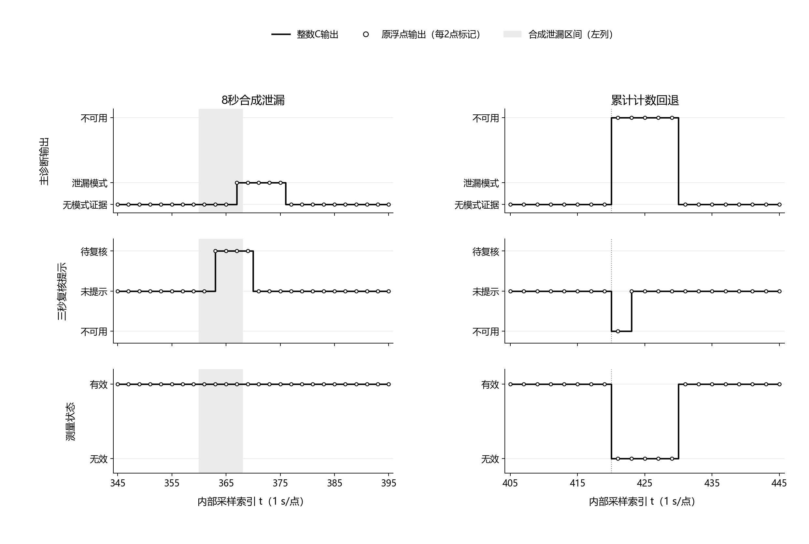

# MCU输入与整数诊断：第十轮验证

2026年10月6日。项目：基于 LoRa 的南疆滴灌支管道早期故障诊断物联网原型系统。

本轮完成了可供移植的C整数诊断内核、节点输入与固定容量存储约定，并与现有逐秒参考进行对照。216条合成轨迹中，C与独立整数参考的130,896次更新逐字段一致；监测阶段102,816条记录的九个输出字段也与原浮点程序一致。三个额外构造的边界样例仍出现浮点与整数判断差异，因此采用结论是“本批轨迹输出一致，整数版本可进入采集适配层验证”，不声称任意输入下严格等价，也不声称已在STM32运行。

## 一、实现范围与工程约束

诊断路线保持固定1 Hz输入、十秒主窗和五次连续确认；三秒短窗连续两次越限只产生待复核提示。内核只接收完成区间的时刻索引、累计脉冲、两路整数压力及质量码，配置包括独立健康许可、数值参照和门限，不接收故障真值、场景名或未来测量。无当前模式证据仍不能写成设备已确认健康，测量不可用时也不能沿用先前的有效模式。

标定与健康参照拟合暂留在PC端。原有程序从监测开始前的历史校准段形成参照及门限，本轮将其生成注册配置，再回放历史端点预热C窗口；从索引130开始比较诊断，130以前只做C与整数参考的实现核对。另行改变130之后的压力输入，不改变配置指纹。实际部署时配置加载、预热和开始监测的时序还需验收，这个离线回放不证明节点能提前取得未知校准结果。

压力输入单位为0.01 kPa；门限及阻力参照按百万分之一量化；预测流量使用10—200 kPa、0.5 kPa间隔的381点表及整数插值。比较保留整数压力和与累计脉冲差，用交叉相乘代替在线浮点除法和幂运算，等号不报警。流量只在输出时舍入至0.001 L/min，舍入后的无线流量不再输入诊断。内核没有动态分配，PC配置生成仍使用浮点运算，不能写成整个系统已消除浮点。

每秒450脉冲是保证算术有界的保护上限，在540脉冲/L假设下对应50 L/min。候选SEN0549厂家仅在0.3—5 L/min区间给出±1%误差规格，因此合成轨迹超过5 L/min的部分只验证软件，不证明该传感器覆盖该工况。实际支路实验工作域、脉冲系数、压力量程及电平仍须标定。[DFRobot规格](https://wiki.dfrobot.com/sen0549/)

## 二、分步验收

| 分项 | 完成工作 | 结论及限制 |
|---|---|---|
| 10A 输入与资源 | 6项检查：时间/增量拒绝、表示范围、计数回退、固定布局、64位乘法边界及配置校验 | 拒绝不改变原状态；计数回退重建窗口。仅验证主机代码及布局 |
| 10B 整数内核 | 7组边界，含24个精确比较向量；门限等号、两侧一单位、压力域、低流量、质量失败、许可缺失、短窗与主窗分离、极值计算 | 独立Fraction有理数参考与C一致；严格编译及有符号溢出陷阱通过，无STM32运行时间结论 |
| 10C 三路对照 | 144条既有轨迹＋72条新种子轨迹；原压力浮点、量化压力浮点、量化压力C同配置比较并完整复算 | 本批九字段及事件掩码无差异；并非通用数学等价证明 |
| 补充边界 | 压力舍入、表插值及工作域舍入三个构造样例；未来输入修改和毫秒边界拒绝检查 | 保留实际差异，不按结果调门限或表间距 |
| 10D 图像与记录 | 六面板实际输出图，PNG与SVG；字号、边界、碰撞及最终图像查看 | 黑白可辨，修正端点标记贴边；未插入Word，未验打印尺寸 |

C编译使用`-std=c11 -Wall -Wextra -Werror -Wconversion -O2 -ftrapv`。配置与输入边界限制下，已核对的最宽乘法上界为2,025,000,000,000,000,000，低于有符号64位上限；极值测试能执行而不触发溢出陷阱。该检查不代替目标工具链、最坏栈占用或全部未定义行为检查。

## 三、输出对照与边界反例

对照覆盖十二种既有场景、三档压力噪声。45000—45003为既有输入回归，51000/51001在本轮首次用于这套轨迹核验。各轨迹使用自己的监测前配置，三路对照共用该配置，量化压力的浮点程序不重新拟合门限，从而分开检查输入舍入与整数近似。轨迹来自相同合成模型，各样本具有时间相关性，不能把记录数写成独立田间试验数。

| 数据集 | 轨迹数 | C与整数参考更新数 | 监测记录数 | 原浮点／整数输出不同记录 |
|---|---:|---:|---:|---:|
| 既有输入回归 | 144 | 87,264 | 68,544 | 0 |
| 新种子检查 | 72 | 43,632 | 34,272 | 0 |
| 合计 | 216 | 130,896 | 102,816 | 0 |

九个比较字段为测量状态、诊断模式、短窗有效性、短窗活动状态、短窗越限、主窗当前标签、事件掩码、质量原因及输出流量。这里的“一致”指这些离散输出与舍入后的流量，不指内部残差或预测值逐位一致。图中的短窗先提示、主窗后确认以及计数回退后重建窗口，都由实际回放结果产生。

图1 两条新种子轨迹的输出对照，种子51000、压力噪声参数0.3。左列合成泄漏区间为内部索引360—367，短窗提示事件在363、主诊断事件在367；右列计数在420回退，主窗在420—429不可用、430恢复有效。横轴为内部采样索引，协议采集结束时刻为(t＋1)×1000 ms；连线表示离散状态保持，圆点每两点显示一次原浮点输出。它不能替代实物延迟测量。

额外反例使用明确构造的预测关系与门限，检查临界比较，并未修改上述216条轨迹的门限。反例中的比较位不等于经过连续确认的故障事件。

| 构造条件 | 浮点判据 | 量化／整数判据 | 说明 |
|---|---|---|---|
| P1＝119.999 kPa，Q＝6 L/min，预测5√(P1/120)，泄漏门限0.2 | 泄漏比较为真 | 压力舍入为120.00，比较为假 | 输入舍入改变临界比较 |
| 同一预测，均值P1＝120.25 kPa，门限取浮点残差等值，整数门限198752/10⁶ | 原值及使用量化门限均不越限 | 表插值后整数比较为真 | 相同量化压力下仍可能出现临界差异 |
| 某压力点P1＝10.004 kPa，其余窗口满足工作域 | 原压力严格大于10 | 舍入为10.00后域检查不通过 | 无效域状态不能写成故障或正常 |

上述三种差异使“对任意输入严格等价”的结论不成立。本批216条轨迹没有命中这些判定边界，不能据此删除反例，也不能把合成输出一致当作实测识别准确率。后续台架需要保存原始输入、配置及实际操作标签，分别评价量化误差、门限裕量和临界工况；在这些证据形成前，当前整数版本保留为候选。

## 四、存储与移植交接

节点候选布局保持16业务、1探测、64完整历史及最新遥测缓存，没有为了消除满队列扩大容量。主机sizeof观测为：诊断状态200 B、含预测表配置1548 B、单槽84 B、完整存储布局6968 B，三项合计8716 B。存储布局只声明容量，没有实现第九轮的恢复发送、SD日志或掉电事务。它也不包含FatFS、驱动缓冲区和栈；STM32F103C8官方20 KB SRAM、64 KB Flash约束下仍须目标编译及链接映射检查，不能宣布整机资源验收通过。[ST规格](https://www.st.com/en/microcontrollers-microprocessors/stm32f103c8)

旧事件跨重启保留原身份与出生时刻，不得以新时钟重写期限。在没有连续时间证据时，旧事件的年龄未知，应隔离而不是自动当作新事件补发。完整原始测量日志与允许替代的普通遥测必须分开；派发次数的持久登记、记录提交边界、部分写入和旧ACK恢复将独立实现及掉电验收。本轮没有修改第九轮发送端或前轮失败记录。

下一工作包按顺序完成**采集适配层软件故障注入、协议快照映射**，把压力时效、计数异常、配置许可与窗口状态实际接到C内核和通信帧，先验证端到端语义；之后再做STM32目标编译、链接占用与真实采样周期。持久队列独立实施，网站、三维、PPT和申报书继续保持当前版本，不把多个任务混在一个通过结论中。

本轮冻结指纹：`371cc7fd6c1860d81c15e3803ee6968e8b35b8815d3fb7604f041350038c806d`。

- [分项计划](../docs/MCU输入与整数诊断_分项执行计划.md)、[输入与存储合同](../docs/MCU输入与存储合同.md)、[C内核](../firmware/integer_diagnosis.c)、[头文件](../firmware/integer_diagnosis.h)、[独立整数参考](../simulation/integer_diagnosis_reference.py)。
- [输入与资源验收](../simulation/integer_diagnosis_review/input_resource_acceptance.json)、[边界验收](../simulation/integer_diagnosis_review/boundary_acceptance.json)、[复算验收](../simulation/integer_diagnosis_review/replay_acceptance.json)、[反例及额外检查](../simulation/integer_diagnosis_review/counterexample_acceptance.json)。
- [216条轨迹记录](../simulation/integer_diagnosis_review/results.csv)、[配置记录](../simulation/integer_diagnosis_review/profiles.json)、[轨迹差异记录](../simulation/integer_diagnosis_review/differences.json)、[反例构造参数](../simulation/integer_diagnosis_review/counterexample_parameters.json)、[冻结参数与源码指纹](../simulation/integer_diagnosis_review/frozen_parameters.json)。
- [图像程序检查](../simulation/integer_diagnosis_review/figure_checks.json)、[最终查看记录](../simulation/integer_diagnosis_review/visual_review.json)、[第九轮报告](事件优先与遥测保留_第九轮验证.md)。
