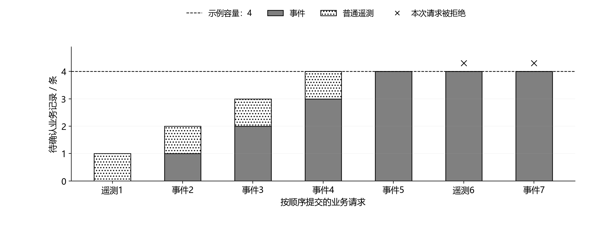
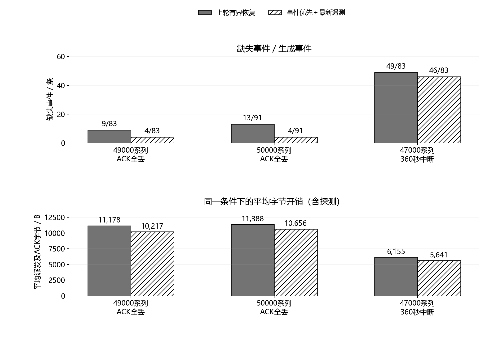

# 事件优先与遥测保留：第九轮验证

2026年10月6日。项目：基于 LoRa 的南疆滴灌支管道早期故障诊断物联网原型系统。

本轮将“保留已接纳事件、普通遥测只保留最近一条”确定为下一步移植的候选策略。它缓解了ACK单向失败时普通遥测占用事件队列的问题，未改变诊断输出、采集频率、消息格式、重试次数或记录期限。已知49000系列ACK全丢场景的事件缺失从9/83降为4/83，未使用的50000系列从13/91降为4/91；密集事件本身仍会占满队列，360秒中断仍超过300秒期限。本报告证明主机实现与合成回放中的行为，不构成STM32、实物无线、能耗或棉田性能验收。

## 一、策略与实现边界

事件用于记录发生过的变化，普通遥测用于更新最近状态，两者具有不同的保留价值。新策略保持16个未确认业务槽、1个独立条件探测槽和64条历史记录；初始最多8次派发，恢复追加最多4次，总计不超过12次，期限仍为300秒。已接纳事件保留原身份、原正文、派发次数和期限，不通过合并相邻告警或调整诊断门限降低事件数。新事件遇到满队列时，可以让普通遥测退出；16槽全为事件时，新事件与新遥测都明确拒绝。系统记录拒绝原因，而不是把容量不足写成送达成功。

普通遥测最多占一个未确认业务槽。相同来源、相同正文的重复提交返回原消息，不获得新的身份或重试预算；较新来源生成新身份，将旧遥测记为“被较新遥测替代”。事件需要槽位时，旧遥测记为“为事件让位”。两种退出都保留原帧和派发次数，分别计数，不能算作ACK确认或过期。若旧ACK晚到，仅在相应历史尚保留时追记原消息，不确认新遥测，也不为事件激活追加派发。消息正文不原地修改，CRC及ACK指纹随各自原帧保持一致；这些完整性检查不提供身份认证。

更新前先验证来源、正文与时序。非法新样本、冲突正文、时间回退或序号耗尽不会先删掉旧记录；替代、让位与新记录入队在同一SQLite事务中完成。当前会话另保留一个最近已接纳遥测的原帧，使历史裁剪后再次提交同一来源仍返回原身份，而不是重新入队。正常重开会话清空该会话遥测缓存，已经接纳的旧会话事件仍保留原身份。事件去重沿用有序来源及淘汰水位约束，不能据此声称支持任意乱序来源。

候选类使用独立策略标识，拒绝直接打开旧恢复策略数据库，也拒绝改变已登记容量。部署应使用独立数据库，当前没有自动迁移方案。主机测试覆盖文件数据库重开和事务回滚，尚未覆盖突然掉电；旧恢复类没有反向识别新数据库的新增限制，不能把单侧检查描述成双向迁移保护。

最近状态的替代意味着普通遥测不承担完整测量历史。后续台架实验必须另外保存逐秒原始测量、健康参照、操作标签与配置，保证论文评价可追溯；不能将有意裁剪的无线状态流当成完整实验数据。本轮没有改变固定1 Hz输入、十秒主诊断和三秒待复核基线，也没有用通信队列的改善替代诊断准确性验证。

## 二、逐项验收结果

| 分项 | 已完成检查 | 验收结论与限制 |
|---|---|---|
| 9A 接纳与身份 | 14项新增检查；在新类上复跑17项既有身份检查 | 相同来源不重置，冲突与较旧来源拒绝；事件让位、满事件拒绝、晚ACK隔离、失败回滚、会话重开通过。仅为主机实现 |
| 9B 容量与预算 | 4项新增检查；复跑19项既有预算检查；1000条连续遥测与既有1000条事件压力检查 | 连续遥测仅占1槽，历史不超过64条；第17条密集事件明确拒绝；12次派发与300秒期限不变。未验证Flash布局、磨损和掉电 |
| 9C 同输入回放 | 648组原条件配对结果、96组新种子结果，共744组；324条上轮候选原字段逐条复现 | 两策略输入哈希与生成事件数相同，原帧、去重、期限与次数检查通过。均使用合成模型 |
| 9D 图像与记录 | 两张PNG逐张查看；对应SVG、字号、文字边界和碰撞记录保留 | 黑白可区分，未发现文字重叠、裁切或错位。尚未插入Word，不代表页内排版或打印验收 |

连续1000条遥测提交产生999次替代，历史裁剪935条，仍保留一个最新遥测原帧用于来源幂等；本项观测的保留帧字节峰值为3630 B。候选逻辑最多包含16条业务、1条探测、64条历史与2条单行元数据，共83行。按每条帧最多64 B并计入额外遥测缓存和35 B快照，保守载荷边界为(16＋1＋64＋1)×64＋35＝5283 B。这个数只约束保留的帧与快照，不含对象、索引、SQLite页和日志，更不是STM32的RAM或Flash需求；MCU存储方案需单独设计和核验。

图1 事件接纳与遥测让位。图中为实际发送端程序运行的4槽软件示例，便于逐步观察，正式候选容量仍为16槽。第五个请求让遥测退出，随后队列全为事件，两个新增请求均被拒绝；4槽不表示设备数量或棉田分区数量。

## 三、配对结果及工程取舍

648组记录由324个上轮候选条件分别运行两策略构成；新增96组使用预先固定、此前未使用的50000/50001种子，覆盖12条轨迹及四种链路条件。49000系列已被上轮检查并用于本轮问题定位，属于回归材料，不再称作新留出。50000系列仍由同一合成水力模型生成，不能看作独立田间验证。各轨迹在不同链路条件下重复使用，汇总事件数也不能当成独立物理试验次数。

下表每行两策略使用相同的测量快照与业务请求。事件接收数按接收端唯一业务记录统计；字节开销包含派发失败的尝试、探测以及生成后丢失的ACK，取该条件下每次回放的平均值。

| 条件 | 每策略回放数 | 上轮／新策略接收事件 | 上轮／新策略平均字节（B） | 取舍 |
|---|---:|---:|---:|---|
| 主对照：清洁链路 | 72 | 328/328／328/328 | 995.51／995.51 | 结果及开销不变 |
| 主对照：随机丢失 | 72 | 328/328／328/328 | 1842.38／1856.13 | 新策略多18次遥测替代，开销增加约0.75% |
| 主对照：60秒中断 | 72 | 328/328／328/328 | 1890.56／1890.56 | 本批事件无缺失 |
| 边界：20秒中断 | 12 | 83/83／83/83 | 1485.67／1485.67 | 结果及开销不变 |
| 边界：120秒中断 | 12 | 83/83／83/83 | 3982.25／3824.75 | 10次遥测替代，开销减少约3.96% |
| 边界：360秒中断 | 12 | 34/83／37/83 | 6155.25／5641.42 | 容量拒绝减少，期限限制仍存在 |
| 49000系列：ACK全丢 | 12 | 74/83／79/83 | 11178.42／10217.33 | 缺失9→4，已知失败的回归检查 |
| 50000系列：ACK全丢 | 12 | 78/91／87/91 | 11387.83／10655.92 | 缺失13→4，新种子检查 |
| 50000系列：随机丢失 | 12 | 91/91／91/91 | 2115.92／2115.92 | 本批事件无缺失 |
| 50000系列：两次中断 | 12 | 91/91／91/91 | 3205.92／3205.92 | 本批事件无缺失 |
| 50000系列：全程不可达 | 12 | 0/91／0/91 | 7959.83／7453.92 | 开销减少不能证明业务成功 |

其余48000、49000系列对照完整保留在CSV中。选择性展示上述条件用于解释机制，不删除其他结果。主对照随机丢失时的字节略增说明：替代旧遥测会改变后续派发与ACK时序，不能保证每种条件都更省。UART及ACK字节属于通信工作量指标，尚未测量LoRa空中占用或电流，不能换算成实测节能率。

图2 三类困难条件下的事件缺失与平均通信字节。柱上分数表示接收端缺失事件数／生成事件数；49000为已知回归，50000为本轮新种子，47000为长中断边界。灰度及填充纹理同时区分策略，读图不依赖颜色；下半图的字节值四舍五入至整数。

ACK全丢时，接收端收到事件但发送端始终收不到确认，记录仍可能在发送端过期。50000系列新策略接收87条事件，同时有87条事件未获确认而过期，这两个数字描述不同端的状态，不能相加计算失败。该组剩余4条缺失均对应满事件队列的拒绝；只减少普通遥测占槽无法解决事件到达持续高于队列释放速度的问题。在已知高噪声局部限制轨迹中，21条生成事件的新策略接纳17条并拒绝4条，没有删改诊断输出来降低事件数。

360秒中断组的新策略未因容量拒绝事件，但仍有46条事件在300秒期限内未送达。它把原先另外3条容量拒绝转为接收成功，不能恢复已经到期的记录。回放结束未确认队列清空也不代表全送达：过期、替代和明确拒绝都会减少队列。最大事件延迟仅针对实际收到的事件计算，例如本组295秒，不包含缺失事件，不能解释成全部事件的延迟上限。

## 四、采用范围与下一工作包

新策略作为移植候选保留，依据是事件接纳优先级明确、源身份和重试预算不被重置、存储载荷有界，并在相同输入下改善了两组ACK单向失败结果。它不保证任意事件密度下零缺失，也不支持超过期限的无限补发。第八轮实现、初版及失败数据继续原样保存，便于复查修改前后的真实差异；本轮未修改申报书、网站、三维模型或PPT。

下一工作包收敛到**MCU输入与存储合同、整数诊断等价验证**：先明确传感器时间戳、累计流量计数、质量状态和独立健康参照的输入约定，再给出固定容量内存结构及持久化边界；随后用主机C实现对照已有逐秒参考，检查量化、溢出、无效输入与状态转换。每项单独验收，不在同一步扩展阀门控制、网站展示或更多诊断算法。主机等价通过后，STM32真实采集、Flash掉电、串口及无线实验再分别实施。

本轮源与参数冻结指纹：`6bec73cc33fc58fe1419b926bec0bec7a070f389e92584512adaa19a304a7261`。以下材料共同构成证据，图像不替代数据和验收记录：

- [分项执行计划](../docs/事件优先与遥测保留_分项执行计划.md)、[发送端候选实现](../prototype/admission_transport.py)、[回放程序](../simulation/review_event_admission.py)、[验收程序](../scripts/validate_event_admission.py)。
- [接纳验收](../simulation/event_admission_review/admission_acceptance.json)、[容量验收](../simulation/event_admission_review/storage_acceptance.json)、[既有身份回归](../simulation/event_admission_review/recovery_identity_acceptance.json)、[既有预算回归](../simulation/event_admission_review/recovery_budget_acceptance.json)、[配对复算验收](../simulation/event_admission_review/replay_acceptance.json)。
- [648组配对记录](../simulation/event_admission_review/paired_results.csv)、[96组新种子记录](../simulation/event_admission_review/holdout_results.csv)、[分组汇总](../simulation/event_admission_review/group_summary.json)、[参数与源码指纹](../simulation/event_admission_review/frozen_parameters.json)。
- [4槽示例记录](../simulation/event_admission_review/queue_example.json)、[困难轨迹请求与终态](../simulation/event_admission_review/admission_example.json)、[图像程序检查](../simulation/event_admission_review/figure_checks.json)、[最终图像查看记录](../simulation/event_admission_review/visual_review.json)、[第八轮报告](断连恢复与有界补发_第八轮验证.md)。
