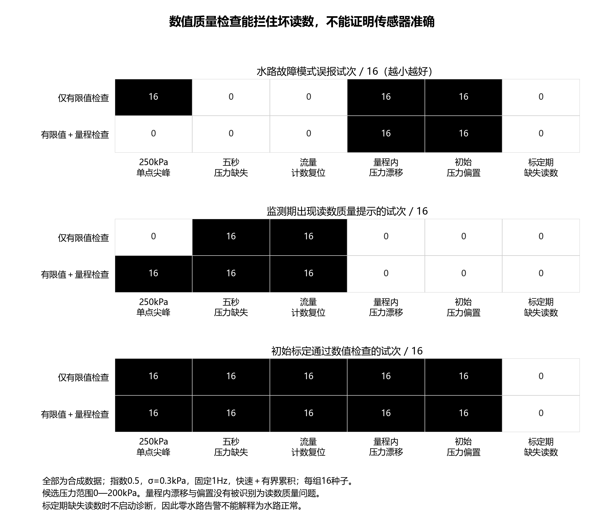
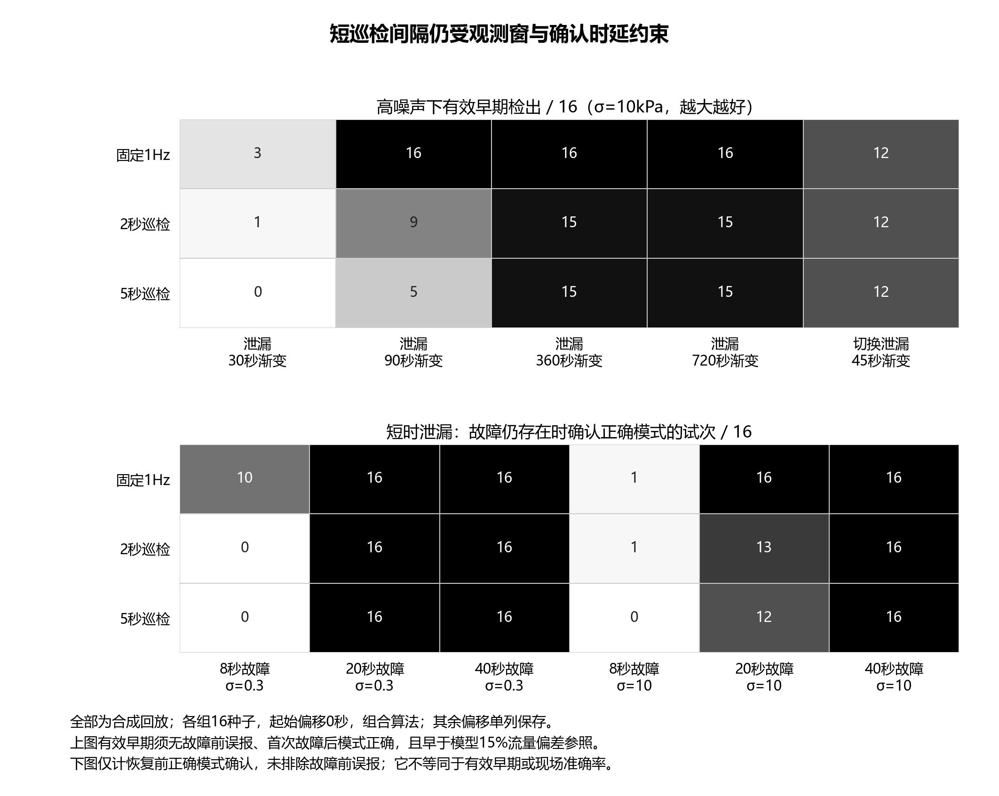
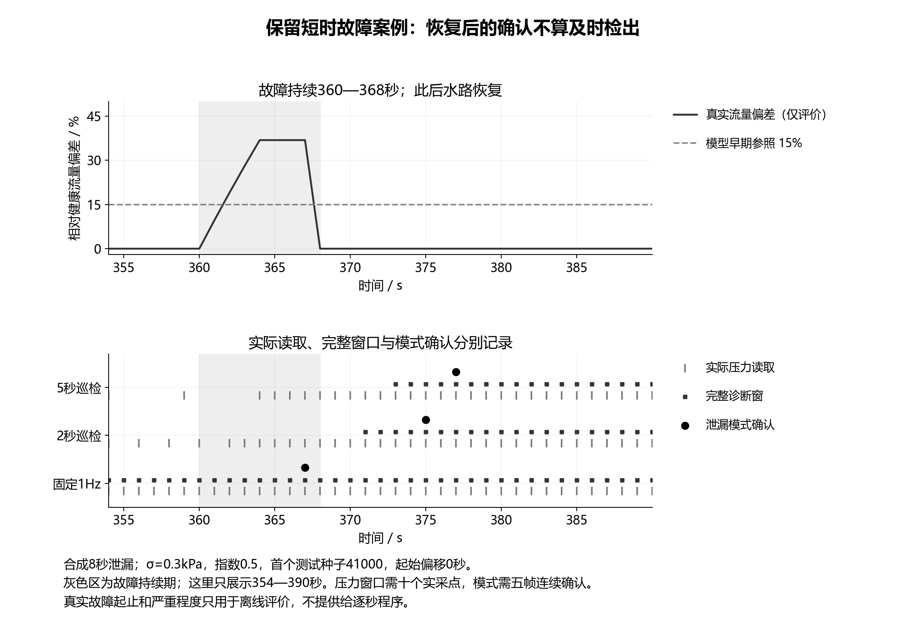

# 传感器质量与采集间隔：第四轮验证与执行约束

2026年10月6日。本轮承接第三轮发现的压力漂移误判与巡检迟报，完成数值质量检查、逐秒输入程序以及1/2/5秒采集间隔的独立回放。所有结果均为合成数据，未取得台架或棉田实测，不能写成设备精度、现场准确率或实测节能。申报书、项目书、网站、三维模型和PPT继续等待算法规则稳定后同步。

## 1. 现阶段采用什么，保留什么

**固定1Hz压力采集、一次十秒流量计数窗、连续实采压力窗和噪声保护快速判断，继续作为工程基线。** 有界累积保留为缓变识别候选；2秒与5秒压力巡检保留为采集策略实验配置。本轮发现低频采集在正常时段明显降低完整诊断窗口的覆盖，在较快的渐变故障中降低有效早期检出；不能仅根据读取数量减少，就把低频配置定成系统默认规则。

事件触发研究仍有价值。接下来把压力采集与通信上报分别设计：先保证诊断需要的观测连续性，再比较定期状态上报和事件上报的发送次数、缓存与接收效果。固定1Hz也是本轮比较基线，并非已证明对所有故障足够。短时泄漏表明十秒观测窗与连续五帧确认本身存在时延约束，后续要单独验证快速变化复核通道，不能在当前结果中宣称已解决突发故障。

数值质量检查可以进入原型逻辑，但其输出应称为“读数不可用”“超出拟选量程”或“计数异常”。量程内偏置、漂移及真实水路异常，不能仅凭范围检查区分。程序允许建立参照，也不等于水路已确认健康：台架标定前必须用独立参考测量和受控水路检查确认状态，正式运行还需保留标定记录、轮灌配置和原始时间戳。

## 2. 这一轮如何验证

新程序的运行接口只有时间戳、累计流量计数和当前请求读取的压力。每秒提供累计计数快照，压力只在采集计划要求的时刻提供；运行程序不接收故障开始时刻、严重程度、阀门操作安排、未读取压力或未来数组。十秒流量由十个计数区间一次计算，压力窗只由十个实际连续的一秒读数计算。缺测期间不补值，不跨间隔累积，模式确认要求五帧连续有效诊断。

数值检查设两种配对配置：有限值检查，以及有限值加0—200kPa范围检查。0—200kPa是拟选压力测量范围的候选约束，没有据此证明已购传感器或实际水路的工作范围。读数无效后清空压力窗，重新取得完整实采窗；计数发生回退时记录异常，重建同一计数段内的十秒流量窗。数值检查不能确定超范围来自接线、设备还是水路本身，也不能将低压或低流量的数据不足解释为正常。

流量快照连续可用是本轮明确的硬件前提，不代表STM32休眠时已能持续完成这些工作。实际实现需检查计数器位宽、回绕扩展、复位、丢脉冲以及ADC与计数时间戳的对齐。本轮仅测试合成累计计数的复位，尚未验证定时器回绕处理、MCU低功耗模式或整机电流。

| 工作包 | 条件与规模 | 证据数量 |
|---|---|---:|
| 健康门限训练 | 12个新种子、3档压力噪声、4种健康场景，覆盖1/2/5秒配置的全部整数起始偏移 | 1152条配置训练记录 |
| 采集间隔对照 | 另16个种子、3档噪声、15种场景、8种间隔与偏移组合、2种算法 | 720条源轨迹、11520条配对结果 |
| 数值质量对照 | 16个种子、3档噪声、12种情况、2种检查配置、2种算法，固定1Hz | 576条源轨迹、2304条配对结果 |

训练种子40000—40011，测试种子41000—41015，不与前三轮观测生成的基础种子重合。健康场景包括正常、供压切换、供压渐变和长时正常；累积门限只用健康峰值的1.1倍确定。1/2/5秒配置分别得到门限，所有整数起始偏移都进入健康训练。测试前冻结代码摘要、参照与配置，测试后未用故障结果调整参数。

采集对照固定模型负载指数0.5，压力噪声σ为0.3、3、10kPa，流量扰动标准差0.02L/min。既有准稳态水力模型增加了30/90/360/720秒泄漏渐变、30/90/360秒局部受限渐变，以及持续8/20/40秒的短时泄漏。短时泄漏在四秒内上升后保持，达到持续时长后恢复；这只是规定的合成波形，不代表真实管道破裂或水锤。

各场景、噪声档和采集配置复用基础随机数，方便配对比较；各起始偏移复用同一轨迹。因此11520条结果不等于11520次独立实验，不合并为一个现场准确率。短时故障严格区分有效早期、故障仍存在时的正确模式确认，以及恢复后的迟报；恢复后的确认不算故障期间检出。初始即存在泄漏的案例按真实有故障评价，没有当成正常水路计算误报。

## 3. 数值检查的收益与边界

下表为σ=0.3kPa、固定1Hz、快速加有界累积，每组16个测试种子。“误报”指真实水路没有故障时出现水路故障模式确认；读数质量提示另计，不扣除诊断不可用时段。

| 检查场景 | 仅有限值检查：水路误报 / 16 | 增加量程检查：水路误报 / 16 | 实际处理与限制 |
|---|---:|---:|---|
| 单次P0读数250kPa | 16 | 0 | 增加范围检查后16/16出现质量提示，平均完整诊断帧由471降至461 |
| P1连续五秒缺失 | 0 | 0 | 两种配置均提示缺失，重新形成压力窗；平均可诊断457帧 |
| 累计流量计数复位 | 0 | 0 | 两种配置均提示异常，十个新计数区间后恢复；可诊断461帧 |
| P0在三分钟内漂移10kPa | 16 | 16 | 数值仍在范围内，没有识别为质量问题 |
| 初始P0偏置10kPa并持续 | 16 | 16 | 参照数值检查通过，后续仍出现水路误报 |
| 标定时P1存在缺失读数 | 0 | 0 | 两种配置均拒绝启用参照，可诊断帧为0；零告警不能称为正常 |

其他量程内压力阶跃偏置同样未解决。P0增加10kPa、P1降低10kPa的对照在低噪声下均16/16出现水路故障模式误报。压力读数卡住的案例没有被范围检查识别为质量问题；无显著水力激励时，恒定读数也不能简单作为传感器损坏证据。这些结果要求把传感器校验与水路诊断分别验收，不能写成“已实现传感器故障自诊断”。

更重要的反例是初始水路已经泄漏。两种检查配置在低噪声下均16/16允许完成数值标定，但16/16没有确认泄漏；中噪声下也全部没有检出。原因是本地流量增益校正吸收了开始时已经存在的异常，独立健康拟合关系也不能自动避免这项污染。高噪声下组合仅1/16后来确认正确模式，不能据此称初始健康校验有效。独立健康水路与传感器校验是运行条件，不能由“前一段数据看起来稳定”替代。

滴灌出流受设备压力—流量特性及水力条件影响，可参见[FAO关于灌溉系统与运行约束的说明](https://www.fao.org/4/w4367e/w4367e0c.htm)。该依据支持建立具体支路参照，不支持把任意开机读数认作健康。累积统计的方法基础可参见[NIST的CUSUM说明](https://www.itl.nist.gov/div898/handbook/pmc/section3/pmc323.htm)；本轮有界累积及门限为本项目候选实现，没有将标准控制图的理想统计条件套成现场误报保证。

## 4. 采集频率、时间尺度与诊断覆盖

以下首先比较默认起始偏移0秒；算法为快速加有界累积，分母均为16。“有效早期”沿用无故障前误报、首次故障后模式正确、早于模型流量偏差15%参照的联合条件。15%仍仅是离线评价参照，不是作物损失阈值。

| 场景与指标 | 固定1Hz | 2秒巡检 | 5秒巡检 |
|---|---:|---:|---:|
| 90秒泄漏渐变，σ=10，有效早期 / 16 | 16 | 9 | 5 |
| 720秒泄漏渐变，σ=10，有效早期 / 16 | 16 | 15 | 15 |
| 45秒切换泄漏，σ=10，有效早期 / 16 | 12 | 12 | 12 |
| 8秒泄漏，σ=0.3，恢复前正确确认 / 16 | 10 | 0 | 0 |
| 20秒泄漏，σ=10，恢复前正确确认 / 16 | 16 | 13 | 12 |
| 正常低噪声段，平均压力读取帧数 | 471 | 268.3 | 145.3 |
| 同段平均完整可诊断帧数 | 471 | 50.1 | 48.3 |

恢复前正确确认的指标未排除故障前误报，不能与有效早期直接合并。三种配置在8/20/40秒短时泄漏中均未取得有效早期检出，说明现有窗口与确认组合不适合承诺这类极快故障的提前预警。固定1Hz在部分短时故障中仍能赶在恢复前确认，低频配置则可能在水路恢复后才形成完整诊断窗。

起始偏移仍有影响。在σ=10的90秒泄漏渐变中，2秒巡检两个偏移分别9/16、10/16有效早期；5秒巡检五个偏移为5/16、7/16、6/16、6/16、3/16。切换泄漏的5秒巡检为12/16、9/16、10/16、8/16、6/16。不能只报告默认偏移的较好结果，也不能将重复偏移视作独立重复实验。

诊断覆盖的代价在无故障段更加明显。正常低噪声段的471个逐秒时刻中，2秒巡检平均只有50.1个完整可诊断帧，5秒巡检只有48.3个。长时低噪声段1671个逐秒时刻中，两者平均分别147.4和136.7个可诊断帧。其余时刻包括未采压力和虽有读取但窗口不足，均没有新的完整诊断证据。降低读取次数的结果不能转换为节能百分比，更不能用缺测下的零告警说明长期运行健康。

在长时健康默认偏移的三个噪声档中，保护快速通道本轮均0/16发生水路模式误报；组合在σ=3、固定1Hz下1/16误报，在σ=10的三种配置下均1/16误报。这个局部结果支持继续把快速通道作为比较基线，不代表它在量程内漂移、未报负载变化或实际棉田中没有误报。

首个测试种子41000的8秒泄漏案例可直接核对：故障持续360至368秒，固定1Hz在367秒确认泄漏，2秒巡检在375秒确认，5秒巡检在377秒确认。后两者是在水路恢复后确认，已归入迟报。图中真实流量偏差和故障区间仅用于离线评价，不输入逐秒程序。

## 5. 分项验收与下一步

验收脚本逐条重新生成1152条健康门限训练记录、11520条采集结果和2304条质量结果。另对24组情况独立核对计数差、实采压力均值、最长60点后缀和与五帧确认；对同样24组改变未来输入及全部未读取压力，已有输出保持不变。逐秒程序在9组干净输入对照中与上一轮固定频率前端的采集计划、残差和事件一致。计数复位后420—429秒诊断不可用、430秒完整恢复，标定缺失时阻止启用参照，均做了专门核查。

验收记录见[逻辑与复算检查](../simulation/quality_interval_review/acceptance.json)。逐条结果见[采集对照CSV](../simulation/quality_interval_review/sampling_results.csv)、[质量对照CSV](../simulation/quality_interval_review/quality_results.csv)，冻结参数见[配置文件](../simulation/quality_interval_review/frozen_parameters.json)。质量异常、基线未启用和窗口不足均有独立状态，不能从误报分母中偷偷删除。

三张图完成实际PNG查看与文字边界、交叠、字号检查，使用灰度、符号与明确数字区分内容，未发现错位或遮挡。最小字号11磅，并保存PNG与SVG。验收仅覆盖独立图片；尚未插入申报书，不能据此保证Word缩放后的字号、页边距或打印效果。

下一分项集中研究快速变化复核与通信上报策略，保持水路模型和慢通道作为可比较基线。快速变化复核需要重新冻结短窗长度、触发条件和确认规则，采用新数据比较水路供压变化、偏置、尖峰与真正短时故障；质量未知时只能输出待复核异常，不能直接确认故障或执行关阀。通信策略则分别核对发送尝试、接收、去重、缓存恢复与事件迟延，不能把少发数据等同于可靠送达。

| 下一分项 | 完成标准 | 当前不能写入已有成果的内容 |
|---|---|---|
| 快速变化复核 | 与十秒主诊断配对；短时故障检出、供压切换误报、质量异常及实际窗口逐条可核对 | 已解决所有突发故障、已能自动判断漂移来源 |
| 上报策略对照 | 采集与上报分开，固定相同采集数据；保存发送与接收证据，故障前后迟延可复算 | 未测电流时的整机节能、没有收包记录时的可靠送达率 |
| 健康参照取得 | 设计独立压力/流量参考和水路确认记录；程序保留标定通过与健康确认的区别 | 自动确认开机水路健康、以稳定数据替代外部确认 |
| 台架接口准备 | 核对累计计数连续性、回绕、复位、时间戳、实际ADC响应和采样切换 | Python程序等同于已部署STM32固件 |

实现入口：[逐秒运行逻辑](../simulation/sampling_quality_runtime.py)、[本轮训练与回放](../simulation/review_quality_intervals.py)、[独立验收](../scripts/validate_quality_intervals.py)、[制图](../scripts/plot_quality_intervals.py)。按训练`--fit`、默认回放、独立验收和制图的顺序运行；前三轮文件保留，不同前端或门限的结果分开解释。项目目标继续聚焦南疆棉田支路维护诊断，不扩展为无人值守灌溉控制系统。
