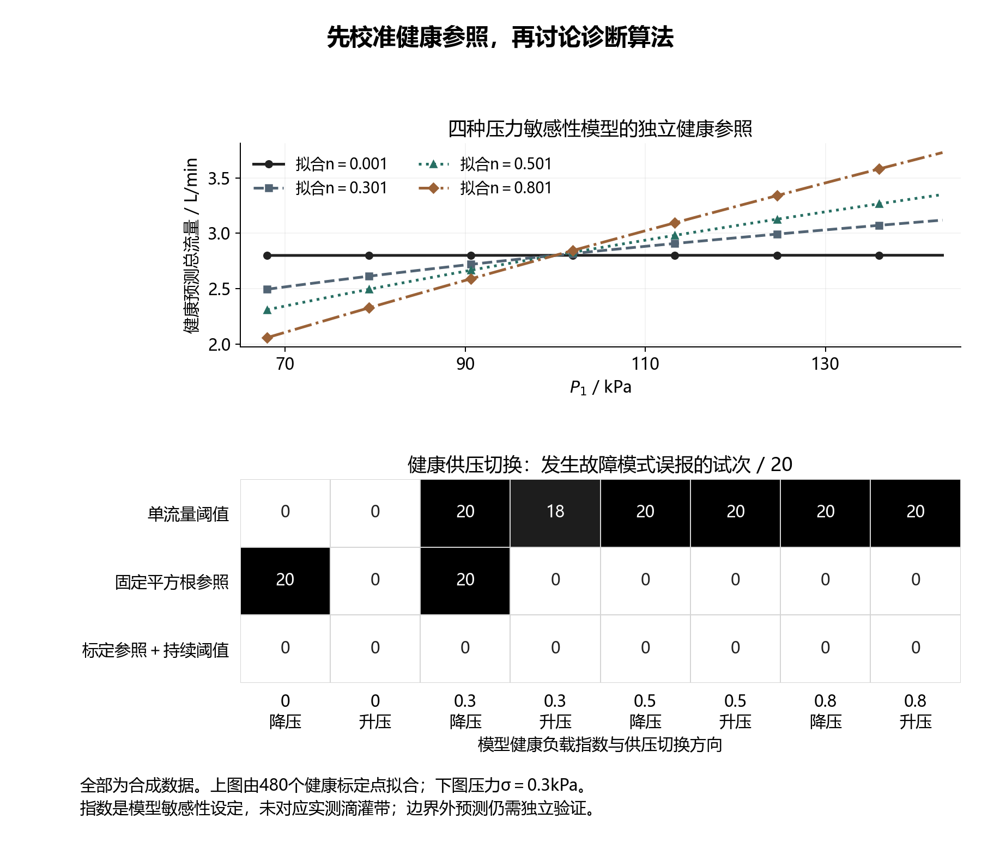
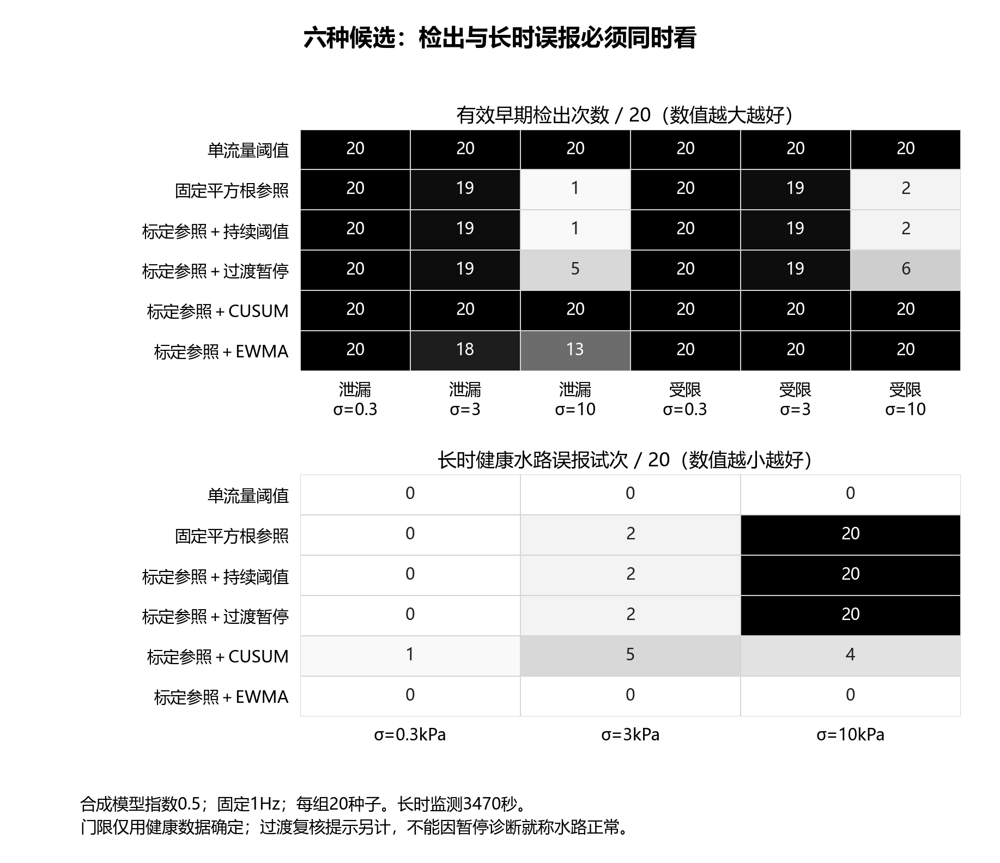
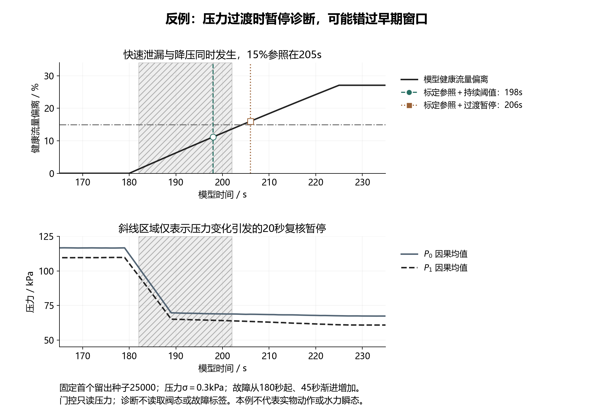

# 健康工况参照与算法选择：第二轮验证

2026年10月6日。本轮先处理健康参照、诊断统计量与工况过渡的关系，完成六种方法的配对回放和逐秒程序核对。研究对象仍是双压力及总流量支持的支管异常巡检。所有数据来自模型，没有新增实物、田间、射频或能耗证据；本轮不修改项目书和申报书。

## 一、当前工程取舍

**下一轮采用“独立健康压力—流量参照＋持续残差判断”作为候选主线，保留单流量和固定平方根关系作基线。CUSUM和EWMA继续作为对照，不因算法名称决定取舍。** 这不是最终定型：健康参照尚未经过实测，持续阈值在长时或高噪声条件下仍有误报，需要继续检查测量条件、参照偏差和采样策略。

这轮最明确的否定结果是：不将“压力发生变化”直接解释成正常操作，也不默认暂停20秒诊断。压力变化可能由供压调整、邻支路动作、故障或测量异常引起。门控虽然能减少部分故障模式提示，但在切换期间的快速泄漏中遮住了有效早期窗口，不能把这样的暂停称为系统性能提升。可保留压力变化标志，用于加密采样和提醒复核，同时继续计算诊断残差；后一组合仍需下一轮验证。

## 二、先解决参照问题，再比较算法

现有K＝Q/√P1隐含健康总流量与压力的平方根关系。本轮把健康负载压力指数设为0、0.3、0.5、0.8，观察关系失配时会发生什么。这些是集总模型的敏感性设定，没有把它们指定为某种已购买滴灌带的实测参数；支管总流量也不能直接等同单个滴头的出流。FAO资料在讨论局部灌溉设计时将压力、滴头出流指数和滴头类型列为需考虑的因素，支持先核对具体出流关系，而不把一个压力指数用于所有设备。[FAO灌溉系统与调度关系资料](https://www.fao.org/4/w4367e/w4367e0c.htm)

每种模型负载在供压80、100、120、140、160 kPa及B支路开关两状态下采集独立合成健康数据。每种120个健康点，合计480个；以log(Q)对log(P1/100)拟合Q_ref＝a(P1/100)^n。拟合指数分别约为0.0008、0.3007、0.5007、0.8006。诊断程序仅接收保存的对应支管参照，不接收模型真实指数。每次运行的初始20—119秒另用于健康增益及阻力基准校正；实施时该段必须由人工确认健康，不能让未知故障污染启动参照。

诊断残差采用e_Q＝Q/Q_ref−1，以及e_R＝(P0−P1)/Q²−R0；e_Q无量纲，e_R单位为kPa/(L/min)²。流量残差反映相对健康出流的增加，阻力残差反映相对健康压降关系的增加。两者都越限时输出模式不确定；这些模式提示不直接等同故障原因，更不直接授权真实关阀。健康参照保持固定，运行过程中没有自动重新拟合，避免把缓慢故障逐步吸收到“正常”基准中。

| 方法 | 参照与判断 | 在本轮中回答的问题 |
|---|---|---|
| 单流量阈值 | 初始健康Q，±6%变化 | 不使用压力归一化能做到什么 |
| 固定平方根参照 | K变化超过6%，或R估计增加超过0.6 | 原物理特征在不同压力敏感性下是否失配 |
| 标定参照＋持续阈值 | e_Q超过6%，或e_R超过0.6 | 独立健康标定本身能否改善判断 |
| 标定参照＋过渡暂停 | 相同残差，但压力变化时暂停20秒 | 减少模式误报是否以失去早期窗口为代价 |
| 标定参照＋CUSUM | 标准化残差正向累积，k＝0.5 | 渐进变化累积能否兼顾误报和延迟 |
| 标定参照＋EWMA | 残差指数加权平均，λ＝0.2 | 平滑统计量能否提供更合适的取舍 |

EWMA采用E_t＝0.2e_t＋0.8E_(t−1)。NIST介绍了该递推和权重对历史观测的影响，也说明常规控制限有独立数据等前提。由于本轮使用重叠10点均值，没有照搬独立样本的控制限或报警概率，而是用完整合成健康轨迹确定候选门限。[NIST EWMA说明](https://www.itl.nist.gov/div898/handbook/pmc/section3/pmc324.htm)

## 三、冻结参数与可获得信息

正常及供压下降、上升、缓慢下降四类健康场景，结合四种模型指数、三个压力噪声等级和12个独立训练种子，共576条轨迹，用于确定CUSUM和EWMA门限。每路采用健康统计量最大峰值的1.10倍并设置下限；CUSUM门限为237.7229、258.6584，EWMA门限为0.135781、3.211460。前者是标准化累积量，后者分别为相对流量残差和阻力残差，单位不能混用。门限使用了σ＝10 kPa的压力噪声挑战，因此整体偏保守，本轮不声称这是最优参数。

参数冻结后，测试使用另外20个基础噪声种子。四种负载、三个压力噪声等级、十二种场景共2880条合成轨迹，形成17280条六方法配对结果。标定、门限训练、测试种子分别保存，不使用测试故障来调门限；同一测试基础噪声序列在场景和噪声等级间复用，因此2880条不等于2880次独立实物实验。虽然测试改变了健康压力敏感性，它仍处于同一幂律模型族内，不能据此宣称已经验证真实滴灌系统泛化。

| 信息 | 在线判断是否使用 | 具体处理 |
|---|---|---|
| P0、P1、Q及时间戳 | 使用 | 固定1 Hz输入，因果10点均值 |
| 事先确认健康的支管参照 | 使用 | 保存拟合系数、标定压力范围和版本 |
| 初始健康标定段 | 使用 | 健康增益与阻力基准校正；需要实际人工确认 |
| B阀门真实状态、供压设定指令 | 不使用 | 当前设备未证明能获得这些信息 |
| 故障时刻、故障程度、健康真值流量 | 不使用 | 仅由独立评价程序读取 |
| 未来观测、未采集观测 | 不使用 | 逐秒程序只接受当前三通道读数 |

暂停候选只根据两个压力的当前因果均值与10秒前均值判断：任一相对变化超过10%，产生“过渡待复核”状态，最多持续20个观测，触发后40秒内不再次触发。没有将其标为正常，也没有重新设定健康基准。报告同时记录故障模式误报、过渡复核次数和暂停观测数，以免通过减少可判断时段掩盖问题。

## 四、健康参照的收益与边界

压力噪声σ＝0.3 kPa、健康供压120→80 kPa并伴随B支路动作时，健康指数0和0.3两组中，固定平方根参照各有20/20条记录出现故障模式误报，标定参照两组均为0/20。指数0.5和0.8的这些下降场景中，原方法本身就是0/20，不能把不存在的改善也归功于新方法。正常升压对照同样保留，具体结果见逐条记录与图。

标定参照使用的是与生成模型匹配的幂律形式，拟合效果良好在本轮条件下并不意外。真实台架必须先检验此形式能否拟合实际支管总流量；若出现补偿区间、分段规律或明显残差，应重新选健康参照形式，而不是强行沿用这四个模型指数。

所有超出标定P1最小值或最大值的观测另计，没有从统计中删除，也没有声称外推已验证。低噪声供压下降对照在标定下边界附近平均约20.4个观测越界，部分由测量噪声造成；快速故障示例有112个越界观测，说明故障也可能把压力推离健康标定范围。当前结果包含这些外推，不能当作已证明的现场性能。下一步要检查仅在标定范围内成立的结论，以及越界时如何保留异常信息并降低诊断置信度。



## 五、算法没有一个全面胜出

下表取健康指数0.5、每组20个测试种子。有效早期须无故障前模式误报、首次确认模式正确，且早于模型健康总流量偏离15%的参照。这里15%依然是仿真评价尺度，不是农业损失或学校验收标准。所有方法均需5次连续观测确认，在1 Hz下首末历时4秒。

| 压力噪声σ / kPa | 方法 | 泄漏有效早期 / 20 | 受限有效早期 / 20 | 长时健康模式误报试次 / 20 |
|---|---|---:|---:|---:|
| 0.3 | 标定参照＋持续阈值 | 20 | 20 | 0 |
| 0.3 | 标定参照＋CUSUM | 20 | 20 | 1 |
| 0.3 | 标定参照＋EWMA | 20 | 20 | 0 |
| 3 | 标定参照＋持续阈值 | 19 | 19 | 2 |
| 3 | 标定参照＋CUSUM | 20 | 20 | 5 |
| 3 | 标定参照＋EWMA | 18 | 20 | 0 |
| 10 | 标定参照＋持续阈值 | 1 | 2 | 20 |
| 10 | 标定参照＋CUSUM | 20 | 20 | 4 |
| 10 | 标定参照＋EWMA | 13 | 20 | 0 |

长时正常监测覆盖130—3600秒，共3470秒；每组20条记录的总监测时间为69400秒。σ＝3 kPa时，持续阈值、CUSUM、EWMA的故障模式提示事件率分别约为0.16、0.83、0次/小时；σ＝10 kPa时分别约为39.11、0.57、0次/小时。这些是指定模型和观察时长中的事件统计，不是现场误报率预测，零次也不能解释为零风险。

σ＝0.3 kPa的渐进泄漏中，持续阈值和CUSUM的有效提前量中位数分别为51、57秒，EWMA仅5秒；受限分别为110、106、41秒。本轮CUSUM对低噪声泄漏稍早，但对受限稍晚，长时误报也更多。EWMA健康对照中的模式误报较少，代价则是保守门限及额外平滑造成的延迟。不能由这一组参数认定某类算法普遍好或不好，更不能只比较故障检出次数就宣布胜出。

本轮CUSUM更换了残差定义及健康训练集，因此门限也与第一轮不同；这一轮只能在自身冻结协议内比较，不能把前后两轮差异全部称为算法改进。单流量基线也没有删除：它在稳定供压故障中表现良好，但健康供压变化会造成模式误报，说明需要同时看正常操作对照。



## 六、过渡暂停的否定反例

从180秒起同时出现健康供压下降和45秒渐进泄漏，健康指数0.5、压力σ＝0.3 kPa时，持续阈值和标定参照均有20/20次有效早期，加入20秒过渡暂停后降为0/20。算法没有完全漏掉最终异常，而是确认变晚，失去有效早期资格。固定首个种子25000的示例中，独立15%参照在205秒，标定参照持续判断在198秒确认，暂停候选在206秒确认；CUSUM在203秒、EWMA在212秒确认。

同一低噪声长时正常水路中，暂停候选平均屏蔽240个观测，而原持续判断本来就没有模式误报。在高噪声长时对照中，平均暂停约683.75个观测，仍有20/20条记录出现模式误报。这种规则既没有充分解决长时噪声问题，又能遮住快速故障，不采用为默认路线。

未知健康负载增加仍与泄漏产生完全相同的三通道观测；传感器漂移也仍可能引发受限模式。对于前者需要可获得的操作记录或人工复核，对于后者需要测量质量检查。这些不能靠EWMA、CUSUM或持续确认保证辨因。系统输出应明确为支管异常模式，保留核查、处置和复测流程。



## 七、逐秒逻辑已跑通，尚未部署硬件

新增`ReferenceDiagnostic`程序逐秒接收P0、P1、Q，内部保存10点窗口、健康标定数据、残差统计和确认状态，输出异常模式、诊断事件、压力变化标志及标定范围越界标志。没有向该程序提供阀态、故障开始时刻或故障程度。固定种子的24个“场景×方法”完整运行与离线回放逐项核对，残差、CUSUM、EWMA、过渡标志和确认事件一致；非连续1秒时间戳会被明确拒绝，没有插值成未采集数据。

计算验收还包括17280条方法记录重算、健康拟合及门限核对、原平方根模型恢复、未来数据改变不影响历史输出、EWMA逐项递推、过渡时段有界，以及未知负载同形保留。绘图检查文字边界和文字相交，另逐张目视检查，修复了压力下标字体缺失、坐标刻度越界和图中表格边界不清楚的问题。三张图同时提供PNG和SVG，并用线型、标记、网纹和数字支持黑白阅读。

这仍是固定1 Hz的主机算法原型，不是STM32固件。没有验证真实传感器响应、脉冲计数、节点电流、实际LoRa链路或真实控制执行。初始健康段确认、断采后的质量状态、参照越界和漂移处置都是进入实际系统前要处理的条件。

## 八、下一项先做什么，以及何时才改申报书

下一工作包是**诊断与事件采集组合回放**，使用本轮健康参照及持续判断为候选主线，CUSUM作为诊断对照。压力变化用于触发高频观测和复核提示，不默认关闭诊断。保留固定高频方案，分别比较算法变化与采集变化，避免一次把两项收益叠在一起。暂不扩展网站、三维模型或真实关阀任务。

| 工作 | 具体产物 | 进入下一步的验收要求 |
|---|---|---|
| 采集输入对齐 | 压力时间戳、流量计数窗口和每次真正取得的数据 | 不将瞬时Q、10秒脉冲均值和再次平滑混为一谈；未采集的压力不得用于唤醒判断 |
| 非等间隔判断 | 支持实际观测间隔的因果确认规则和回放代码 | 持续确认按经过时间及真实观测数定义；CUSUM/EWMA重新处理间隔并独立健康校准，不能直接复制1 Hz参数 |
| 工况及故障对照 | 正常切换、慢故障、快故障、漂移、未知负载及缺测 | 不删除切换期间故障；异常采集不能自动更新健康基准；报告漏检、晚检及暂停/无效时段 |
| 采集—诊断消融 | 固定高频、低频、事件采集的同数据比较 | 在相同有效早期和误报条件下看观测及发送次数；没有电流实测不写节能百分比 |
| 方案冻结 | 明确采用方法、参数适用条件、状态机和证据清单 | 关键反例和时序逻辑通过，能解释失败；当前仿真身份及实测待完成内容明确 |
| 文档同步 | 将通过的路线写回申报书及后续实施计划 | 仅在前项稳定后修改；按学校模板复查公式、图片、表格和分页，保留信息与预算空位 |

参考范围越界与初始健康确认不能因论文写法不便而隐去，但它们应在执行说明中用明确条件表达，不把申报正文写成一串“待确认”。未来正式研究仍需真实独立运行批次、参考测量和导师审核；仿真逻辑跑通与大创结项、论文发表是不同阶段。

## 九、文件与复现入口

本轮协议、参照、门限及源文件哈希保存在`simulation/operating_reference_review/frozen_parameters.json`。同目录包含480个健康参照点、576条门限训练峰值、17280条方法记录、首个固定种子的全部场景原始观测、统计汇总及验收记录。其余轨迹由冻结源文件和记录中的种子完整重建；没有选取有利示例替代所有场景。

算法与模型：`simulation/review_operating_reference.py`；逐秒原型：`simulation/reference_runtime.py`；核验：`scripts/validate_operating_reference.py`；绘图：`scripts/plot_operating_reference.py`。复现测试直接运行如下命令。只有有意建立新参数版本时才使用`--fit`，不能在看过测试结果后反复调参并仍称这些测试为独立验证。

```powershell
$env:PYTHONPATH='C:/Users/Lenovo/.cache/codex-task-deps/dachuang-plots'
$taskPython='C:/Users/Lenovo/.cache/codex-runtimes/codex-primary-runtime/dependencies/python/python.exe'
& $taskPython simulation/review_operating_reference.py
& $taskPython scripts/validate_operating_reference.py
& $taskPython scripts/plot_operating_reference.py
```
