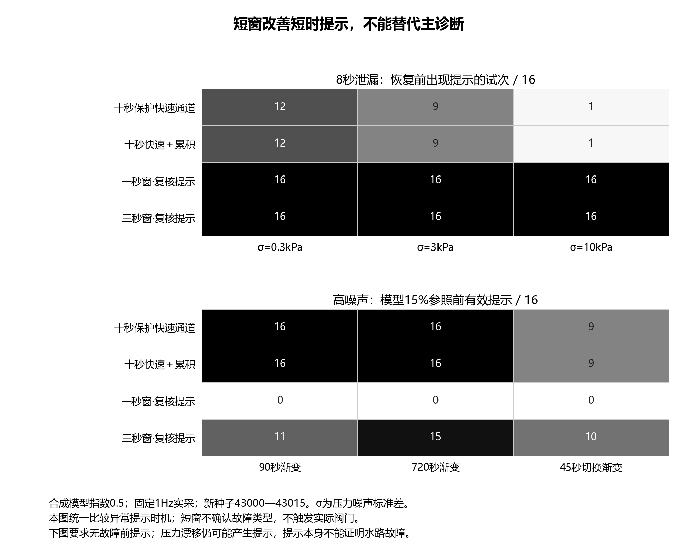
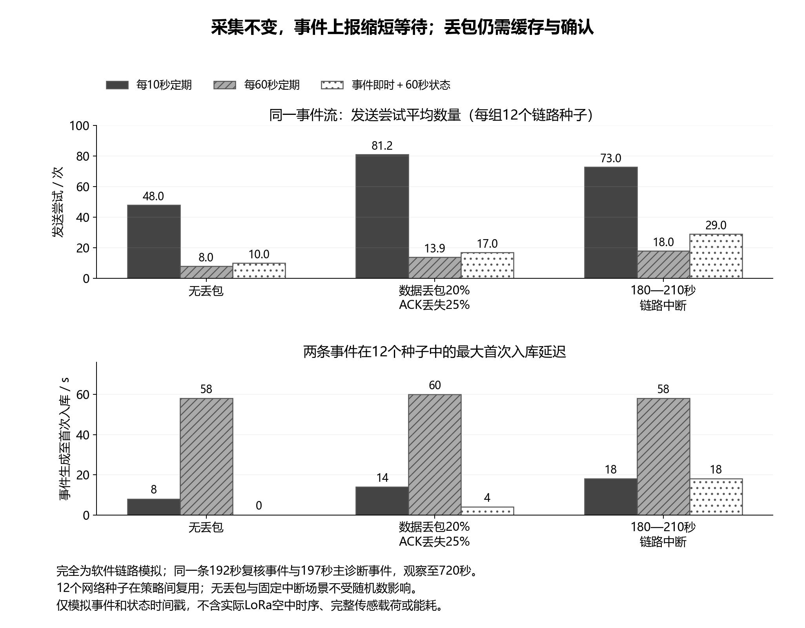

# 快速复核与可靠上报：第五轮分项验证

2026年10月6日。按“连续执行、逐步总结、逐步验收”的要求，本轮先验收快速复核，再执行与验收通信缓存。两项分别保存数据与验收记录，没有用一个总结果代替分项检查。图像最后单独查看并核对。算法仍是合成水力回放，通信包含实际本地SQLite逻辑与模拟链路，不包含实物水路或无线模块。

## 1. 快速复核：保留主诊断，增加待复核提示

这一项使用480条新合成源轨迹，噪声种子43000—43015，压力σ=0.3/3/10kPa。对象为正常、长时正常、供压切换、供压渐变、90/720秒泄漏渐变、8/20/40秒短时泄漏与45秒切换泄漏。四种方法形成1920条提示时机对照，另对压力漂移、偏置、越量程、缺失读数、计数复位和初始泄漏形成576条对照。总计2496条记录，和第四轮使用不同种子。

压力均按1Hz实际读取。主诊断继续使用十秒压力窗、一次十秒流量计数窗以及五帧连续确认。短窗候选分别采用一个或三个实采压力点，与同长计数区间对齐，连续两帧越限产生“快速变化待复核”提示。短窗波动尺度只由本次初始健康段计算，使用冻结的保护系数6及原残差门限；没有在测试结果上调参。范围与有限值检查保留，计数回退的窗口不用于计算。

这里有意把四种输出统一比较为异常关注信号。短窗没有输出泄漏或堵塞的已确认类别，水路模式判断仍由主诊断给出并需要人工核查。因此本轮的“有效提示”只要求无故障前提示、首次故障后提示早于模型15%偏差参照，没有把它当作上一轮的正确类别早期检出率。压力漂移也会使短窗提示，不能据此确定水路故障，更不能下发真实关阀动作。

| 同一组新种子、默认固定1Hz | 十秒保护快速通道 | 十秒快速＋累积 | 一秒窗提示 | 三秒窗提示 |
|---|---:|---:|---:|---:|
| 8秒泄漏，σ=0.3，恢复前提示 / 16 | 12 | 12 | 16 | 16 |
| 8秒泄漏，σ=10，恢复前提示 / 16 | 1 | 1 | 16 | 16 |
| 90秒泄漏渐变，σ=10，有效早期提示 / 16 | 16 | 16 | 0 | 11 |
| 45秒切换泄漏，σ=10，有效早期提示 / 16 | 9 | 9 | 0 | 10 |

短窗在本组8秒泄漏中提高了恢复前的关注机会，但四种方法在该场景均没有满足模型15%参照前的有效提示条件。一秒窗在高噪声缓慢泄漏中明显变迟，不能因为短时场景的较好结果就替换所有诊断。三秒窗可作为待复核提示候选，十秒保护快速通道继续作为主诊断基线；有界累积仍保留在缓变对照中。

在本轮四种健康水力场景、三个噪声档下，四种方法每组均0/16出现不必要提示，不能外推为现场零误报。压力漂移和P1偏置在低噪声下使两种短窗均16/16产生提示；这些提示可以用于设备排查，却不证明水路故障。质量对照CSV中的`false_attention`按水路真值统计无水路故障的提示次数，必须与传感器异常真值分开解释。初始健康参照污染的限制仍存在，本轮没有用短窗自动确认开机健康。

这一步的独立验收复算了全部2496条结果，并在20组对照中独立计算压力均值、计数差和连续两帧确认。改变370秒后的压力和计数，此前的残差、记录和事件保持不变。验收见[快速复核检查](../simulation/rapid_delivery_review/attention_acceptance.json)，逐条数据见[提示时机CSV](../simulation/rapid_delivery_review/attention_results.csv)和[质量对照CSV](../simulation/rapid_delivery_review/quality_attention_results.csv)。**通过的是合成实现与复算，故障身份识别和实物时序仍未验收。**

## 2. 可靠上报：相同采集与事件流，单独比较通信

快速复核验收完成后，固定使用首个种子43000、σ=0.3kPa的切换泄漏事件流：192秒产生三秒窗待复核提示，197秒产生主诊断泄漏模式事件。三种上报策略使用完全相同的两条事件与固定采集结果，分别为每10秒定期、每60秒定期，以及事件即时加每60秒状态。比较通信时不改变采样或诊断算法。

链路条件为无丢包、数据丢失20%加ACK丢失25%，以及180至210秒的固定中断。丢失概率是人为设定的测试条件，不是E220或实际棉田测量。12个链路种子44000—44011在策略间复用，形成108组对照；无丢包和固定中断的重复种子结果相同，不能视为12次独立无线实验。最多每秒尝试一次，重试间隔至少两秒，原轨迹600秒后再观察120秒。

发端保留待确认包，只有收到相应ACK才删除。收端用包ID与事件ID去重，重复内容应一致；相同ID携带冲突内容时拒绝确认并回滚。ACK只在数据库事务提交后返回。事件优先于状态包，定期策略则把待发送事件放入下一次定期包；最后一个周期未发的事件在结束后补发。这是单发端的协议逻辑参考实现，不是实际LoRa帧格式。

| 同一事件流 | 每10秒定期 | 每60秒定期 | 事件即时＋60秒状态 |
|---|---:|---:|---:|
| 无丢包，发送尝试数 | 48 | 8 | 10 |
| 无丢包，最大首次入库等待 | 8秒 | 58秒 | 模型时钟内无额外等待 |
| 数据/ACK丢失，平均发送尝试数 / 12种子 | 81.2 | 13.9 | 17.0 |
| 同条件，12种子中的最大首次入库等待 | 14秒 | 60秒 | 4秒 |
| 固定中断，发送尝试数 | 73 | 18 | 29 |
| 固定中断，最大首次入库等待 | 18秒 | 58秒 | 18秒 |

事件上报相比60秒纯定期增加了发送数，同时缩短了事件等待；相比10秒纯定期减少了发送尝试。链路中断期间仍只能等待恢复，不能消除不可用时段。在本组观察期限内，108组均未残留未收事件或未确认包，事件表无重复行；这只是当前有限事件流与设定链路条件的结果，不能承诺任意中断都不丢数据。

模拟只传送事件记录和状态时间戳，没有完整P0/P1/Q载荷、实际帧长度、空中发送时间、串口响应或无线占用。因此发送次数不换算为节能百分比或整机功耗。零额外等待来自离散软件时钟，不代表真实LoRa零延迟。缓存当前未加入容量上限或状态过期合并，长时间中断下的增长、数据完整性与存储空间需要后续实测和压力测试。

这一项逐条复算108组结果，另外在真实本地SQLite文件上测试正常程序重启、ACK丢失后的再次接收、去重、包内容冲突、事件内容冲突和事务回滚。接收端关闭后重新打开仍能读取提交的事件，发端重开仍保留未确认包，已确认包删除后包序号不复用。验收见[缓存与确认检查](../simulation/rapid_delivery_review/delivery_acceptance.json)，数据见[链路对照CSV](../simulation/rapid_delivery_review/delivery_results.csv)。

本地程序正常关闭与重启不等于突然断电验证。SQLite发端是主机上的参考逻辑，STM32端须移植为SD或Flash的持久队列；本轮没有完成该固件实现。真实串口、无线、计数回绕、多节点ID命名空间、完整载荷分包与硬件断电恢复均未验证。

## 3. 这一轮收尾与固定执行路线

两个工作包分别保存验收文件，全部采用测试前冻结的配置，见[第五轮参数](../simulation/rapid_delivery_review/frozen_parameters.json)。两张图分别服务于短窗取舍和通信取舍，采用灰度、数字与纹理，检查文字边界、交叠与最小11磅字号，并查看实际PNG。未发现文字错位或遮挡。独立图验收不覆盖Word插图缩放与页内排版。

当前可进入台架原型的路线为：独立确认健康条件与标定；固定1Hz实采及质量状态记录；十秒主诊断；三秒窗待复核提示作为候选；主机事件即时上报、定期状态与待确认缓存参考逻辑；人工查看和复测。不以快速提示直接控制阀门，不把量程检查当作传感器准确性证明。

本轮约定的算法与软件逻辑验证已完成，现有数据还不能支持“算法全面最优”“已经部署STM32”或“真实无线可靠率”等结论。后续实际执行先做参考压力/流量标定、真实脉冲与ADC对齐、固件采样、串口收发和断电恢复；有实物证据后再给出现场性能。申报书按此前要求暂未修改，后续修订应沿用上述清楚的任务与证据边界。

入口：[短窗提示实现](../simulation/rapid_review_runtime.py)、[发端缓存与收端去重](../prototype/reliable_outbox.py)、[分开运行的回放](../simulation/review_rapid_delivery.py)、[分项验收脚本](../scripts/validate_rapid_delivery.py)。运行顺序为`--freeze`、默认快速复核回放、默认验收，再运行`--delivery-only`通信回放与验收脚本的`--delivery`。第五轮不同阶段的结果独立保存，避免后一步覆盖前一步证据。
