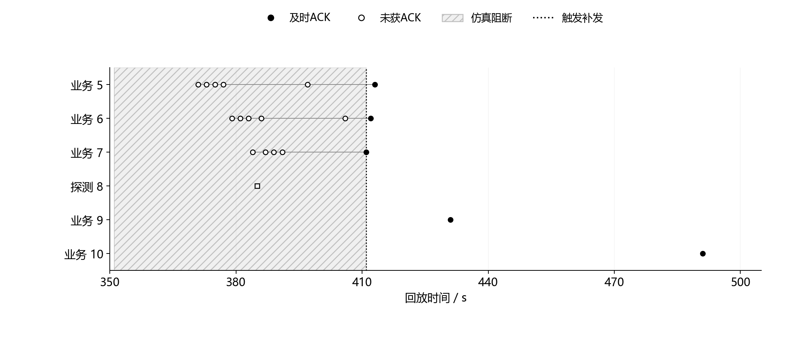
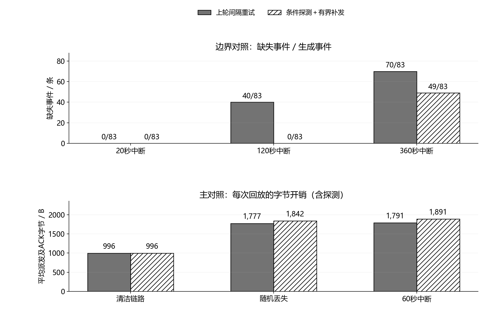

# 断连恢复与有界补发：第八轮验证

2026年10月6日。本轮按[执行计划](../docs/断连恢复与有界补发_分项执行计划.md)，集中处理第七轮120秒中断后事件无法恢复的问题。新增主机参考发送端，复用原有精简帧和接收事务，诊断、1Hz采集、十秒主窗与三秒待复核规则均未改。申报书、网站、三维、PPT和控制功能未改。

条件探测与有界补发在本批120秒中断对照中送达83/83条事件，上轮候选只送达43/83条；清洁链路没有新增探测字节。但300秒保留期限和16条未确认容量仍构成限制：360秒中断缺49/83条，ACK全部丢失的未使用种子检查缺9/83条。**本轮完成的是有边界的软件参考实现，尚不能写成无线链路可靠性已通过实测。**

## 一、实施和分项验收

| 分项 | 验收条件 | 实际证据 | 结论 |
|---|---|---|---|
| 8A 恢复与身份 | 有效且及时的ACK才能证明近期连接；原身份、正文和采集时间不变；重开不重置业务预算 | 实际SQLite文件上的17项检查，覆盖重复/错误/迟到ACK、来源冲突、旧快照、重开及时间回退 | 所列检查通过；没有突然掉电、实际无线或时钟同步验证 |
| 8B 预算与容量 | 初始≤8次、追加≤4次；未确认≤16、探测≤1、历史≤64；过期/淘汰/拒绝明确记录 | 19项检查；1000条连续事件后历史上限仍为64；容量满和过期边界反例 | 逻辑容量与预算检查通过；未定义STM32存储布局 |
| 8C 配对回放 | 同一输入和链路随机数，逐条复算；旧失败保留；探测计入开销 | 最终648组结果、原持续探测576组均复算一致；252组上轮候选对照指标不变 | 复现检查通过；送达效果有下述失败边界 |
| 8D 图像与证据 | 正确标注、文字不裁切/碰撞、灰度可区分；最终PNG查看 | 两张图保存PNG/SVG及制图脚本；最终图片逐张检查 | 独立图片检查通过；未插入Word，不代替页内打印验收 |

分项原始记录：[身份](../simulation/bounded_recovery_review/identity_acceptance.json)、[预算与容量](../simulation/bounded_recovery_review/budget_acceptance.json)、[逐条复算](../simulation/bounded_recovery_review/replay_acceptance.json)。四项的“通过”只对应表中条件，不代表所有中断场景达到零缺失。

## 二、恢复依据、次数和期限

[RecoverySender](../prototype/recovery_transport.py)不接收“中断已经结束”的提示。消息派发后至少8秒仍未确认，且最近8秒没有其他有效ACK时，才允许使用普通遥测帧进行探测，两次探测至少间隔30秒。探测使用最近提供的快照，其采集序号、运行时间和数值保持原样；没有待确认消息，或业务正常及时确认时，不额外探测。AUX就绪仅表示可以尝试本地派发，不能证明远端接收。

ACK需要匹配设备、会话、消息序号和正文指纹，且对应一条实际预留过派发的记录。最近一次派发后8秒内的有效ACK可以作为近期双向链路证据；若前一确认已超过8秒或此前没有确认，尚未确认且仍有追加预算的旧业务记录转入恢复派发。普通业务ACK也可以触发这个过程，不必等待专用探测。迟到ACK可以补记接收，但不能重新激活旧队列；重复历史ACK也不能再次启动恢复。指纹和CRC是匹配与差错检查，本实现不提供认证机制。

初始最多派发8次，保持上轮间隔策略；恢复阶段每条最多追加4次，间隔2秒，整个生命期最多12次派发预留。及时恢复可能使某条消息在初始次数尚未用完时转入追加阶段，所以实际次数可以少于12。再次断连、进程重开或收到多个恢复ACK，都不会清零追加预算。程序限制每秒最多一次派发预留；这不是测得的空口吞吐量，真正的串口发送、模块忙闲与无线耗时仍须实物联调。

期限仍为入队后300秒，没有为了得到零缺失而延长。到期即停止派发并记录过期；若相符ACK晚到，在历史仍保留时可记为晚到确认。发送端正常重开分配新会话，旧业务记录仍用旧身份；新会话不沿用旧快照构造新的采集记录，避免把旧时间改成新启动时间。主机时间必须连续且不回退，实际节点重启后的时间映射另行实现。

图1　受限场景的一段派发记录。每行是一条消息，行名数字为消息序号，设备和会话均为1；连线只连接同一消息的派发尝试。横轴为共同仿真时钟，等于内部一秒索引加一。阻断区间为351—411秒；业务7在411秒收到有效ACK后，业务6与5分别在412、413秒用原字节补发。业务5的采集时间仍为371秒，业务6仍为379秒，不能写成412、413秒的新采集。探测8没有收到ACK，没有触发恢复。

## 三、有界保留与拒绝记录

16个业务槽包含初始重试、追加重试和耗尽次数后的停放记录。停放没有释放容量，因为这些记录仍可能需要确认或补发。探测单独占1槽，满业务队列不能阻止探测；失去确认的探测在30秒后退出该槽。终态与拒绝共用64条历史环，超过后淘汰最旧记录，同时累积统计淘汰数。拒绝记录保存原因、时间和来源采样序号/事件码，但不为未入队消息分配业务身份。

历史环中仍保留的事件来源可以重复查询，返回原消息，不重新入队。当前会话已淘汰事件形成来源水位；不在保留记录中且采样序号不高于水位的事件被明确拒绝。这个约束以顺序生成事件为前提，也会拒绝晚到的旧来源，不能称为任意乱序事件流的无损去重。曾被容量拒绝的来源没有算作已接纳事件，裁剪其拒绝记录不会妨碍以后重新申请入队。

1000条连续入队、派发、确认后，历史最多64条，累计淘汰936条。压力检查观察到的历史帧最大字节量为3648B，主机SQLite文件为36864B；二者含义不同。按配置，最多16业务＋1探测＋64历史＋1元数据逻辑记录，帧与最近快照的保守字节界限为5219B，**这不包括SQLite页、索引、元数据、事务日志、程序和临时缓冲**，不是单片机RAM或Flash预算。没有突然断电或Flash磨损测试。

当前不覆盖未确认记录来接纳新消息。满队列会拒绝新业务，并增加拒绝累计数；过期后释放槽，但过期不等于送达。上轮候选只把正在重试的记录计入16槽，次数耗尽后的无确认记录继续保留在无界历史中。本轮对未确认保留和历史都加了约束，因此两者差异包含存储策略改变，不能全部归因于探测规则。

## 四、配对结果与字节代价

主对照使用上轮72条合成轨迹，各运行两种策略和三种链路条件，共432组；每个策略/条件合计生成328条事件。20/120/360秒边界使用上轮12条轨迹，形成72组，每个长度和策略生成83条事件。另保留48000/48001种子形成的72组重复挑战；条件探测修订后才运行未使用的49000/49001种子，形成72组留出检查。总计648组配对结果，不是648次独立台架试验；同轨迹的不同网络条件和策略相互关联，新种子也仍使用同一个水力模型。

| 主对照条件 | 上轮：接收 / 生成事件 | 本轮：接收 / 生成事件 | 上轮平均字节 / B | 本轮平均字节 / B | 本轮相对增加 |
|---|---|---|---|---|---|
| 清洁链路 | 328 / 328 | 328 / 328 | 995.51 | 995.51 | 0% |
| 20%数据丢失＋25%ACK丢失 | 328 / 328 | 328 / 328 | 1777.46 | 1842.38 | 3.65% |
| 60秒中断 | 328 / 328 | 328 / 328 | 1791.39 | 1890.56 | 5.54% |

60秒中断的已接收事件最大首次延迟从66秒降为52秒；随机丢失主对照两种策略均为6秒。字节量包含所有派发预留以及接收端生成的ACK，探测已计入；丢失的派发和ACK也计入。没有电流、空口时间、模块休眠或能耗测量，不能把字节差直接换算为节能率。

| 单次中断 / s | 上轮：接收 / 生成 | 本轮：接收 / 生成 | 上轮缺失 | 本轮缺失 | 本轮过期业务消息 | 本轮容量拒绝 |
|---|---|---|---|---|---|---|
| 20 | 83 / 83 | 83 / 83 | 0 | 0 | 0 | 0 |
| 120 | 43 / 83 | 83 / 83 | 40 | 0 | 0 | 0 |
| 360 | 13 / 83 | 34 / 83 | 70 | 49 | 60 | 7 |

120秒对照中，平均字节由3495.25B增为3982.25B，增加约13.93%；本轮最大首次延迟116秒。上轮最大98秒仅统计其已接收的43条，其余40条缺失，不能直接用98与116比较完整送达效果。360秒中断超过300秒保留期限，部分记录已过期，队列也达到16槽；60条过期和7条拒绝包含遥测与事件，不能与49条缺失事件相加。即便该组期末未确认槽为零，仍有缺失。

图2　单次中断边界及主对照字节开销。上半图以缺失/生成事件标注，三个边界各有12组配对轨迹；下半图为每组平均主机字节量，各条件有72组配对轨迹。实心和斜线纹理区分策略，标注为四舍五入显示值，完整小数保存在CSV中。

第一次持续探测版本也已完成576组并通过复算，清洁链路平均3141.68B，约为上轮3.16倍。因此保留旧结果后，在同一工作包内修订为条件探测；最终清洁链路不再发送额外探测帧。该修改参考了已经看到的结果，原主对照、边界和48000系列均不能再当作未见数据。持续探测的代码、配置、数据和原验收均保存在[初次实验目录](../simulation/bounded_recovery_review/initial_continuous_probe/README.md)，最终验收加载其中旧发送端源码，576组逐条复现，未覆盖不利结果。

## 五、ACK单向失败与未使用种子检查

| 49000系列条件 | 上轮：接收 / 生成 | 本轮：接收 / 生成 | 本轮缺失 | 本轮容量拒绝 | 本轮过期业务消息 |
|---|---|---|---|---|---|
| 随机丢失 | 83 / 83 | 83 / 83 | 0 | 0 | 0 |
| 两次60秒中断 | 83 / 83 | 83 / 83 | 0 | 0 | 0 |
| 数据可达、ACK全部丢失 | 83 / 83 | 74 / 83 | 9 | 10 | 171 |

每行条件、每种策略各12条轨迹。两次中断分别施加于内部索引[350,410)和[440,500)，即仿真时间[351,411)和[441,501)。随机丢失中，上轮已接收事件最大首次延迟13秒，本轮15秒；重复中断分别为67与56秒。本轮没有在所有延迟指标上胜出。

ACK全部丢失时，接收端可能已有记录，发送端却无法确认，探测也得不到双向证据。保留16条未确认记录会使后续新消息被拒绝，最终缺9条事件；上轮候选在无界终态历史中保留181条无确认业务记录，因此仍能不断接纳新消息。上轮接收事件完整不代表发送端确认完成，本轮存储有界也不代表送达完整。48000系列同类挑战缺12/91条；全程不可达则两种方案均缺91/91条。这些是必须保留的反例。

## 六、验收收尾和下一步边界

两张最终PNG分别查看，时间图将每条消息单独列行，避免多个重试标记拥挤到同一行。横轴、阴影、消息序号、ACK与补发时刻均对应实际软件记录；图例和正文足以解释。字号不少于11pt，文字边界和碰撞检查通过；图中不依靠颜色区分策略。源文件见[制图脚本](../scripts/plot_bounded_recovery.py)与[图像检查](../simulation/bounded_recovery_review/figure_checks.json)。这些是独立图片的验收，尚未进行Word插入或纸面尺寸检查。

证据入口：[冻结参数](../simulation/bounded_recovery_review/frozen_parameters.json)、[主对照](../simulation/bounded_recovery_review/paired_results.csv)、[中断边界](../simulation/bounded_recovery_review/boundary_results.csv)、[重复挑战](../simulation/bounded_recovery_review/new_seed_results.csv)、[未使用种子检查](../simulation/bounded_recovery_review/holdout_results.csv)、[恢复过程记录](../simulation/bounded_recovery_review/recovery_example.json)、[验收脚本](../scripts/validate_bounded_recovery.py)。基线代码和前轮证据未改，申报书继续等待方案稳定后统一修订。

本轮可保留条件探测与有限补发作为实现候选，300秒期限和16槽是明确工程边界。下一分项先确定满队列时事件与遥测的接纳优先级、允许舍弃哪些旧遥测、如何记录舍弃，针对ACK单向失败再做同信息对照；不能依靠无限重试或无界日志回避问题。随后冻结单片机移植输入、整数诊断等价与存储布局，进入实际串口、ADC/计数时序和台架验证。保持这一顺序，不再扩展研究主题。
