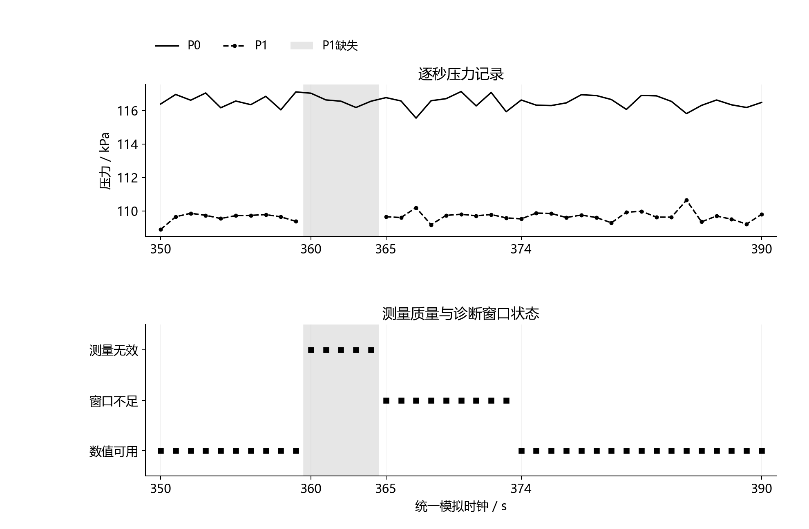
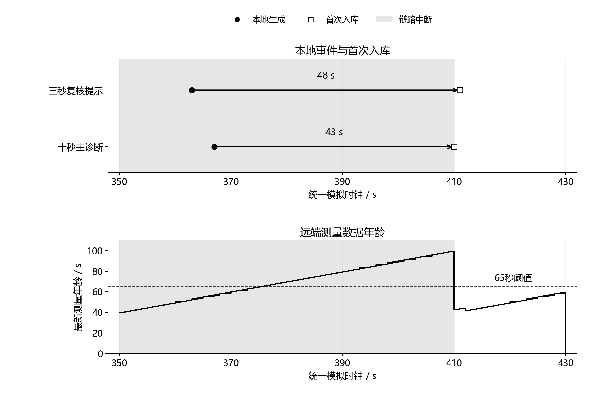

# 采集、诊断与接收持久化：第六轮软件联调

2026年10月6日。本轮将一秒压力与计数输入、十秒主诊断、三秒待复核提示、事件队列和接收持久化接成一条可回放的软件链路，完成三个独立验收环节。当前证据支持主机程序在指定合成场景及链路假设下正确传递记录，尚不支持STM32、真实LoRa、台架故障识别或田间性能结论。申报书、项目书、网站、三维模型及PPT均未改动。

## 一、约束、输入与判定边界

算法沿用已冻结的健康参照和门限，固定一秒压力采集及连续计数快照，主诊断采用十秒实际压力窗口与同时间范围的计数流量；三秒短窗连续两点满足条件后产生待复核提示。主诊断仍需连续五点确认，输出泄漏形似、受限形似或不确定模式。未因为加入短窗而降低主诊断确认要求，也没有增加自动阀门控制。

本轮采用12类场景、三个压力噪声标准差及四个新种子，共144条合成轨迹。场景包括正常、供压变化、90秒渐进泄漏、90秒渐进受限、8秒泄漏、切换快速泄漏，以及压力缺失、越量程尖峰、计数复位、初始标定缺失、初始已有故障和压力漂移。压力噪声标准差为0.3、3、10kPa，种子为45000—45003；水力模型、流量噪声和540脉冲/升假设沿用前轮，不重新拟合门限。

独立健康许可与数值校准分别记录。程序默认没有健康许可，实验回放在明确的配置前提下授予许可；初始已有故障场景不授予许可，用于检查禁止诊断的逻辑。这样的设置不代表系统能自动发现初始化故障，也不能消除“健康许可授错、增益吸收初始故障”的既有问题。实施时必须依靠独立参考测量和操作检查建立健康基准。

网络对照包括无丢包、数据丢包20%且ACK丢失25%、350≤t＜410秒完全中断。相同采集记录用于三种链路，共432组传输回放；同一网络种子的随机数跨场景和噪声设置复用，因此这些记录是配对软件对照，不是432次独立无线实验。发送上限为每秒一个逻辑包，重试间隔两秒，正常状态每60秒发送；有事件时立即入队，仿真结束后另观察120秒补传。

数据时效按采集时间计算。65秒只是本轮与60秒定期上报配套的可配置软件阈值，不是通信模块的超时规格；数据过期不等同于确认无线断连，数值可用也不等同于确认健康。当前程序要求输入时间逐秒连续，实际采集停顿、时钟漂移和设备重启后的会话切换尚需另外实现。

## 二、6A：三秒复核的逐秒实现

此前三秒短窗使用完整数组回放。本轮新增逐秒模块，只接收当前时间、当前双压力和当前累计计数；短窗流量通过四个计数端点中首尾差构成三秒估计，压力采用同一时间范围的三个实采点。初始校准仅保存20—119秒的历史短窗记录，129秒使用已经形成的本地基准计算短窗噪声门限，不读取后续轨迹或故障操作标签。

144条轨迹完成62,892条短窗记录及130次提示事件的参考一致性核对，逐点数值、有效状态、异常条件和事件时刻均与第五轮整段参考实现一致。另对五类代表场景独立计算窗口、核对连续两点确认，并修改370秒以后的输入，验证既有记录及事件不受未来数据影响。初始标定缺失的试次不启用短窗；“没有输出”在这里意味着基准不可用，不能解释为未发生异常。

该环节通过的是实现一致性与因果性验收，没有重新证明短窗优于主诊断。前轮发现的高噪声缓变提示迟报、短时故障达到模型15%参照之后才提示，以及压力漂移产生故障形似证据等边界继续保留。

## 三、6B：统一状态与完整逻辑载荷

每条节点记录保存采集时刻、运行身份、双压力、累计脉冲、十秒流量、测量状态、数值基准是否可用、健康许可、短窗有效性、待复核状态和主诊断模式。压力缺失转成JSON空值，不用零替代，也不插值补齐；接收端拒绝非有限JSON数值。质量变化、具体测量问题、短窗提示和主诊断事件分别保存，事件身份与记录内容保持不变。

不可用状态包括健康参照未确认、标定不可用、压力质量不合格、窗口不足和运行域不满足。质量异常后等待窗口重新形成，不能将刚恢复的一点测量直接用于十秒诊断。当前没有诊断证据记为“无当前证据”，不能据此生成“已恢复正常”“维护完成”或“阀门已关闭”；这些结论需要后续独立操作、复测或执行反馈。

144条轨迹的状态记录完成复算。此外使用实际本地SQLite文件验证完整包重启读取、ACK丢失后的重复接收、事件内容冲突时整包回滚，以及非有限载荷拒收。完整测量与事件在同一事务中提交之后才返回ACK。旧包随后到达时，最新测量按采集时刻选择；数据年龄也使用采集时刻，不因旧包刚收到而清零。

以下边界按窗口端点逐项核对：

| 输入问题 | 主诊断不可用范围 | 重新达到数值可用条件 | 验收解释 |
|---|---|---|---|
| P1在360—364秒缺失 | 360—373秒 | 374秒 | 365秒重新读取后，还需十个连续压力点 |
| P0在360秒超出假设量程 | 360—369秒 | 370秒 | 越量程点被剔除，不与后续正常点混成完整窗口 |
| 累计计数在420秒复位 | 420—429秒 | 430秒 | 等待计数区间重新完整，不把负差当流量 |

图1　压力缺失与主诊断窗口恢复。示例来自噪声标准差0.3kPa、种子45000的压力缺失场景；灰色区域对应五个缺失采样点。曲线与状态直接取自本轮逐秒记录，374秒的“数值可用”仅表示满足当前输入检查和窗口条件。

## 四、6C：事件送达、补传与数据时效

432组回放均完成生成事件与接收事件的逐条内容核对，已接收测量与原节点记录相同，期末没有事件缺失、额外事件、重复事件行或待发送包。每个链路模式对应相同的518条生成事件；这518条由144条采集轨迹产生，不可当作518次独立故障实验。对于无事件的正常轨迹，仍传送定期状态和末尾测量，不依赖发生故障才建立接收记录。

| 软件链路模式 | 回放组数 | 最大事件首次入库延迟 | 每组平均发送尝试 | 监测期数据过期时长 |
|---|---:|---:|---:|---:|
| 无丢包 | 144 | 0个模拟时钟步 | 11.28次 | 0秒 |
| 随机数据丢包与ACK丢失 | 144 | 8秒 | 18.46次 | 本批均为0秒 |
| 350—410秒完全中断 | 144 | 50秒 | 40.46次 | 本批每组34秒 |

无丢包时的零时钟步表示同一仿真秒内完成函数调用与提交，不意味着真实传输或磁盘写入零耗时。本轮没有LoRa空中传输时长、模块缓冲、串口波特率或业务认证模型；发送尝试也包括重试，不能直接换算为节能比例。观察期末清空只证明本批有限队列在指定中断和120秒补传期内送达，不保证任意持续中断、任意缓存容量下都能恢复。

联调出现了事件送达乱序：8秒泄漏示例中，三秒复核提示在363秒生成、411秒首次入库，十秒主诊断在367秒生成、410秒首次入库。原因是较早事件上次重试发生于409秒，410秒尚未达到两秒重试间隔，后生成的事件先获得发送机会。这种情况不能靠接收顺序改写故障发生过程，必须同时保留生成时刻与入库时刻。

图2　事件生成、首次入库及远端测量数据年龄。示例来自噪声标准差0.3kPa、种子45000的8秒泄漏场景。376—409秒远端数据超过65秒年龄阈值；410秒接收补传后使用367秒的测量记录，随后411秒收到更早的363秒记录也不覆盖它。所有时刻来自软件模拟，并非无线实测。

本轮示例包的完整JSON业务正文为426—717个UTF-8字节，尚未计入本地包序号包装和真实通信协议开销。这里的“完整”指主机中明确保存了测量、状态及事件字段，不表示这些JSON可以直接作为所选LoRa模块的单帧负载。这一结果反而给出了下一步任务：精简编码、划分测量与事件帧、明确序号和会话身份，再核查模块帧长、缓存及串口设置。

## 五、分项结论与后续执行

| 分项 | 当前验收结论 | 不在该结论内 |
|---|---|---|
| 6A 逐秒短窗 | 144条轨迹参考一致；五组独立窗口与未来输入核验通过 | 故障类型确认、田间精度、短窗普遍优越性 |
| 6B 状态与记录 | 144条轨迹状态复算；完整载荷事务、重启读取、去重、冲突回滚、数据年龄核验通过 | 自动确认初始健康、突然断电、STM32存储与时钟 |
| 6C 联合链路 | 432组有限链路回放内容相同、期末送达；补传不覆盖新测量 | 实际无线时延、射频性能、任意长中断及容量保证 |
| 6D 图表 | 两张灰度图按数据生成，检查字号、文字边界及碰撞，并逐张查看最终PNG | Word最终打印尺寸及页内排版 |

本轮初步联调后补充了数据年龄检查，重新冻结配置并重跑6A、6B、6C，最终验收文件均对应同一参数摘要。健康许可、质量状态和通信确认的含义已经分开；算法仍保留原有反例，不能因为系统链路跑通就写成水路故障性能已验证。

下一工作包优先完成通信帧和采集时序设计：先依据候选模块确认串口与负载约束，给出测量帧、事件帧、ACK及会话身份；再用完整记录核对编码解码、重复、乱序、缺帧和重启行为。只有协议与采集边界明确后，才进入STM32移植、真实串口及LoRa联调。真实传感器标定和健康参照确认仍是台架诊断的前置条件；申报材料后续只纳入已经得到相应证据的内容。

分项文件：[执行计划](../docs/端到端软件联调_分项执行计划.md)、[冻结参数](../simulation/integrated_monitor_review/frozen_parameters.json)、[6A验收](../simulation/integrated_monitor_review/streaming_acceptance.json)、[6B验收](../simulation/integrated_monitor_review/semantics_acceptance.json)、[6C验收](../simulation/integrated_monitor_review/transport_acceptance.json)。原始对照见[逐秒一致性结果](../simulation/integrated_monitor_review/streaming_results.csv)、[状态结果](../simulation/integrated_monitor_review/semantics_results.csv)、[传输结果](../simulation/integrated_monitor_review/transport_results.csv)及[图示示例记录](../simulation/integrated_monitor_review/examples.json)。
