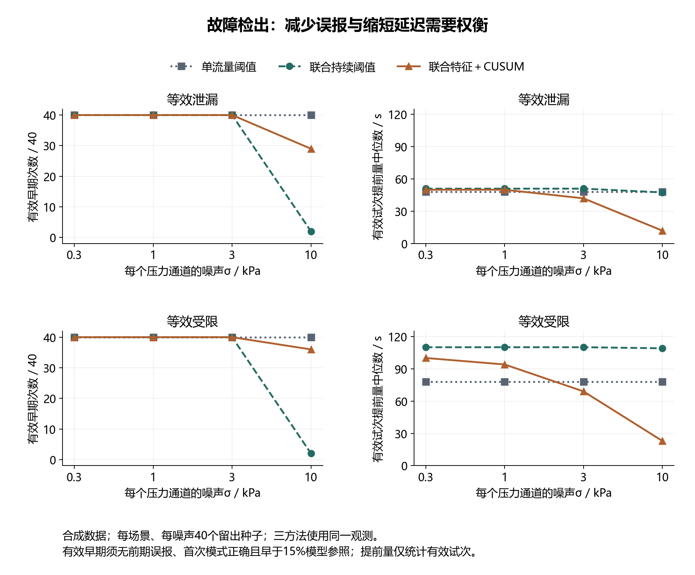
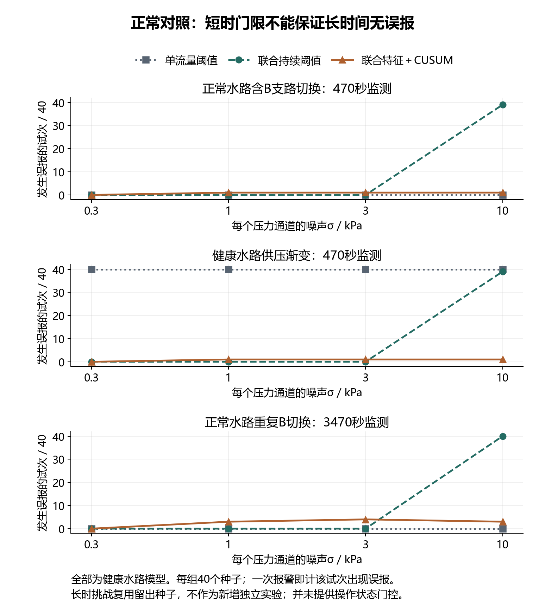
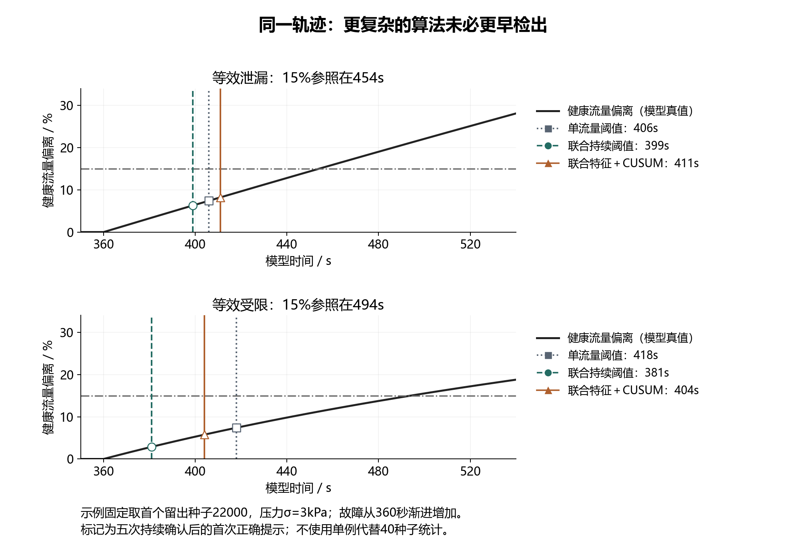

# 压力—流量诊断算法：第一轮对照验证与工程取舍

2026年10月6日。本轮沿用双压力与总流量的水力模型，新增正常数据门限标定和独立种子测试，比较单流量阈值、联合特征持续阈值与联合特征CUSUM。所有结果均为未标定合成数据；本轮完成的是候选算法的离线可行性分析，没有新增实物、田间数据或能耗实测。

## 1. 对项目路线的判断

项目可以继续沿“压力—流量联合分析、事件触发采集、可靠传输与人工复核”推进。现有联合特征在模型匹配时能够抑制供压变化造成的假故障，并较早发现局部受限；引入CUSUM后，高压力噪声下的误报减少，但部分工况的检出时间变晚，且长时间运行仍出现误报。因此，CUSUM有继续对照研究的价值，当前应保留为候选方法，尚不适合替换原方案或在申报书中写成已经验证的全面性能提升。

这轮验证也明确了后续研究应解决的具体问题：正常轮灌操作与异常如何区分，初始健康参照能维持多久，传感器漂移如何影响判断，以及减少误报要付出多少检测延迟。算法名称本身不构成创新；在支管巡检的实际约束下，用可复核的数据说明这些取舍，才可能形成研究贡献。

## 2. 对照条件与参数来源

三种方法使用完全相同的P₀、P₁、Q观测，固定每秒取得一组数据，使用因果10点均值和相同的5次持续确认。健康参照均取初始20—119秒的数据，监测从130秒开始。5次确认在1 Hz下首末相隔4秒；这是现有固定采样诊断规则，不能与事件采样回放中的“至少两次真实观测且历时5秒”混为一谈。

| 方法 | 判断量 | 本轮规则 |
|---|---|---|
| 单流量阈值 | Q相对健康参照的变化 | 增加超过6%提示泄漏模式，下降超过6%提示受限模式 |
| 联合持续阈值 | K＝Q/√P₁；R̂＝(P₀−P₁)/Q² | K相对参照增加超过6%，或R̂增加超过0.6 kPa/(L/min)² |
| 联合特征CUSUM | 相同K与R̂偏离，经初始健康波动尺度归一化 | 分别累积正向偏离；两路同时越限输出“模式不确定”；越限后仍需5次持续确认 |

CUSUM采用逐步更新的正向累积量：Sₜ＝max(0，Sₜ₋₁＋zₜ−k)，当S超过相应门限h时产生候选提示。本轮k固定为0.5；无效压力或流量观测将累积量清零。公式和算法来源见[NIST CUSUM控制图说明](https://www.itl.nist.gov/div898/handbook/pmc/section3/pmc323.htm)。NIST给出的示例门限没有直接移植到本项目。

归一化尺度由每条记录初始健康段的1.4826×MAD估计，并设置K相对尺度0.003和R̂尺度0.03的下限。这两个下限是本轮候选设定，尚未经过传感器标定。门限只用40个训练种子、4个压力噪声等级、正常及健康供压渐变两类场景，共320条健康轨迹确定；每路取健康轨迹的最大累积峰值再乘1.10，并设最小门限5。冻结结果为h_K＝362.7049、h_R＝419.7514，均为归一化累积量的无量纲门限。

较大的门限说明本轮短健康段标定、连续重叠均值和多噪声工况带来了明显累积波动，不能据此照搬常规独立样本的报警概率。这里通过完整健康轨迹校准门限，保留了10点重叠窗口的相关性；并未证明长期误报概率已受控。训练观察到零误报也是该选参方法的直接结果，不是独立验证结论。

测试使用另外40个种子，训练与测试种子无交集。六类场景和四个压力噪声等级共960条合成轨迹，三方法形成2880条配对记录。同一基础噪声序列在不同场景、不同噪声等级中复用，因此不能把960条记录当作960次独立物理实验，也没有计算这样的合并置信区间。噪声σ＝0.3、1、3、10 kPa是敏感性假设，不是传感器厂家准确度。

## 3. 故障检出结果

“有效早期”须同时满足：故障发生前没有确认误报；故障发生后的首次确认模式正确；确认时刻早于模型真值所定义的同工况健康总流量偏离15%的参照。15%仅为本轮模型评价尺度，未对应作物损失、学校验收或农业标准。故障在360秒开始，180秒内渐进增加，评价程序读取真值，在线诊断程序不读取故障时间或程度标签。

| 压力噪声σ / kPa | 故障 | 单流量阈值：有效早期 / 40 | 联合持续阈值：有效早期 / 40 | CUSUM：有效早期 / 40 |
|---|---|---:|---:|---:|
| 0.3 | 泄漏 | 40 | 40 | 40 |
| 0.3 | 受限 | 40 | 40 | 40 |
| 1 | 泄漏 | 40 | 40 | 40 |
| 1 | 受限 | 40 | 40 | 40 |
| 3 | 泄漏 | 40 | 40 | 40 |
| 3 | 受限 | 40 | 40 | 40 |
| 10 | 泄漏 | 40 | 2 | 29 |
| 10 | 受限 | 40 | 2 | 36 |

低噪声下，三方法的有效检出次数相同，CUSUM没有带来次数上的提升。σ＝0.3 kPa时，联合持续阈值与CUSUM的泄漏提前量中位数分别为51秒和50秒，受限分别为110秒和100秒；σ＝3 kPa时，泄漏分别为51秒和42秒，受限分别为110秒和69秒。这里对应每组全部40个有效试次，说明当前CUSUM参数在这些工况下产生了额外延迟。

σ＝10 kPa时，联合持续阈值在两类故障中各有38条记录出现故障前误报，只剩各2条有效早期记录；CUSUM消除了这两组故障记录的前期误报，泄漏29条、受限36条满足有效早期，其余11条泄漏和4条受限均为晚于或恰好达到参照时才确认，并非完全漏检。CUSUM在有效记录中的提前量中位数分别为12秒和23秒。不同方法的有效记录集合不同，不能只比较这些条件中位数，就宣称某一种方法整体更快。

单流量阈值在四个压力噪声等级中都能检出本轮所设故障，因为流量噪声始终保持0.02 L/min，压力噪声不会直接进入该方法；但它在健康供压下降场景中全部发生误报。这个基线仍然有价值，不能因其“简单”而忽略，也不能仅用稳定供压故障结果称它足以应对实际轮灌。



## 4. 正常对照与对抗性检验

| 压力噪声σ / kPa | 健康供压渐变：单流量误报试次 / 40 | 健康供压渐变：联合持续阈值 / 40 | 健康供压渐变：CUSUM / 40 | 长时健康水路：CUSUM误报试次 / 40 |
|---|---:|---:|---:|---:|
| 0.3 | 40 | 0 | 0 | 0 |
| 1 | 40 | 0 | 1 | 3 |
| 3 | 40 | 0 | 1 | 4 |
| 10 | 40 | 39 | 1 | 3 |

短时正常对照覆盖130—600秒，即470秒、471个采样点；另将正常水路延长至3600秒，重复健康B支路开关，监测时长3470秒、3471个采样点。长时挑战复用测试种子，三方法共480条记录，属于另一个观察时长条件，不能当作新增独立实验。σ＝3 kPa时，CUSUM有4/40条长时记录出现误报，而现有联合持续阈值为0/40。短时门限不能保证长期监测不误报，初始参照的小偏差在累积过程中会暴露出来。

未知健康负载增加与等效泄漏在当前模型中产生完全相同的三通道观测，CUSUM输出也完全相同；该问题属于观测信息不足，不能通过更换累积算法解决。入口压力传感器漂移也会使联合方法输出受限模式。实际系统应先输出支管异常模式供人工核查；本轮结果不支持让这一判断直接驱动真实关阀。

另完成12条无随机噪声的反例轨迹，三方法共36条判断记录：P₁时间错位0、0.1、1、5秒，以及健康负载指数0、0.3、0.5、0.8与供压80、160 kPa组合。当P₁错位5秒时，联合持续阈值和CUSUM都发生误报；健康负载不服从平方根关系时，两种联合方法在部分供压变化中均误报。时间对齐、健康负载标定和操作记录因此是必要的工程任务，不能放到算法之后再处理。





## 5. 申报、大创实施和论文各如何安排

申报阶段保留现有系统路线，将CUSUM作为联合特征变化检测的候选对照方法。可表述为：“围绕轮灌支管压力与流量的连续变化，构建联合特征及累积变化检测方法，对比固定阈值与累积统计在正常操作扰动、渐进故障及传感器漂移条件下的误报和检测延迟，确定可检边界与参数适用范围。”已有工作只能表述为完成合成数据配对分析，不能写成完成实物诊断、验证节能或达到某个真实识别率。本轮结果单独保存，尚未修改已经满意的申报书正文及插图。

大创实施先完成真实健康水路的跨供压标定、两压力时间对齐和流量计数验证，再采集独立故障操作数据。算法选择须以实测健康波动和操作对照为依据；固定阈值保留为可回退的基线。STM32上所需的两路累积更新计算量有限，但本轮没有编译固件、计时或验证存储与接口，不能写成已部署。事件触发采集单独评价，之后再与诊断方法组合；本轮1 Hz算法表现不能直接推给5秒或更长间隔的数据。

论文方向可继续围绕“不同工况信息与采样策略下，支管渐进异常的可靠检出边界”展开。提交论文前需要真实独立批次、健康及正常操作对照、固定参数留出验证、故障程度参照和强基线。当前仅更换了随机种子，水力公式、故障类型、发生时刻和增长速度都相同，不构成跨田块、跨系统或真实泛化证明，也不据此承诺论文档次。

## 6. 下一工作包与具体验收

下一步只处理“正常工况参照与门控”，暂不同时扩展神经网络、自动阀控或网站模块。先建立正常供压、B支路操作与健康负载变化的参照约束，再用新协议检查它是否减少误报，同时保留切换期间出现故障的反例，避免单纯屏蔽操作时段获得好看的结果。随后才进入算法与事件采样的组合回放。

| 顺序 | 要做什么 | 必须满足的验收条件 |
|---|---|---|
| A 定义可获得的工况信息 | 明确节点能获得哪些操作记录、哪些仅供评价 | 三种算法输入可比；不得向诊断程序泄露故障时间、真值程度或不可获得的B阀态 |
| B 健康参照与失配试验 | 比较固定平方根关系与健康标定参照；加入不同增长速度、发生时刻和记录长度 | 训练与测试按完整运行分开；参数先冻结；正常切换、漂移和未知负载不得从统计中删除 |
| C 误报与延迟配对比较 | 用一致观察时长比较基线与候选 | 报告误报试次、事件次数、每小时误报及漏检；提前量比较明确对应记录集合；失败结果保留 |
| D 自适应采样组合 | 使用实际取得的样本重放算法，不补入休眠期间的隐藏观测 | 非等间隔统计重新设计与校准；比较时分离算法增量和采样增量；没有电流测量就只报告采集与通信次数 |
| E 进入正式材料 | 根据通过的结果决定哪些图与表有必要使用 | 图注明合成身份，正文不宣称实测；只采用回答研究问题的图；保持现有学校模板格式 |

本轮程序检查包括参数及源文件哈希锁定、2880条配对结果重算、CUSUM递推独立核对、改变未来数据不影响历史输出、无效观测重置、未知负载观测同形和统计汇总复核。三张图分别提供PNG与SVG，采用不同线型和标记；已修正图例与竖线相交及页脚过近问题，完成实际图像目视检查。程序检查通过只说明这些范围内的计算和图表一致，不代表工程系统已通过实物验收。

## 7. 文件与复现

- 冻结参数与结果：`simulation/cusum_review/frozen_parameters.json`、`summary.json`。
- 原始合成观测：`heldout_observations.npz`；逐条方法结果：`paired_results.csv`。
- 正常标定：`healthy_training.csv`；反例：`stress_results.csv`；长时正常记录：`long_healthy_results.csv`。
- 算法：`simulation/review_cusum.py`；校验：`scripts/validate_cusum_review.py`；绘图：`scripts/plot_cusum_review.py`。
- 计算验收：`simulation/cusum_review/acceptance.json`；文字边界检查：`figure_checks.json`。

运行环境使用本地已有NumPy与Matplotlib。保持本轮结果复现时直接运行测试，不必重新拟合。`--fit`会重新生成训练门限，仅在有意建立新参数版本时使用。

```powershell
$env:PYTHONPATH='C:/Users/Lenovo/.cache/codex-task-deps/dachuang-plots'
$taskPython='C:/Users/Lenovo/.cache/codex-runtimes/codex-primary-runtime/dependencies/python/python.exe'
& $taskPython simulation/review_cusum.py
& $taskPython scripts/validate_cusum_review.py
& $taskPython scripts/plot_cusum_review.py
```
