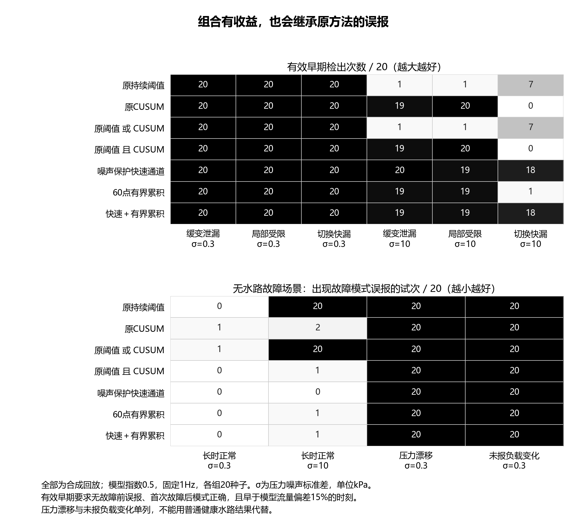
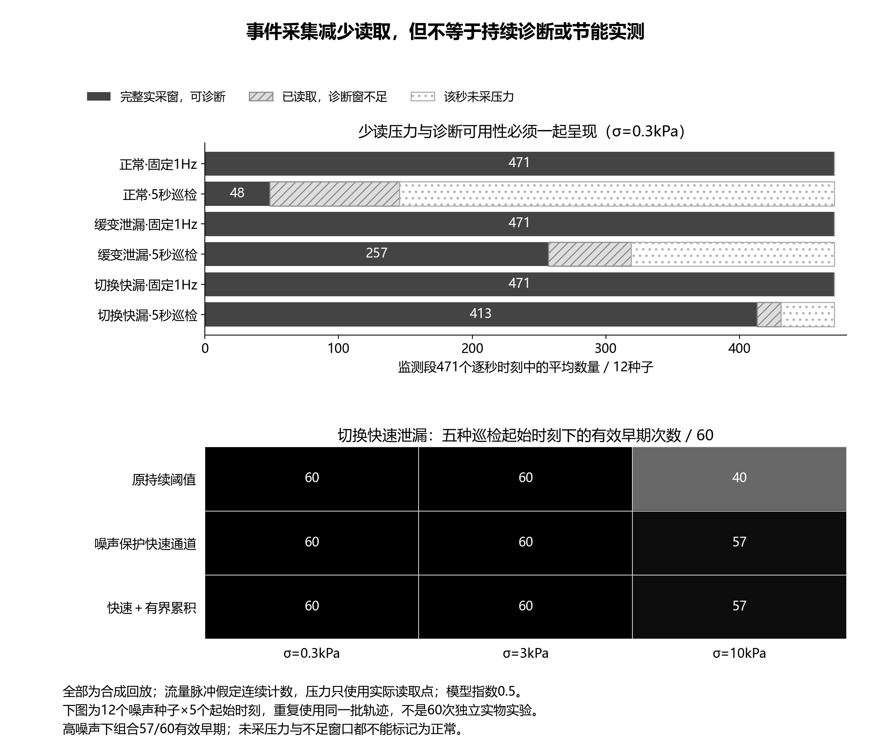
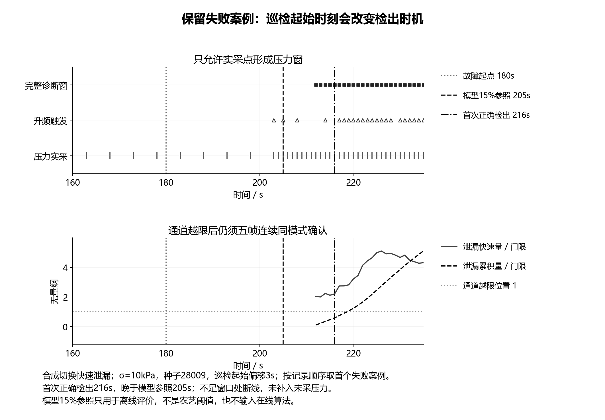

# 组合诊断与事件采集：第三轮验证与工程取舍

2026年10月6日。本轮服务于“算法与采集逻辑先跑通，再修改申报书”的任务。申报书、实施项目书、网站、三维模型与PPT均未据此更新。这里记录的是合成模型上的候选方案、配对结果和失败边界，不能作为实物台架、棉田验证或论文实测结果。

## 1. 本轮结论与方案取舍

快速判断与累积判断存在互补性，值得继续研究，但简单拼接不能同时解决所有问题。“任一通道报警”的组合保留了原阈值的高噪声误报；“两个通道同时报警”的组合保留了CUSUM在快速故障中的延迟。加入健康波动保护和累积长度限制以后，部分场景有所改善，仍出现额外误报、压力漂移误判和巡检相位引起的迟报。现在不能把组合写成已确定的最优算法。

当前取舍是：**固定1Hz采集继续作为实现与评价基线，噪声保护快速通道作为重点候选，60点有界累积作为缓变故障的对照候选；组合方案与五秒巡检均保留在实验分支。** 后续可以研究快速告警与趋势提示分级输出，但本轮尚未测试这种分级规则。已经发生的组合误报仍按误报记录，不能改名为“提示”后从统计中删除。

这样做没有削弱项目的研究目标。项目要回答的是在健康工况变化与传感器扰动存在时，怎样同时控制早期识别延迟、误报和采集开销。找到方法的适用边界，比堆叠算法名称更能形成可信的研究工作；现场部署的默认配置则应等待独立回放和台架数据。

## 2. 组合通道怎样工作

健康参照沿用第二轮已冻结的支路压力—流量拟合关系，不用测试故障重新标定。在线计算两个残差：实际流量相对健康预测的增量，以及单位流量平方对应的压降相对初始健康值的增量。记为 $x_Q$ 和 $x_R$，后者保留 kPa/(L/min)² 的量纲；健康波动尺度 $s_Q,s_R$ 由初始确认健康段的MAD确定并设置下限。初始健康段真实可获得、支路结构与参照一致，是部署前必须满足的条件，本轮模型按此条件生成。

快速通道对每个残差采用 $x_j>\max(\tau_j,6s_j)$，其中原门限为 $\tau_Q=0.06$、$\tau_R=0.6$。乘数6是本轮冻结的候选保护系数，并不是已验证的“六倍标准差置信保证”。健康段样本有限，滑动平均又会引入相关性，不能将这条规则直接换算成现场误报概率。

累积通道采用最近最多60次连续有效更新中的最大正后缀和：

$$
B_j(t)=\max\left\{0,\max_{1\leq\ell\leq\min(60,N_t)}\sum_{i=t-\ell+1}^{t}\left(\frac{x_j(i)}{s_j}-0.5\right)\right\}.
$$

$N_t$ 是当前连续有效更新段长度。在本轮有效诊断更新为1Hz的条件下，60点对应最多60秒；遇到缺测或无效窗重新开始，不能跨间隔把一次更新仍当作一秒累计。这是本项目测试的有界累积变体，不等同于标准无界CUSUM。CUSUM的基本累积思想及门限与识别速度的权衡可参见[NIST控制图说明](https://www.itl.nist.gov/div898/handbook/pmc/section3/pmc323.htm)，本轮数值门限另由健康回放确定，未直接套用文献示例。

本轮组合规则是在每个残差通道内取“保护快速越限或有界累积越限”，再用两个残差通道形成模式判断。流量残差通道单独越限输出泄漏模式，压降残差通道单独越限输出局部受限模式；两个通道均越限输出不确定模式。连续五个有效、逐秒、同模式的诊断帧才确认事件。五帧从第一帧到第五帧相隔四秒，不宜简单写成额外等待五秒。模式仅表示观测与假设的符合程度，不代表已确认真实泄漏位置或故障原因。

## 3. 数据划分、对照与评价规则

本轮先做固定频率的算法消融，再单独改变传感前端验证事件采集，两部分不混在一起报告性能。两部分都使用既有准稳态水力模型、独立高斯测量扰动和新噪声种子；没有加入真实传感器响应、水锤、土壤或作物模型。

| 工作包 | 数据与方法 | 实际记录数 |
|---|---|---:|
| 组合门限训练 | 12个训练种子，4种负载指数，3档压力噪声，4种健康场景 | 576条健康训练记录 |
| 固定1Hz消融 | 20个新种子，4种指数，3档噪声，12个场景，7种方法 | 2880条轨迹、20160条配对结果 |
| 实采窗门限训练 | 指数0.5，沿用12个训练种子，3档噪声，4种健康场景，2种采集配置 | 288条配置训练记录 |
| 实采窗对照 | 另12个新种子，指数0.5，3档噪声，12个场景，2种采集配置，3种算法 | 432条源轨迹、2592条配对结果 |
| 巡检起始时刻检查 | 快速切换泄漏，12个种子，3档噪声，5个起始偏移，3种算法 | 540条相位对照记录 |

训练种子为26000—26011，组合测试为27000—27019，实采窗测试为28000—28011。各层训练与测试种子分离。不同场景、噪声档仍重复使用同一组基础随机数；五种巡检偏移也使用相同轨迹，因此记录数不能写成同等数量的独立实验。模型指数0、0.3、0.5、0.8只是敏感性设定，没有据此认定实际棉田滴灌带的压力指数。

有界累积门限取健康训练峰值最大值的1.1倍并设置下限，固定与自适应实采前端分别训练。固定高斯前端门限为104.914和131.516；实采前端两种配置的门限均约103.845和96.904。数值接近不代表两种采集配置等效。标准CUSUM对照仍使用第二轮健康训练门限，未在本轮故障测试上调参。配置、源文件摘要和门限在测试前保存，测试后没有用结果回调门限。

“有效早期”须同时满足：故障前无故障模式误报；故障后的首次确认模式正确；确认时刻早于模型中流量偏离同工况健康值15%的时刻。15%仅是本次离线评价参照，不是作物损失阈值，也不输入在线判断。提前量的中位数只对有效早期试次计算，必须同时给出其分母；一个试次取得较大提前量不能抵消其他试次的误报或迟报。长时健康监测为3470秒，包含3471个逐秒读取时刻。

## 4. 组合的收益与反例

以下均取模型指数0.5；σ是压力测量噪声标准差，单位kPa。其他模型指数的逐条结果保留在CSV中，下面的表不代表全部场景通过。

| 场景与指标 | 噪声保护快速通道 | 快速＋有界累积 | 解释 |
|---|---:|---:|---|
| 缓变泄漏，σ=0.3，有效早期 / 20 | 20 | 20 | 两者均检出，但组合能提前 |
| 同场景，有效提前量中位数 | 51秒 | 65.5秒 | 均以20个有效试次计算 |
| 缓变泄漏，σ=10，有效早期 / 20 | 20 | 19 | 组合受到故障前误报影响 |
| 切换快速泄漏，σ=10，有效早期 / 20 | 18 | 18 | 快速通道承担主要识别作用 |
| 长时健康，σ=10，误报试次 / 20 | 0 | 1 | 组合继承累积通道误报 |
| 压力漂移，σ=0.3，水路故障模式误报 / 20 | 20 | 20 | 传感器异常不能由这两通道自动分清 |
| 未报健康负载变化，σ=0.3，误报试次 / 20 | 20 | 20 | 与泄漏观测相同的反例仍存在 |

直接用原阈值与标准CUSUM做“或”组合，在高噪声缓变泄漏中仅1/20有效早期，19/20存在故障前误报；做“且”组合可以减少这类误报，却在高噪声切换快速泄漏中0/20有效早期。组合首先要处理健康波动、窗口长度与确认规则，不能仅靠逻辑运算符或增加算法数量。

压力漂移虽然不属于水路故障，也不代表设备可以忽略它。正确的后续方向是用标定与独立测量先建立传感器质量证据，再验证是否具备区分设备异常与水路异常的观测条件。未告知的负载变化与泄漏可以产生相同的P0/P1/Q序列，在该反例下任何只接收这三路数据的算法都不能可靠分辨。需要限定稳定轮灌配置，或增加确实可获得的配置记录；不能从真实故障标签推断“已知工况”。

## 5. 事件采集的实采窗约束与结果

本轮采用的候选配置是初始130个时刻按1Hz实采，随后每五秒读取压力；当前实采压力或持续计数得到的流量残差触发后，转为1Hz并延续30次高频观察，新的触发重新延长。触发使用健康段计算的尺度和当前观测，不读取阀门操作安排、故障起点或真实严重程度。五秒只是用于验证的候选间隔，不据此推荐几分钟一次采样。

流量前端假设540脉冲/升并持续计数，从最近十个一秒计数区间直接得到一次十秒流量估计。模型将每个区间内流量设为常值后生成整数计数，并不是实测脉冲时序。压力均值只能由十个实际获得的连续一秒读数计算；不把未读取的压力补入窗口，也不对已经十秒计数的流量再平均十次。十秒压力点与十个流量计数区间按照本轮规定的时间戳对齐，真实设备仍须检查时间戳、响应时间与脉冲丢失。

只有完整有效压力窗才能进行本轮诊断。窗口不足记录为“数据不足”，累积统计与确认计数清零；它不能当作正常，也不是本轮以前的固定20秒过渡暂停。低频阶段存在诊断不可用时刻，是目前必须公开的代价，不能用“没有报警”替代正常判定。持续流量计数本身依赖实际外设与时钟设计，本轮尚未确认STM32在目标低功耗模式下可以不中断地获得这些计数；减少压力读取次数不等于已经实现芯片休眠、传感器断电或整机节能。

| 实采窗结果，指数0.5 | 固定1Hz＋组合 | 五秒巡检＋组合 |
|---|---:|---:|
| 正常、σ=0.3，监测段平均压力读取帧数 / 12种子 | 471 | 145.4 |
| 同场景，平均完整可诊断帧数 | 471 | 48.4 |
| 缓变泄漏、σ=0.3，有效早期 / 12 | 12 | 12 |
| 同场景，有效提前量中位数 | 66秒 | 52秒 |
| 缓变泄漏、σ=10，有效早期 / 12 | 12 | 11 |
| 切换快速泄漏、σ=10，默认起始时刻有效早期 / 12 | 12 | 12 |

上表显示五秒巡检能减少读取，但健康段大部分逐秒时刻没有完整的新压力窗。正常低噪声场景平均只有48.4个可诊断帧，约占471个逐秒时刻的10.3%；这一比例表示诊断更新覆盖，不能转述为只有10.3%的时间系统健康或其余时间存在故障。计数文件还分别记录实采但窗口不足的时刻以及未采压力的时刻。通信记录仅统计发送尝试，未模拟LoRa收包、ACK成功、重传或通信能耗。

巡检起始偏移0—4秒的敏感性检查显示，在低、中噪声的快速切换泄漏中，保护快速通道与组合均60/60有效早期；在σ=10时，两者均57/60，其中3组迟于模型参照。这个结果不能按“95%现场准确率”书写，因为它只覆盖一个合成场景，五种偏移也不是独立实验。按记录顺序取首个组合失败案例：种子28009、偏移3秒，故障起点180秒、模型参照205秒、首次正确确认216秒。触发虽已发生，完整压力窗与连续确认仍来不及形成。

## 6. 本轮验收与下一分项

本轮验收针对合成程序与独立图片，不针对真实水路效果。验证脚本重新生成576条组合健康训练记录、288条实采配置训练记录、20160条组合结果、2592条实采结果和540条相位结果并逐条对照；另以直接枚举后缀和的算法核对2000次随机累积更新。压力窗、流量计数窗和事件确认序列分别核查，没有把批量结果复算当作唯一证明。

对六组场景改变未来输入，已输出的采集计划、诊断记录和事件保持不变；把所有未读取时刻的压力改成异常值，回放保持完全相同。后者只修改未采压力，没有修改流量：持续流量计数是明确允许的在线输入，未读取压力则不是。未报负载变化与泄漏的观测等价反例也被保留。接受记录见[合成回放验收](../simulation/hybrid_sampling_review/acceptance.json)，每秒可用性见[诊断覆盖记录](../simulation/hybrid_sampling_review/diagnostic_coverage.csv)。

三张独立图使用明确数字、灰度、线型、符号和填充纹理区分内容，检查了文字边界、文字交叠与最小11磅字号，并逐张查看实际PNG。修正了失败案例图坐标刻度碰撞和曲线显示范围，最终图未发现文字错位或遮挡。PNG与SVG、源数据摘要均留存；这次没有插入Word，因此不将独立图验收扩大为申报书页内排版验收。

下一分项先解决传感器漂移与采样配置边界，暂不增加YOLO、深度网络或自动关阀。按下面的顺序单项推进，参数重新选择后必须另用独立测试，不能拿本轮结果同时训练和证明新方案。

| 下一项 | 工作内容 | 完成条件 |
|---|---|---|
| 初始健康与质量检查 | 明确健康参照的取得条件；加入偏置、漂移、异常值与数据失效对照，检查误判来源 | 各类异常分别报告；无法识别的情况明示为边界，不能隐藏为无效数据 |
| 采集间隔边界 | 在新的冻结协议下比较1/2/5秒巡检及完整窗口形成方式，增加短时故障、不同渐变速度与相位 | 配对报告漏检、误报、延迟、读取数和诊断覆盖；失败案例可复现，不只展示成功例 |
| 算法定型 | 先保持快速通道基线；验证有界累积是否提供独立收益，如研究分级输出须重新定义评价 | 独立测试下同时核查早期与健康长时误报，明确最终采用与未采用的规则 |
| 台架前接口验证 | 用实际脉冲输入与压力读数核对时间戳、计数持续性、窗口、采样切换和确认行为 | 原始记录可与独立参考逐点核对；实物缺失时只交付模型检查，不能写为已通过硬件验证 |
| 材料更新 | 依据最终算法与真实已有证据同步申报书、实施计划和答辩图 | 区分研究目标、模型验证和实际完成；单独完成黑白打印与页内图文排版复核 |

可复现入口为[候选算法与采集回放](../simulation/review_hybrid_sampling.py)、[独立检查脚本](../scripts/validate_hybrid_sampling.py)、[制图脚本](../scripts/plot_hybrid_sampling.py)。先运行回放脚本的`--fit`保存健康训练与配置，再运行默认回放、独立检查和制图。当前冻结结果保存在`simulation/hybrid_sampling_review/`，保留前两轮文件以便比较；不同前端、不同种子或不同门限的结果不混写成同一项准确率。
