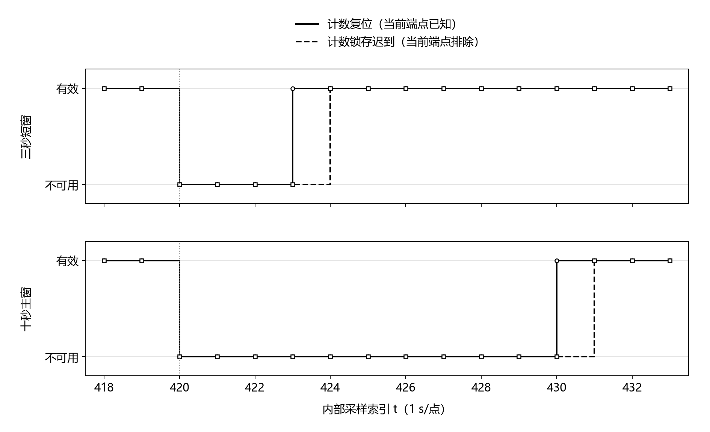

# 软件链路收尾验证

2026年10月6日。完成采集适配层故障注入、C诊断结果与通信快照映射、主机发送接收联调，并据此收敛申报方法。保持第十轮内核和第九轮发送端冻结，没有修改原诊断门限、容量或重试预算。

## 分项结果

| 步骤 | 验证内容 | 结果与范围 |
|---|---|---|
| 11A 采集适配 | 17组：缺测、原值越量程、未就绪、过期/重复、转换重叠、未来转换、超出30ms范围、计数迟到/非有限锁存、已知复位、序号缺口/重复、计数表示及增量保护、显式新实例和非法身份 | 通过。异常端点不产生有效候选；拒绝后停止原测量会话，不伪造正常快照 |
| 11B 快照与接收 | 6组：未知注册拒绝、提交前回滚、提交后重放确认、旧记录年龄、保持计数不可用、身份内容冲突 | 通过。ACK在事务提交之后；重复不修改原始内容和首次接收时刻 |
| 11C 轨迹与字节 | 216条既有轨迹，130,896次更新；102,816条监测期记录，九字段对照独立整数参考；131,671帧编码及分段解析 | 本批差异为零，全部帧核对通过。使用第十轮配置和输入，是实现回归，不是本轮新训练或实测准确率 |
| 11C 端到端 | 8条诊断轨迹＋12条定向故障轨迹，四种链路条件，共80组 | 每种条件20组；相同事件定义和输入；有限队列、原内容及提交顺序通过 |
| 11D 图像及材料 | 保存计数端点恢复实输出图；整理最终方法；另存学校模板申报书 | 图用线型和标记区分、已查看最终PNG；申报书另做20页图文检查，不复用旧验收状态 |

累计端点迟到与已知计数复位的处理不同。定向轨迹在内部索引420注入异常：复位后的已知端点可作为新窗口起点，三秒窗423、十秒窗430恢复；迟到端点被完全排除，三秒窗424、十秒窗431恢复。迟到端点及随后缺少有效十秒窗口期间，输出流量为缺失，不按保持计数补算；内部索引t对应协议采集结束时刻(t＋1)×1000ms。序号缺口或增量保护拒绝后，远端已有记录会随原采集年龄变旧，不会立即凭空收到停机通知。

图为实际保存的软件输出，不是压力或电流实测；虚线、实线及不同标记在黑白条件下可区分。程序检查文字边界和碰撞后，逐张查看最终PNG确认没有错位、裁切或图例遮挡。

## 本批通信结果

| 主机链路条件 | 回放组数 | 生成事件 | 接收事件 | 容量拒绝 | 源端过期 |
|---|---:|---:|---:|---:|---:|
| 正常链路 | 20 | 95 | 95 | 0 | 0 |
| 随机丢失（上行及ACK分别20%概率） | 20 | 95 | 95 | 0 | 0 |
| 索引400—459上行中断 | 20 | 95 | 95 | 0 | 0 |
| ACK全部丢失、上行正常 | 20 | 95 | 95 | 0 | 95 |

ACK全丢时接收成功与源端过期可以同时成立：接收端已经保存，源端没有确认，期限后仍须记录过期。不能把源端过期数作为接收缺失数。普通遥测替代次数也不是故障事件被删除次数。四种条件复用相同输入，表中各95个事件不能合并成380个独立异常。

本批属于稀疏事件的定向联调，不能覆盖第九轮密集事件或360秒中断边界。第九轮已保存ACK全丢、长中断及容量满时的接收缺失与拒绝；这些失败没有被本批全部送达的结果推翻。节点至多16业务槽、普通遥测至多1槽、全部逻辑行至多83，初始8次与恢复4次预算保持不变。

首次完整回放因验收脚本使用了错误的统计字典键中止，没有生成最终通过记录。修正为原发送端实际字段后重新冻结，再重跑17组输入、6组接收及216条完整轨迹。修改仅在新联调脚本，冻结的C内核、发送端和旧失败数据未变；不隐去中间错误，也不据结果调参。

## 软件完成与实物边界

当前已完成主机采集适配、整数诊断、快照/事件字节和SQLite语义的连接，允许进入STM32移植与台架。PC配置生成、理论转换时序、主机共享时钟和SQLite事务不替代实际HAL、总线、中断、RF或SD/Flash掉电。量程内漂移、未知负载、未经核验的初始健康段及整数临界反例仍保留；部分合成流量超过候选传感器规格区间时只验证软件。没有整机功耗、真实节能比例、实物识别准确率或田间成果。

方法与三阶段任务见[最终方案](../docs/算法与软件最终方案.md)。代码为[采集适配](../prototype/acquisition_pipeline.py)、[C桥接](../firmware/acquisition_bridge.c)；证据为[分项输入验收](../simulation/acquisition_pipeline_review/input_acceptance.json)、[接收验收](../simulation/acquisition_pipeline_review/receiver_acceptance.json)、[最后验收](../simulation/acquisition_pipeline_review/final_acceptance.json)、[轨迹结果](../simulation/acquisition_pipeline_review/results.csv)、[通信结果](../simulation/acquisition_pipeline_review/link_results.csv)和[定向故障实例](../simulation/acquisition_pipeline_review/fault_examples.json)。

冻结指纹：`05e88b369dd6d281253b450824ddd74d68ce4213c909f13f2484a76ca07dd8dc`。复现顺序为已冻结源码检查、A输入验收、B接收验收、完整回放、C最终验收；图和Word按最终结果另行检查。不要用重新冻结代替来源核对，不改旧算法链上的任何参数或源码。
