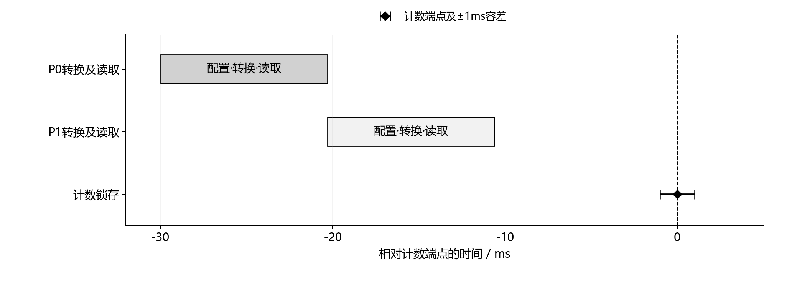
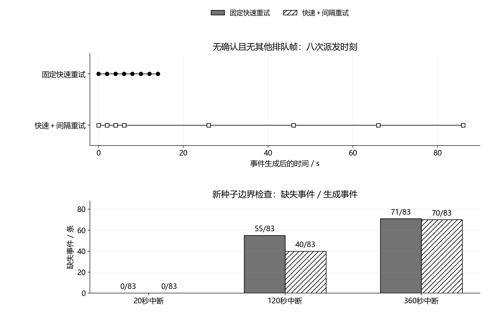

# 通信帧、会话身份与采集时序：第七轮验证

2026年10月6日。本轮承接第六轮软件联调，按[分项执行计划](../docs/通信帧与采集时序_分项执行计划.md)依次完成编码、身份与事务、时序、字节链路四项检查。研究对象仍是南疆棉田滴灌支管的双压力与流量监测；保留固定1Hz输入、十秒主诊断与三秒待复核通道。本轮没有修改申报书，也没有扩展控制、网站、三维或PPT。

精简帧、会话身份与采集时序的所列软件检查通过。重试对照暴露了另一项限制：固定快速重试会在中断期间耗尽次数；加入间隔重试后，60秒中断对照的事件缺失由53条降至零，但新种子的120秒中断仍缺40条。协议实现已形成可复现参考，长中断恢复尚未解决，不能写成“可靠送达已经验证”。全部水力轨迹为合成数据，链路为主机字节回放。

## 一、逐项验收与结论

| 步骤 | 本步验收标准 | 实际证据 | 结论与适用范围 |
|---|---|---|---|
| 7A 编码 | 候选64字节以内；C/Python逐字节一致；损坏、分段和非法状态按规定处理 | 1429条记录，133个分段位置，456个单比特损坏，12个非法向量与6个状态/整数边界向量；3344条C/Python命令一致 | 编码检查通过；未做STM32编译运行或量化后诊断等价检查 |
| 7B 身份与事务 | 设备与会话隔离；重复一致、冲突回滚；提交后ACK；未知时钟不冒充实时数据 | 实际SQLite文件上的23项检查，含重开、旧待发包、错误ACK、两设备、容量与序号边界 | 主机参考检查通过；没有实物掉电或Flash原子分配证据 |
| 7C 采集时序 | 分别保留P0/P1读取完成年龄；拒绝过期、重用、重叠和迟到记录；无效计数端点不得进入后续窗口 | 9种排程、2000个计数快照及质量门控恢复检查 | 模型与输入门控检查通过；尚未测中断延迟、传感器响应或总线时序 |
| 7D 字节链路 | 相同事件流配对比较；内容一致；分别报告缺失、待发与无确认，不预设零缺失 | 432组逐条复算，216组初始失败结果原样复现，另有72组新种子边界结果 | 复现检查通过；长中断送达效果未达目标 |

验收原始记录：[编码](../simulation/protocol_session_review/codec_acceptance.json)、[会话与事务](../simulation/protocol_session_review/session_acceptance.json)、[时序](../simulation/protocol_session_review/timing_acceptance.json)、[链路](../simulation/protocol_session_review/byte_link_acceptance.json)。这里的“通过”只对应表内标准，不替代台架验收或科研效果评价。

## 二、精简帧与状态含义

采用版本2、小端整数、CRC16与COBS零字节分隔。解码后公共头为16字节：版本和类型各1字节、载荷长度2字节、设备/会话/消息序号各4字节。测量快照为35字节；事件在快照后增加事件码与细节码各1字节。计入校验、COBS和分隔符，遥测帧55字节、事件帧57字节、ACK帧24字节。ACK正文为原消息的4字节CRC32指纹，同时核对原设备、会话和消息序号。本轮遥测与事件均要求确认，与旧版本协议分开保存。

候选E220-400T22D手册支持64字节分包配置，因此上述应用帧可放入候选分包长度；实际模块仍须读回配置并完成串口验证。AUX状态不等于业务持久化确认，不能替代ACK。[厂家手册](https://www.ebyte.com/downpdf/1077.html)

下表偏移以**解码后的快照起点**为零，不是COBS线上字节的位置。

| 相对偏移 / 字节 | 字段 | 编码与含义 |
|---|---|---|
| 0 / 4 | uptime_ms | 本会话启动后的采集端点毫秒数，不是UTC |
| 4 / 4 | sample_seq | 本会话采样序号 |
| 8 / 4 | config_id | 接收端已登记的配置标识 |
| 12 / 2 | reference_id | 已登记参照标识；无数值参照时为零 |
| 14 / 4 | cumulative_pulses | 累积流量脉冲 |
| 18 / 4、22 / 4 | P0、P1 | 有符号整数，单位0.01kPa |
| 26 / 4 | Q10 | 十秒流量，有符号整数，单位mL/min |
| 30 / 1 | status | 测量与参照条件状态 |
| 31 / 1 | flags | 数值参照、健康许可、短窗有效、短窗关注及合成来源标志 |
| 32 / 1 | pattern | 当前模式证据：无证据、泄漏、受限、不确定或不可用 |
| 33 / 1、34 / 1 | P0/P1年龄 | 读取完成至计数端点的毫秒数；缺失为255 |

状态0表示诊断所需输入条件有效，**不表示设备正常**。其余状态分别表示健康参照未确认、数值参照不可用、压力质量异常、窗口不完整、工况域不满足；这些状态不能携带有效主诊断模式。缺失压力/流量用专用整数哨兵，压力年龄同时写255；保留标志位非零、未知事件码或状态冲突均被拒绝。配置登记另保存参照、许可、来源与版本，缩短帧不意味着删除解释这些数值所需的上下文。

[Python编解码](../prototype/compact_protocol.py)与[可移植C编解码](../firmware/protocol_v2_codec.c)已按固定向量相互核对。C在本机以`-std=c99 -Wall -Wextra -Werror -O2`编译运行，尚无HAL、ADC或LoRa驱动。1429条记录的最大量化误差为压力0.004995kPa、流量0.0004445L/min，分别小于0.005kPa与0.0005L/min的编码误差界限。这只能验证数据表示；算法仍用原浮点输入，不能据此声称整数移植后诊断完全相同。[固定向量](../simulation/protocol_session_review/golden_vectors.json)保留具体字节。

## 三、身份、缓存、提交与数据年龄

[会话传输参考](../prototype/session_transport.py)以设备、会话、消息序号作为消息身份，以设备、会话、采样序号约束测量身份。主机发送端重开后分配新会话，旧待发记录保留原身份；旧对象不能继续写新会话。接收端在事务中核对配置、写入测量与消息，提交后才返回ACK。完全一致的重复可再次确认；同身份内容冲突会回滚整个写入，不能更新成另一条测量。错误设备、会话、序号或指纹的ACK不会确认待发包。

当前数据按会话与采样序号选择，不能用旧会话较大的启动时间覆盖新会话。数据年龄依赖另行提供的会话时钟映射及误差界限；映射未知时标为时钟未映射，误差区间跨过65秒候选时效界限时标为时间不确定。本轮字节回放显式使用公共仿真时钟，不能当作实际无线时钟同步。内部索引0对应第一个一秒计数区间结束，线上启动时间为1000ms，避免将区间末端误写为开机时刻。

待发容量为16条，最多派发8次，保留时限300秒；满队列拒绝新包并保留拒绝记录，不覆盖旧待发内容。到期或次数耗尽会留下终态记录；当前实现不会在恢复连接时自动重新激活无确认记录。SQLite历史没有实现有界存储，因此不能直接当作STM32存储方案。数据库删除后的会话身份恢复、Flash分配、断电恢复与实际存储容量均是后续任务。SQLite事务设计参考[官方原子提交说明](https://www.sqlite.org/atomiccommit.html)，本轮只检查正常重开与显式回滚，没有突然掉电试验。

## 四、双压力与流量计数的时序约束

候选ADS1115按128SPS单次转换顺序读取P0、P1。依据单次转换时长与速率偏差建立排程，模型另外假设100kHz I²C，每通道配置0.36ms、一次轮询0.18ms、读取0.45ms。两次压力转换从一秒计数端点前30ms开始，计数锁存容差设为±1ms；这些是拟实施约束，不是实测指标。[TI数据手册](https://www.ti.com/lit/ds/symlink/ads1115.pdf)

图1　双压力依次转换与计数端点的理论排程。采用名义速率的0.9倍、无额外等待，两通道共19.391ms，完成时间分别约在端点前20.304ms和10.609ms。横轴是相对计数端点的时间，菱形及误差棒表示拟定的计数端点容差，矩形不是同时采样。

在速率0.9/1/1.1倍与每通道额外等待0/2/7ms的9种组合中，0和2ms等待满足30ms窗口，7ms等待的三种情况均被拒绝；程序没有把迟到读数强行归入有效样本。缺少就绪、复用上次时间戳、通道转换重叠或计数锁存迟到，也会使相关输入不可用。压力年龄描述读取完成时刻，不是压力信号的瞬时采样时刻；ADC积分过程、传感器带宽和真实总线等待仍须台架测量。

[时序门控](../simulation/acquisition_timing.py)与[诊断适配](../simulation/timed_monitor.py)还检查了无效计数端点进入后续窗口的风险。索引360注入迟到锁存后，360—370的十秒窗口不可用，371才形成新的有效窗口；迟到端点不能被下一窗当起点。初始参照阶段的计数迟到也会阻止建立参照。候选计数速率按SEN0549的540脉冲/L和5L/min推算45脉冲/s，用于回绕合理性界限，不是实测最大频率；16位计数差仍无法区分所有复位与合法回绕。[DFRobot中文资料](https://wiki.dfrobot.com.cn/SKU_SEN0549_Gravity_Water_Flow_Sensor_G1_4)

## 五、字节链路对照：修正有效，但仍有边界

主对照采用6种场景、3档噪声和4个种子，共72条合成轨迹。每条轨迹分别运行两种重试策略和三种链路条件，得到432组配对记录。清洁链路、20%数据丢失加25%ACK丢失、60秒中断均为软件条件；相同策略对照复用轨迹和随机数，不是432次独立实物试验。每个策略/条件组合有72组记录，合计生成328条事件。

| 策略 | 链路条件 | 接收 / 生成事件 | 缺失事件 | 无确认消息 | 待发消息 | 已接收事件最大首次延迟 / s |
|---|---|---|---|---|---|---|
| 固定快速重试 | 清洁 | 328 / 328 | 0 | 0 | 0 | 1 |
| 固定快速重试 | 随机丢失 | 328 / 328 | 0 | 0 | 0 | 6 |
| 固定快速重试 | 60秒中断 | 275 / 328 | 53 | 110 | 0 | 53 |
| 快速＋间隔重试 | 清洁 | 328 / 328 | 0 | 0 | 0 | 1 |
| 快速＋间隔重试 | 随机丢失 | 328 / 328 | 0 | 0 | 0 | 6 |
| 快速＋间隔重试 | 60秒中断 | 328 / 328 | 0 | 0 | 0 | 66 |

两种策略均保持8次派发上限。固定快速重试在孤立且无确认条件下于0、2、4、6、8、10、12、14秒派发；候选策略改为0、2、4、6、26、46、66、86秒，给恢复后的链路保留后几次机会。修正是在发现60秒中断失败后提出的，因此该组结果属于设计对照，不能作为独立泛化结论。原始216组固定快速结果已单独保留，全部旧字段重新复算一致。

最大延迟只统计已接收事件。固定快速方案缺失53条，不能直接以其53秒对比候选66秒来判断完整效果。待发清空也不等于全部成功，110条无确认消息同时包含事件与遥测。当前统计的是主机派发及生成ACK的字节量，不是无线空口时间、电流或节能率。

随后冻结策略，使用两个新种子、3种场景和2档噪声形成12条新轨迹，分别施加20、120、360秒中断，得到72组边界记录。每个中断长度和策略各12组、共83条生成事件；不同中断长度复用这些轨迹，仍不构成相互独立的物理试验。

| 中断长度 / s | 固定快速：接收 / 生成 | 固定快速：缺失 | 快速＋间隔：接收 / 生成 | 快速＋间隔：缺失 |
|---|---|---|---|---|
| 20 | 83 / 83 | 0 | 83 / 83 | 0 |
| 120 | 28 / 83 | 55 | 43 / 83 | 40 |
| 360 | 12 / 83 | 71 | 13 / 83 | 70 |

图2　派发时刻与新种子中断边界。上半图是单条消息且无其他排队帧的实际参考调度，下半图显示缺失事件数；实心与斜线纹理保证灰度打印可区分。两分钟和六分钟中断暴露有限次数重试的限制，不能通过只延长一次等待解决。

所有回放中的内容一致性、去重和流解析检查通过；本批没有容量拒绝，不能据此宣称容量16在所有告警密度下足够。无确认记录仍留在数据库，但尚无连接恢复后的受控补发。完整结果见[主对照CSV](../simulation/protocol_session_review/byte_link_results.csv)、[新种子边界CSV](../simulation/protocol_session_review/boundary_results.csv)及[初始失败CSV](../simulation/protocol_session_review/initial_byte_link_results.csv)。

## 六、图像、证据与下一工作包

两张最终PNG均逐张查看，图例、轴标签和单位完整，没有发现文字裁切、重叠或指向错位；生成检查记录最小字号11pt，并保存SVG与脚本。两图均依靠位置、符号和纹理表达差异，不依赖颜色。检查限于独立图片，尚未放入Word，不能替代最终文档页面与打印尺寸验收。[图像检查](../simulation/protocol_session_review/figure_checks.json)、[制图脚本](../scripts/plot_protocol_session.py)。配置、代码和数据摘要保留在[冻结参数](../simulation/protocol_session_review/frozen_parameters.json)，验收脚本为[validate_protocol_session.py](../scripts/validate_protocol_session.py)。

下一工作包先解决长中断恢复：保持原消息身份，区分首次派发预算与恢复后补发预算，先定义恢复判定、过期规则、队列容量及历史记录上限，再配对验证缺失和时延。恢复后的旧记录必须保留原采集时刻，不得冒充当前测量；不能用无限重试掩盖存储和链路限制。随后再做整数诊断等价、STM32采集与计数锁存实现、真实模块配置读回与串口测试。具体硬件验证按台架条件开展，申报书等上述取舍稳定后统一修改。
