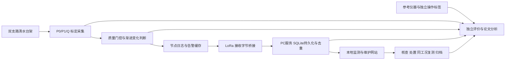

# 项目总规划与任务验收台账

2026-10-06。作为后续工作的统一入口，与《项目范围与三阶段执行方案》配合使用。新增工作先确认服务哪个研究问题、产生什么证据、占用什么资源，再进入执行；展示形式不能替代研究任务。正式申报以导师审核后的学校模板和本批任务书为准。

2026-10-06第二轮算法工作包：完成独立健康参照拟合、576条健康门限训练、2880条合成轨迹及17280条六方法配对核验，并增加逐秒输入程序的24组等价检查。健康参照可减少部分平方根关系失配造成的模式误报；20秒过渡暂停在切换快速故障中失去早期窗口，不采用为默认规则。下一项集中做诊断与事件采集组合回放；项目书、申报书按用户要求等算法和逻辑稳定后再修改。详见[第二轮验证与分项验收](../deliverables/健康工况参照与算法选择_第二轮验证.md)。

2026-10-06新增算法工作包：在320条健康训练轨迹上确定CUSUM门限，冻结后用40个新种子形成960条合成轨迹、2880条三方法配对记录，另做长时正常对照与时间错位/负载失配反例。CUSUM减少了部分高噪声误报，但低噪声下没有取得更早检出的收益，长时健康记录仍有误报，因此保留为候选方法，不替换申报主方案。具体取舍、三阶段安排和下一分项验收见[算法对照验证与工程取舍](../deliverables/算法对照验证与工程取舍.md)。本轮没有改动申报书、网站、三维模型或PPT。

当前申报稿为20页《大创申报书_版式修订稿.docx》，在图文与引文修订稿基础上删除“协议与平台软件”正文外的单格嵌套表格与多余横线；文字、公式和图片内容保持一致。此前已修订标题与语言、图内说明及比例、数学单位和正文引用上标；10张插图经本地打印检查，并复查关键页的灰度效果。检查范围见[图文与引文修订合格性检验](图文与引文修订合格性检验.md)。事件触发采集研究、控制请求模拟和工程约束仍见[扩展执行范围](事件触发与控制扩展_执行范围.md)。上一图文稿、系统方案稿、25页格式稿、13页实施项目书及旧验收为历史版本，不能作为当前稿的检查证明；实施项目书和PPT后续按稳定申报内容同步。三阶段分项要求仍见[分项执行与验收标准](三阶段分项执行与验收标准.md)。

## 1. 总目标、约束与完成层次

题目：**基于 LoRa 的南疆滴灌支管道早期故障诊断物联网原型系统**。对象是支管巡检与维护，任务由测量、诊断、可靠传输、人工核查和独立评价组成。

用户的成果目标是一个大创结项和一篇符合学院认定条件的第一作者论文，争取科研类累计10分。依据用户提供的今年截图，省级第一完成人4分＋符合条件的6分论文可达10分；国家级5分＋6分论文按上限10分计。校级3分＋6分论文、国家级5分＋4分论文都只有9分。**取得立项、结项、论文发表、收录和未来学院认定是不同节点，均不能由现有材料保证。** 未来申请年度、成果认定截止、是否必须已收录及重复计分须向学院核实。不得为了计分降低研究真实性，也不把普通期刊默认计成6分。

实施期：2027年3月—2028年2月。申报准备期约一个月，精确截止、模板最终版本和答辩时长待确定。经费按用户最新要求在申报书留空，此前约2000元只是早期意向，不作为当前已落实资金。实施须落实参考仪器与可调连续水源；目前确认会焊接，团队编程能力、场地和借用另行安排。

| 层次 | 要达到什么程度 | 不可混用的证据 |
|---|---|---|
| A 申报与答辩 | 学校模板完整、任务有研究价值且可执行；已有模型和软件能复现，图文来源及失败边界清楚 | 仿真只能说明模型假设下的行为；网页是软件演示；三维是布局设计 |
| B 大创实施与结项 | 一节点、一接收端、台架和本地软件真实贯通；完成标定、独立操作、通信和恢复验证；按获批任务书提交 | 真实原始日志、参考测量、操作标签、配置、代码和过程记录；不能拿合成记录顶替 |
| C 论文 | 从B的真实数据提炼一项充分贡献，完成基线、留出验证、消融和失败解释，形成并投稿稿件 | 投稿、录用、发表、数据库收录逐一据实记录；模拟表现不能直接写实测准确率 |

## 2. 系统结构与每块职责

图为实施期规划。当前网站没有连接S、L、R，数据来自单独的已保存合成回放。ACK仅表示接收端持久化事件；人工已查看、复测完成和归档分别记录。

| 模块 / 工作包 | 必须做的具体内容 | 本阶段产物 | 实施期验收与依赖 |
|---|---|---|---|
| M1 场景与研究定义 | 定义等效泄漏、等效受限、供压及正常切换；限定支管/区段定位；冻结“早期”参照和独立故障程度 | 问题说明、任务—指标—证据表、文献正文对应 | 导师确认故障定义、参考测量和任务书；没有农业损失标签就不声称减产阈值 |
| M2 台架与三维 | P0侧向取压→受限元件→P1→Q→正常负载/泄漏分流；B为健康扰动支路；设置回水、计量、固定和检修空间 | 水路图、STEP/GLB、可检查三维页面及尺寸待核清单 | 按真实接口调整；完成耐压/漏水检查和独立泄漏计量；先借用夹具，不默认购买定制机架 |
| M3 传感器与采集 / WP1 | 核对压力量程、输出、误差、调理、ADC、流量脉冲电平；建立双压力差压与流量参考标定 | 候选选型、原理图、量程计算和采购核对清单 | 先有参考测量；测量不确定度须低于欲区分变化，否则调整量程/布点/目标程度；参考仪器不能用待测传感器替代 |
| M4 诊断 / WP2 | 质量门控、健康参照、K/R̂及持续判据；正常切换、供压、漂移、未知负载挑战；同信息基线 | 480次合成记录、失败示例、可复现代码 | 标定后冻结方法；以独立日/档/操作留出，报告误报、漏检、类别与检出程度；未知负载同形时保留不可辨识结论 |
| M5 无线 / WP3 | 串口协议、事件身份、缓存、持久化ACK、去重、掉电会话与溢出；统一检测规则比较策略 | 1920次独立通信回放、协议设计及压力检查 | 使用真实LoRa设置、完整发收日志、时钟校核与整机电流；分别报告本地/远端时间，发送帧不能当整机节能率 |
| M6 接收与网站 / WP4 | 接收拟用串口+SQLite；网站六功能页、共享状态、质量状态、核查处置复测、历史导出 | 当前离线软件演示、本地维护记录、浏览器验收 | 真实串口接入、服务器持久化、事件关联device/session/seq、断连恢复；浏览器localStorage仅用于当前演示 |
| M7 数据与独立评价 | 保存原始值、处理值、独立真值和操作；区分训练/调参/留出，记录版本、失败与缺失 | 数据字典、试次表、对照和评价方案 | 两故障×3供压×3程度×≥3独立操作，拟54次主要故障，正常/切换另做；不得把601个相邻采样点当601独立实验 |
| M8 文档与答辩 | 学校九节模板按问题→依据→研究内容→方法→条件→计划→成果展开；PPT按场景→问题→系统→证据→执行叙事 | 现有Word、范围PDF、PPT草案及讲稿 | 真实成员/行政字段/预算确认；PPT同步硬件和预算后再验收；页面数量不代表立项质量 |
| M9 论文与延伸 | 首选跨工况/负载辨识边界；备选同告警规则下真实LoRa取舍 | 问题与实验协议，不预写实测结论 | 有B的真实数据、强基线和独立留出后进入投稿；多支管需第二实际节点及新经费，不挤占基础结项 |

## 3. 申报材料、网站和论文各放什么

| 内容 | 学校申报书 / 范围文件 | 答辩PPT | 运行网站 | 独立研究资料页 / 论文 |
|---|---|---|---|---|
| 场景、价值、文献与创新 | 完整论证，中文文献为主且保留英文 | 提炼研究问题和增量 | 不作为主功能堆放 | 资料页保留全文来源；论文进一步评述与对照 |
| 系统架构与硬件 | 职责、接口、经费、资源前提 | 关键架构、布点和可执行性 | 设备档案和接入状态，链接三维安装模型 | 协议、标定与细节源文件 |
| 建模、仿真 | 假设、失败、拟验证内容和来源标注 | 少量支持结论的图，字号清楚 | 仅提供合成数据回放，不把统计表当运维面板 | 全部统计、参数、试次和可复现结果 |
| 监测与维护 | 说明功能和状态规则 | 用一张演示截图解释闭环 | 六模块真实交互，共享事件和历史 | 论文只统计真实维护配对，不统计演示点击效果 |
| 进度与三阶段规划 | 任务、人员、里程碑、条件与风险 | 重点节点和交付 | 不做答辩播放页 | 本台账和资料页保存完整规划 |

原则：图应回答具体问题。水路/电路用原理图，算法用必要的黑白流程，装配用三维，性能用有坐标和样本定义的统计图，软件用真实界面截图。避免重复流程图和不能核查的装饰性数字。

## 4. 当前完成度：逐项记录，不填虚假百分比

| 当前内容 | 状态 | 可查证据 | 仍未完成 |
|---|---|---|---|
| 学校申报Word和实施书 | 本轮内部审阅版本 | 25页学校模板Word/PDF、13页实施书及全量验收；24页稿和6页PDF为历史 | 真实行政字段、导师审核、本批要求和经费确认；未提交、未立项 |
| 文献 | 已整理与对应 | `application/references.json`：17篇，中文11篇、英文6篇及正文引用 | 新增主张须重新对应支持文献；不能称已完成创新性查新 |
| 建模与仿真 | 历史结果保留，当前台架参数候选通过所列内部检查 | `simulation/diagnosis_review`、历史`diagnosis_results`、`communication_results`及校验脚本 | 无标定、硬件、田间或射频数据；两套仿真非端到端；当前候选已进入运行回放，已整合新版Word，PPT待同步 |
| 三维台架 | 参数化布局和查看器已完成 | STEP、GLB、几何检查及独立网页 | 容量及局部概念检查已完成；实际接口、长时排水、防水耐压和制造装配未验证 |
| 网站 | 六模块离线演示，本轮单独验收 | `deliverables/index.html`、`simulation/quality_review/site_checks.json`、当前原生截图 | 没有设备在线、真实ACK、串口、SQLite服务或用户权限 |
| PPT | 有15页可编辑草案 | PPTX/PDF及讲稿 | 硬件预算同步、正式时长、导师审核与本轮新版截图；本轮未改PPT |
| 实物和科研成果 | 未开展 / 未取得 | 暂无原始实测、结项或论文发表证明 | 全部B层验证和C层成果 |

网站“本轮验收”以对应JSON的状态和具体检查为准；不能用本台账文字代替运行结果。已有源文件和程序由辅助工具生成，团队仍需能够解释、复现并修改。

## 5. 当前一个月的执行顺序

以下按距申报截止的四周倒排，具体日期在获知截止后填写。先补关键可执行条件，再增加展示内容。

| 顺序 / 时段 | 工作与交付 | 完成条件 | 当前动作 |
|---|---|---|---|
| P0 已完成支撑包 | 总规划、三维候选、诊断反例、接口部分检查和主站/选图 | 证据身份明确，当前主站及九图可查；实物与Word整合分开记录 | 本轮Q01—Q06材料检查通过，Q07校核交付；下一材料包A12 |
| P1 第1周 | 导师核定科学问题、早期参照与级别申报目标；落实团队开发负责人、参考仪器、水源与场地；两压力供应商询价 | 名单/借用/报价或可核对沟通记录；条件不足时调整方案和经费 | 需用户和导师提供真实资源，不可由工具虚构 |
| P2 第2周 | 申报书按九节逐段审查，建立正文—任务—指标—证据对应；整理需导师确认的数值目标；检查图、字号、页间引用与预算 | 每项研究目标有方法、对照、数据和验收，所有“已有”有证据；模板和范围一致 | 25页格式优化稿及13页实施书内部复查完成，正式目标待导师与资源核定 |
| P3 第3周 | 在内容稳定后重写和同步PPT，更新真实网站截图；准备六类关键问答并试讲 | PPT与Word题目/测点/经费/状态一致，按正式时长排练；无未经验证性能数值 | 下一材料工作包，不在网站代码里堆PPT |
| P4 最后一周 | 填行政字段、导师审核、原生导出逐页检查、链接和证据包复核，按正式渠道提交 | 导师确认、完整签字/要求、可打开和可追溯的提交包 | 截止与流程确认后办理 |

## 6. 实施期里程碑与退出条件

2026年11月—2027年2月为准备窗口：落实导师及真实开发分工；完成C语言基础、定时器/ADC/脉冲计数、串口日志的小练习，再训练回放分析和网页修改；询价、借用和预约参考仪器，熟悉安全的低压清水实验。学习产物是能独立解释和修改的最小程序，不写成已做出硬件系统。是否提前购买或装配由经费与条件落实决定。

| 时段 / 门槛 | 必须产出 | 未通过时如何处理 |
|---|---|---|
| G1 2027.03–04 测量可行 | 传感器/水路标定、参考读数、有线日志、工况标签；核对差压和流量不确定度 | 改量程、布点或可检程度；不继续用模拟5%指标声称可检，必要时按校方流程变更任务 |
| G2 2027.05–06 独立诊断 | 拟54次主要故障操作＋正常/切换对照；参考测量定义程度，留出批次与方法冻结 | 识别不足则报告边界，保留“异常待检查”，不增加无依据模型来掩盖失败 |
| G3 2027.07–08 真实系统 | 实际LoRa发收、接收持久化与去重、网站串口服务接入；至少8h台架记录和3次恢复检查 | 分别定位测量/诊断/通信/软件问题，保留缺失与重启记录；没有实测功耗就不宣称节能 |
| G4 2027.09–10 研究深化 | 强基线、测点和工况信息消融、整档/整日留出；形成主论文初稿 | 贡献不足时优先补关键对照或缩小结论；投稿档次按证据与导师判断选择 |
| G5 2027.11–2028.02 结项 | 获批任务逐项对照、原始记录/版本、系统演示、研究和调研报告、论文状态 | 论文未录用按真实状态呈现；大创验收按本批要求，不能自动改成“已发表” |

## 7. 论文协议和延伸的进入条件

主线A：**跨供压、跨负载时，双压力/流量与已知操作信息能识别哪些渐进故障，哪里不可辨识？** 设置固定阈值、压力归一化等同信息基线，加入单点/双点、是否有阀态信息消融；先独立标定并冻结参照/参数，再整档或整日留出。报告误报/小时、漏检、正确模式、检出程度、相对独立失效参照的提前量和重标定成本。未知健康负载同形是需要诚实报告的研究边界。现有480次噪声回放不能替代新实验。

备线B：相同检测与及时性约束下，事件告警的可靠性和通信开销如何取舍？只有具备真实链路、节点/接收日志、能量测量和可靠性消融后采用。不要将两个薄弱贡献拼接成一个“云边协同”大题目。

延伸顺序：跨负载与参照迁移（优先复用台架）→多支管共性扰动与局部异常（至少两实际节点及经费）→长期维护配对（真实维护与同工况复测标签）。云、太阳能和自动阀控需新的条件和验收，当前不作为必做。论文计划应给评审和发表留出时间，但无法保证未来推免前收录。

## 8. 验收规则与变更记录

建议职责拆为三类：负责人统筹研究定义、文档和实验标签；嵌入式负责人承担采集、质量门控、节点日志及LoRa；数据/软件负责人承担独立评价、接收数据库与网站。导师审核故障参照、实验设计和论文贡献。此为角色建议，尚无真实三人团队名单；负责人会焊接不能等同具备固件开发能力。P1必须将每项任务落实到真实成员或明确补足能力的安排。

每次变更记录：所属模块、要解决的问题、依赖、投入、产物、证据身份、检查结果、未解决项。满足结构完整、逻辑正确、可复现和实际排版之后再优化配色；不以任意“95分”宣称高标准。关键阻塞项一旦出现就停止扩展示例，优先修正。

本轮变更：保留历史模型与验收，增加取样容量和脉冲窗口分析；修正原生字号、缩进、图片与表格分页，发布25页格式优化申报稿及13页实施项目书；网站补充当前时刻标识、窄屏布局和准确的桥接/持久化职责。按Q01—Q07顺序验收，真实条件确认后进入PPT同步及正式行政提交。
